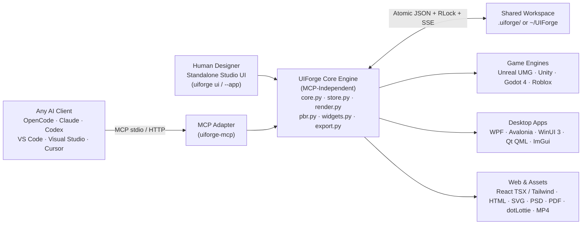

<div align="center">

**English** · [Türkçe](README.tr.md)

<a href="#studio-ui-tour">
  
</a>

<br />

### Local, deterministic UI design studio & MCP server — built for humans, AI agents, or both working live together.

**Design game HUDs, menus, desktop apps, and websites visually in Studio UI, drive them from any MCP AI client, or collaborate side-by-side in Combined Mode — zero subscriptions, zero call quotas, and zero diffusion hallucinations.**

<p>
  <a href="https://github.com/TENETTE/uiforge-mcp/actions/workflows/tests.yml"></a>
  <a href="pyproject.toml"></a>
  <a href="#three-ways-to-run-uiforge"></a>
  <a href="#tools-and-capabilities"></a>
  <a href="#performance-and-gpu-backends"></a>
  <a href="LICENSE"></a>
</p>

<p>
  <a href="#why-uiforge">Why UIForge</a> ·
  <a href="#three-ways-to-run-uiforge">Three Modes</a> ·
  <a href="#studio-ui-tour">Studio UI</a> ·
  <a href="#quick-start">Quick Start</a> ·
  <a href="#what-you-can-ship">Export Targets</a> ·
  <a href="#showcases">Showcases</a> ·
  <a href="#performance-and-gpu-backends">Benchmarks</a> ·
  <a href="#faq">FAQ</a>
</p>

```bash
# Human Mode — standalone visual Studio UI (no MCP client or AI IDE required)
uvx --from git+https://github.com/TENETTE/uiforge-mcp uiforge

# Combined Mode — Studio UI + MCP server synced live on the same workspace
uvx --from git+https://github.com/TENETTE/uiforge-mcp uiforge combined
```

<br />


<sub><em>UIForge Studio running locally in Combined Mode — Cook-Torrance PBR canvas, 8-point transform handles, live Activity Log, and real-time MCP + UI sync.</em></sub>

</div>

---

## Why UIForge?

Modern design platforms gate UI workflows behind per-seat subscriptions, metered MCP call limits, cloud lock-in, or unpredictable diffusion models that hallucinate crooked text and uneditable rasters. **UIForge (`uiforge-mcp`)** provides a single **100% local, MIT-licensed, deterministic graphics and code-generation engine** accessible both through a **standalone visual Studio UI** and through the **Model Context Protocol (MCP)**:

- **Zero MCP required to design:** Want to work directly with sliders, PBR swatches, parametric frames, icons, live bindings, and one-click engine exports? Run `uiforge` in your browser or a frameless desktop window (`--app`) — zero AI IDE, zero API keys, and zero runtime dependency on the `mcp` SDK.
- **Provider-neutral across AI clients:** Want an AI agent to design, audit, iterate, and export? Connect `uiforge-mcp` to OpenCode, Claude Code, OpenAI Codex, VS Code, Visual Studio, Antigravity, Cursor, Windsurf, ChatGPT, or any MCP-compatible client.
- **One shared core engine, zero duplicated logic:** Human Studio UI and MCP Mode invoke the **exact same core operations, renderer, PBR shaders, widget layout, and engine exporters** (`core.py` + `store.py`). Projects edited in the UI open identically in MCP, and vice versa.
- **Deterministic vector + Cook-Torrance GGX PBR:** Every pixel comes from editable vector shapes, HarfBuzz-shaped typography, 39 physically-based Cook-Torrance GGX materials with `.hdr`/`.exr` IBL + ACES filmic tone mapping, and keyframe animations — never blurry diffusion guesses.

---

## Three Ways to Run UIForge

Switch freely between modes at any time — all three read and write the exact same `.uiforge/` (or `~/UIForge`) workspace format:

| Mode | Command | Best For | Requires MCP / AI IDE? |
| --- | --- | --- | :---: |
| **Human Mode (UI Mode)** | `uiforge` or `uiforge ui` (`--app` for native window) | Visual design, 39 PBR materials & 142 icons, live PBR tuning, CVD accessibility checks, and one-click engine export | **No** |
| **MCP Mode** | `uiforge-mcp` or `uiforge mcp` (`--transport stdio\|http`) | Headless AI agent workflows in OpenCode, Claude Code, Codex, VS Code, Visual Studio, Antigravity, Cursor, Windsurf, ChatGPT | Yes |
| **Combined Mode (MCP + UI)** | `uiforge combined` or `uiforge serve --mode combined` | Human and AI editing the **same project simultaneously** with live SSE updates, atomic disk sync, and unified `[MCP]` + `[UI]` Activity Log | Optional (also syncs across separate processes) |

> **Cross-process sync built in:** Even when your AI IDE launches `uiforge-mcp` on its own and you open `uiforge ui` in a separate terminal pointing at the same workspace, atomic file writes (`mkstemp` + `fsync` + `os.replace`) and automatic disk-change detection keep both sides synchronized without corruption.

### Shared Core Architecture



<details>
<summary><strong>Repository structure & key modules</strong></summary>

```text
uiforge-mcp/
├── src/uiforge_mcp/            # Main Python package (src-layout + py.typed)
│   ├── core.py                 # MCP-independent operation dispatcher, render_view & ActivityLog
│   ├── store.py                # RLock + atomic JSON store with cross-process disk sync
│   ├── server.py               # MCP adapter (97 tools, 4 resources, 3 prompts; graceful MCP-free fallback)
│   ├── cli.py                  # Unified CLI (`uiforge`, `uiforge-mcp`, `doctor`, `setup`)
│   ├── studio_ui.py            # Standalone offline Studio HTTP + SSE server (127.0.0.1)
│   ├── ui_assets/              # Studio HTML/CSS/JS + UIForge-forged PBR emblem & starter previews
│   ├── render.py / pbr.py      # Deterministic vector rasterizer, Cook-Torrance GGX PBR & HDR IBL
│   ├── gpu.py / gpu_wgpu.py    # Pluggable CUDA 12, WebGPU WGSL, and OpenCV SIMD backends
│   ├── icons.py / frames.py    # 142 pure-MIT vector icons & 9 parametric AAA frames
│   ├── widgets.py / tokens.py  # Native UI controls & CSS/Tailwind/shadcn/DTCG token importer
│   ├── tools_delivery.py       # Unreal UMG, Unity, Godot, Roblox, PBR texture maps & atlases
│   ├── desktop_export.py       # WPF, Avalonia, WinUI 3, Qt 6 QML & Dear ImGui exporters
│   ├── webexport.py / lottie.py# React TSX/Tailwind, HTML prototypes & dotLottie v2 state machines
│   └── assets/fonts/           # 11 bundled SIL OFL-1.1 font families (incl. Noto BiDi/Indic)
├── tests/                      # 275+ unit, concurrency, security, render & 3-mode integration tests
├── configs/                    # Copy-paste MCP setup templates for 9+ AI clients
├── docs/                       # Studio UI screenshots, full guide & compatibility matrix
├── examples/                   # Reproducible demo scripts (`python examples/run_all.py`)
├── skill/uiforge-mcp/          # Provider-neutral AI agent craft skill (`SKILL.md`)
├── .github/                    # Multi-OS CI, PyPI release workflow, Dependabot & YAML issue forms
├── llms.txt                    # Concise machine-readable project index for AI coding tools
└── pyproject.toml              # Hatchling packaging, extras, pytest & ruff configuration
```

</details>

---

## Studio UI Tour

Every screenshot below was captured directly from the live running UIForge Studio (no mockups). The Studio includes **Dark Atelier & Light Studio themes**, **`Ctrl+K` Command Palette** (fuzzy search across all 97 operations, 39 PBR materials, 142 icons, 9 frames, and canvases), **8-point live resize handles**, **magnetic alignment snap guides**, **`Shift+Click` multi-select + distribute**, **double-click inline text editing**, **live Cook-Torrance PBR parameter tuning & custom material saving**, **Color-Blindness (`Deuteranopia`/`Protanopia`/`Tritanopia`/`Grayscale`) & `Pseudo-Long`/`Pseudo-RTL` simulator**, **Multi-Device Matrix** (`1080p`/`21:9`/`Steam Deck`/`Mobile`), **Visual Variations Explorer**, **CSS `:root` / Tailwind v4 `@theme` / shadcn token import**, and a **Motion Builder + `dotLottie v2`/GIF exporter**.

<table>
  <tr>
    <td width="50%" valign="top">
      <br />
      <strong>1. Zero-MCP 3-Template Studio Launcher</strong><br />
      Launch straight into a <em>Tactical Sci-Fi HUD</em>, <em>Fantasy RPG Forge</em>, <em>Desktop &amp; SaaS App</em>, blank canvas, or screenshot import — zero AI IDE or cloud account required.
    </td>
    <td width="50%" valign="top">
      <br />
      <strong>2. Cook-Torrance PBR Forge &amp; 142 Vector Icons</strong><br />
      Browse <strong>39 live-rendered Cook-Torrance GGX swatches</strong>, tune roughness/metallic/wear live, save custom workspace materials, apply 9 AAA frames, and drop 142 pure-MIT vector icons.
    </td>
  </tr>
  <tr>
    <td width="50%" valign="top">
      <br />
      <strong>3. One-Click Engine, Desktop &amp; Web Delivery</strong><br />
      Export directly to <strong>Unreal Engine 5 UMG</strong>, Unity, Godot 4, Roblox, WPF / Avalonia / WinUI 3, Qt QML, Dear ImGui, React TSX / Tailwind, SVG, PSD, or PBR maps — with inline code inspection.
    </td>
    <td width="50%" valign="top">
      <br />
      <strong>4. Responsive Workspace &amp; Live Data Bindings</strong><br />
      Adapts cleanly to split-screen viewports (<code>900px</code> drawers). Test reactive <code>set_binding</code> sliders, states, WCAG contrast audits, vision simulation, and pixel diff heatmaps live.
    </td>
  </tr>
</table>

---

## Quick Start

Install [uv](https://docs.astral.sh/uv/) (`winget install astral-sh.uv`, `brew install uv`, or `pip install uv`). Python **3.10+** is supported on Windows, macOS, and Linux.

### Option A — Human Mode (Standalone UI, No MCP Needed)

```bash
# Launch Studio UI in your browser (http://127.0.0.1:8766)
uvx --from git+https://github.com/TENETTE/uiforge-mcp uiforge

# Open as a frameless native desktop window (uses pywebview or Edge/Chrome --app)
uvx --from git+https://github.com/TENETTE/uiforge-mcp uiforge ui --app

# Open a specific project workspace
uvx --from git+https://github.com/TENETTE/uiforge-mcp uiforge ui --workspace ./my-game/.uiforge
```

**Persistent install with pip / uv (including optional native desktop window):**

```bash
pip install "uiforge-mcp @ git+https://github.com/TENETTE/uiforge-mcp"
# Optional: native desktop window wrapper via pywebview
pip install "uiforge-mcp[desktop] @ git+https://github.com/TENETTE/uiforge-mcp"
uiforge
```

> **Zero-MCP standalone environment:** Human Mode has zero runtime dependency on the `mcp` package. Even when `mcp` is completely absent and only the core imaging libraries (`pillow`, `numpy`, `opencv-python-headless`, `uharfbuzz`, `pyclipper`) are installed, `uiforge ui` boots and runs all 97 core operations cleanly.

### Option B — MCP Mode (Any AI Client / IDE)

Auto-detect your GPU (`nvidia` / `amd` / `intel` / `apple` / `cpu`) and safely merge UIForge into your client's config without touching existing MCP servers:

```bash
# 1. Inspect GPU, active backend, modes, and tool token footprint
uvx --from git+https://github.com/TENETTE/uiforge-mcp uiforge-mcp doctor

# 2. Configure any supported MCP client automatically
uvx --from git+https://github.com/TENETTE/uiforge-mcp uiforge-mcp setup opencode --write
uvx --from git+https://github.com/TENETTE/uiforge-mcp uiforge-mcp setup claude --write
uvx --from git+https://github.com/TENETTE/uiforge-mcp uiforge-mcp setup codex --write
uvx --from git+https://github.com/TENETTE/uiforge-mcp uiforge-mcp setup vscode --scope project --write
uvx --from git+https://github.com/TENETTE/uiforge-mcp uiforge-mcp setup visualstudio --write
uvx --from git+https://github.com/TENETTE/uiforge-mcp uiforge-mcp setup antigravity --write
uvx --from git+https://github.com/TENETTE/uiforge-mcp uiforge-mcp setup cursor --write
uvx --from git+https://github.com/TENETTE/uiforge-mcp uiforge-mcp setup windsurf --write

# 3. Remote / Streamable HTTP clients (e.g. ChatGPT Apps/Connectors) — authenticated + sandboxed
uvx --from git+https://github.com/TENETTE/uiforge-mcp uiforge-mcp serve --transport http --port 8765 --auth-token YOUR_SECRET
```

See [`configs/README.md`](configs/README.md) for manual JSON / TOML snippets across all supported clients.

### Option C — Combined Mode (Human Studio UI + MCP Together)

```bash
# Run Studio UI (port 8766) + MCP server (stdio or HTTP) on one live workspace
uiforge combined
uiforge combined --transport http --port 8765 --ui-port 8766 --auth-token YOUR_SECRET

# Or switch modes via environment variable
UIFORGE_MODE=combined uiforge
```

### Token-Saving Toolsets for AI Agents

Need a smaller MCP context footprint? Filter exposed tools by workflow and compress schemas (cuts tool-list tokens by up to **77%**):

```bash
uiforge-mcp mcp --toolset core --compact      # Essential drawing, theme, preview & PNG/SVG (~7.8K tokens)
uiforge-mcp mcp --toolset game --compact      # Game HUDs, frames, PBR maps, animations & engine export
uiforge-mcp mcp --toolset desktop --compact   # WPF, Avalonia, WinUI 3, Qt 6 QML & Dear ImGui
uiforge-mcp mcp --toolset web --compact       # Websites, React TSX/Tailwind & interactive prototypes
```

---

## Compared to Paid Design Tools

| Capability | **UIForge (`uiforge-mcp`)** | Figma + MCP | Pencil (`pen.dev`) | Rive |
| --- | :---: | :---: | :---: | :---: |
| **Price & license** | **\$0 · MIT Open Source** | \$16–\$90/seat/mo | \$16–\$48/mo | \$9–\$120/mo |
| **Standalone UI without MCP** | ✅ `uiforge` (browser or `--app`) | ✅ | ✅ | ✅ |
| **MCP tool calls** | **Unlimited · Local** | Metered quotas | Metered agent-days | — |
| **Runs 100% offline** | ✅ | ❌ Cloud | ✅ | ❌ Cloud |
| **Git-local project files** | ✅ Auto `.uiforge/` JSON | ❌ | ✅ `.pen` | ❌ Binary `.riv` |
| **Game Engines (UE UMG / Unity / Godot / Roblox)** | ✅ All 4 + controllers + native widgets | ❌ Manual rebuild | ❌ Web/HTML | Runtime plugin |
| **Desktop Apps (WPF / Avalonia / WinUI / Qt / ImGui)** | ✅ Native XAML / QML / C++17 + ViewModel | ❌ | ❌ | ❌ |
| **Cook-Torrance GGX PBR + Custom `.hdr`/`.exr` IBL** | ✅ 39 built-in + custom HDRI | ❌ | Limited | ❌ |
| **3D Diegetic Perspective & Curved Visor HUD** | ✅ `perspective` / `visor_curve` | ❌ | ❌ | ❌ |
| **Built-in Pure-MIT Vector Icons** | ✅ 142 editable vector icons | Plugins | Partial | ❌ |
| **Engine PBR Texture Maps (Normal/ORM/CanvasTexture)** | ✅ `export_pbr_maps` | ❌ | ❌ | ❌ |
| **Parametric AAA Frames (`add_frame`)** | ✅ 9 editable presets | ❌ | ❌ | ❌ |
| **Screenshot → Editable Canvas** | ✅ `import_screenshot` v2 | ❌ | ❌ | ❌ |
| **Native Input / Scroll / Slider / Toggle / Dropdown** | ✅ Canvas + Web/React + Engines + Desktop | Design only | Partial | ❌ |
| **dotLottie v2 State Machine + MP4 / WebM / PSD / PDF** | ✅ All built-in | SVG / PDF | Partial | `.riv` |

---

## What You Can Ship

| Target | What You Get | Operation / Tool |
| --- | --- | --- |
| **Unreal Engine 5.5–5.8** | Complete Python **UMG `WidgetBlueprint` builder** (`WBP_<Name>_build_umg.py`) with 9-slice `SlateBrush`, `CanvasPanel`, `Image`, `TextBlock`, `EditableTextBox`, `ScrollBox`, `Slider`, `CheckBox`, `ComboBoxString`, plus `import_uiforge.py` and PBR map importer | `export_screen(engine="unreal")`, `export_asset`, `export_pbr_maps`, `write_engine_helpers` |
| **Unity 6** | UI Toolkit (`.uxml` + `.uss` + `Controller.cs`), **uGUI Canvas/RectTransform C# builder** (`unity-ugui`), 9-slice sprites + `UiForgeImporter.cs`, C# tokens | `export_screen(engine="unity" \| "unity-ugui")`, `export_asset`, `write_engine_helpers` |
| **Godot 4** | `.tscn` scenes + `_controller.gd` (data bindings, `sfx_requested` signals, gamepad `focus_neighbor_*`, native `LineEdit`/`ScrollContainer`/`HSlider`/`CheckButton`/`OptionButton`), `StyleBoxTexture .tres`, `CanvasTexture .tres` | `export_screen(engine="godot")`, `export_pbr_maps`, `export_asset`, `write_engine_helpers` |
| **Roblox Studio** | `LocalScript` ScreenGui builder with native controls, `SliceCenter` / `SliceScale` metadata, `UiForgeAssets.luau`, Luau tokens | `export_screen(engine="roblox")`, `export_asset`, `write_engine_helpers` |
| **C# / .NET Desktop** | **WPF** (`.xaml` + `.xaml.cs` + `INotifyPropertyChanged` ViewModel for .NET Framework 4.8 & .NET 8/9/10), **Avalonia** (`.axaml`), **WinUI 3** (`.xaml`) | `export_screen(engine="wpf" \| "avalonia" \| "winui")` |
| **C++ Desktop & Tools** | **Qt 6 Quick** (`.qml` with native `QtQuick.Controls`), **Dear ImGui** (self-contained C++17 `_ui.hpp` with `State` struct) | `export_screen(engine="qt-qml" \| "imgui")` |
| **React & TypeScript** | `<Screen>.jsx` or typed **`<Screen>.tsx`**, CSS or **Tailwind**, live widgets, `data` prop bindings, `onNavigate` / `onSfx`, keyboard & **Web Gamepad API** | `export_react` |
| **Websites & Prototypes** | Responsive HTML5/CSS3 with selectable text, live inputs/sliders/toggles/dropdowns/scrolls, links, overlays, View Transitions, `window.uiforgeSetData()` | `export_web`, `export_prototype` |
| **Engine PBR Texture Maps** | **Albedo, Tangent Normal (OpenGL `+Y` & DirectX `-Y`), Roughness, Metallic, AO, Height, ORM packed + Godot 4 `CanvasTexture .tres`** | `export_pbr_maps` |
| **Motion & Video** | **dotLottie v2 (`.lottie` multi-animation + interactive State Machine ZIP)**, vector Lottie JSON, H.264 MP4 / transparent VP9 WebM (streamed), sprite sheets, GIF / APNG / WebP, DOTween & Roblox ease JSON | `export_animation`, `export_layers` |
| **Atlases, Vector & Print** | **TexturePacker / Godot / Unity / CSS sprite atlases**, editable SVG, PackBits RLE PSD, multi-page vector PDF, iOS/Android/Web PNG sets, ICO, BMFont | `export_atlas`, `export_svg`, `export_psd`, `export_pdf`, `export_png`, `export_bitmap_font` |
| **Design Systems** | Developer spec, W3C DTCG JSON, CSS/USS/C#/GDScript/Luau tokens, **`DESIGN.md`**, plus CSS `:root` / Tailwind v4 `@theme` / shadcn import (`set_theme(tokens=...)`) | `export_spec`, `export_theme`, `set_theme` |

---

## Showcases

Every single image and animation below was rendered deterministically by UIForge itself (reproducible via `python examples/run_all.py`).

### 39 Built-in Cook-Torrance GGX PBR Materials

Rendered in linear HDR with dual-lobe GGX specular, curvature edge wear, 5 studio HDRI light tents (`bright`, `warm`, `dark`, `sunset`, `cyberpunk`) plus optional custom `.hdr`/`.exr` equirectangular IBL (`env_map`), OpenCV SIMD SDF bevels, clearcoat lacquer, linear & radial anisotropic brushed metal, subsurface scattering, crevice AO, HDR emission, and ACES filmic tone mapping.


### Real-time Engine PBR Texture Maps (`export_pbr_maps`) & 9 Parametric AAA Frames (`add_frame`)

Bake any 2D UI badge, button, or medallion into **Albedo, Tangent Normal (OpenGL / DirectX), Roughness, Metallic, AO, Height, ORM packed, and Godot 4 `CanvasTexture .tres`**, or generate 100% editable vector + PBR frames across 9 presets (`rpg_gold`, `royal_ornate`, `fantasy_parchment`, `scifi_hud`, `cyber_tech`, `glass_card`, `medieval_iron`, `luxury_minimal`, `cartoon_thick`).


### HUDs, UI Kits, Variations & Editable Vector SVG

<table>
  <tr>
    <td width="50%" valign="top">
      <br />
      <strong>Realistic Racing HUD</strong> — Conic RPM dial, machined gauges, and crisp shaped telemetry.
    </td>
    <td width="50%" valign="top">
      <br />
      <strong>Full Multi-Widget UI Kit</strong> — Buttons, cards, progress bars, badges, and interactive states.
    </td>
  </tr>
  <tr>
    <td width="50%" valign="top">
      <br />
      <strong>One-Call Visual Variations</strong> — <code>make_variations</code> explores palettes, shapes, and fonts automatically.
    </td>
    <td width="50%" valign="top">
      <br />
      <strong>Editable Vector &amp; Design Tools</strong> — Paths, booleans, patterns, and filters exported cleanly (<a href="examples/design_tools.svg">design_tools.svg</a>).
    </td>
  </tr>
</table>

### Keyframe Animations

| Button entrance + shine | Rev gauge | Menu entrance and selection |
| :---: | :---: | :---: |
|  |  |  |

<details>
<summary><strong>More showcases (lighting, layers, realistic kit, workflow, multi-resolution)</strong></summary>

<br />

<table>
  <tr>
    <td width="50%" valign="top">
      <br />
      <strong>Lighting &amp; Shading Kit</strong>
    </td>
    <td width="50%" valign="top">
      <br />
      <strong>Realistic Material Kit</strong>
    </td>
  </tr>
  <tr>
    <td width="50%" valign="top">
      <br />
      <strong>Layered Painting Breakdown</strong>
    </td>
    <td width="50%" valign="top">
      <br />
      <strong>Components, States, Templates &amp; Pixel Art</strong>
    </td>
  </tr>
</table>

**Multi-resolution pin checks (16:9, 21:9, mobile)**


</details>

---

## Performance and GPU Backends

UIForge uses a pluggable compute pipeline (`UIFORGE_MCP_GPU=auto|cuda|wgpu|cpu`) with **zero mandatory GPU dependencies**:

| GPU Vendor / Platform | Install Extra | Runtime Backend |
| --- | --- | --- |
| **CPU-Only (Universal Default)** | `uiforge-mcp` (or `[cpu]`) | OpenCV C++ AVX2/NEON SIMD + NumPy (0 GPU deps) |
| **NVIDIA (CUDA 12 + WebGPU)** | `uiforge-mcp[nvidia]` (or `[gpu]`) | Fused CuPy CUDA 12 kernels + `wgpu` fallback |
| **AMD (Vulkan / DirectX 12)** | `uiforge-mcp[amd]` | Portable `wgpu` WGSL `@compute` shaders |
| **Intel Arc / Xe (Vulkan / D3D12)** | `uiforge-mcp[intel]` | Portable `wgpu` WGSL `@compute` shaders |
| **Apple Silicon (Metal)** | `uiforge-mcp[apple]` | Portable `wgpu` WGSL `@compute` shaders |

### Measured Benchmarks (Windows, Python 3.12, NVIDIA GeForce RTX 4060 Ti)

| Workload | CPU (OpenCV SIMD) | WebGPU (`wgpu` Vulkan) | CUDA 12 (`cupy`) | Notes |
| --- | ---: | ---: | ---: | --- |
| `512×512` exact Euclidean SDF (`distance_field`) | **2.84 ms** | — | — | `cv2.distanceTransform` C++ SIMD (~9× faster than NumPy JFA) |
| `512×512` shader (`fbm` + `ridged` + `voronoi`) | 150.2 ms | **4.64 ms** (32×) | **1.12 ms** (134×) | Bit-exact `uint32` hash (`max_diff < 1e-4` across CPU / WebGPU / CUDA) |
| `512×512` Cook-Torrance GGX PBR + Studio IBL | 289.5 ms | **40.53 ms** (7.1×) | — | WGSL `@compute` BRDF + ACES Filmic |
| 18 Cook-Torrance PBR cards (`1200×800`, cached) | 593 ms cold / **37.2 ms cached** | — | — | 128 MB LRU element render cache + bbox cropping |
| 21-frame `1280×720` HUD sprite sheet | **873 ms** | — | — | Static-layer pre-baking + parallel worker threads |

> **Hardware honesty note:** GPU benchmarks above were physically measured on an **NVIDIA GeForce RTX 4060 Ti** (CUDA 12 + Vulkan/D3D12 WebGPU). AMD, Intel, and Apple Silicon (Metal) GPUs are targeted through portable standard WGSL via `wgpu-py`, but have **not** been physically benchmarked on those machines yet. See [`docs/COMPATIBILITY.md`](docs/COMPATIBILITY.md) for the complete verification matrix.

---

## Tools and Capabilities

### Configurable Quality Tiers & Style Presets

Not every project should look dark, gritty, or ornate. Set the desired level once per workspace (`set_theme`), per canvas (`update_canvas`), or switch live in Studio UI:

- **4 Quality Tiers (`quality`):** `"simple"` (clean flat/soft shading, 0 grain, minimal frames, 2× SS), `"standard"` (balanced bevels/detail, 3× SS), `"advanced"` (full Cook-Torrance PBR + rich ornaments, 4× SS), `"aaa"` (deepened micro-bevels, heightened edge wear & full ornate filigree, 4× SS).
- **9 Style Presets (`style_preset`):** `"kids"`, `"cartoon"`, `"stylized"`, `"minimal"`, `"web_saas"`, `"scifi"`, `"dark_fantasy"`, `"realistic"`, `"photorealistic"`.

<details>
<summary><strong>All 97 core operations / model-facing MCP tools (+ 2 SEP-1865 app-only tools, 4 Resources, 1 Template, 3 Prompts)</strong></summary>

| Group | Tools / Core Operations |
| --- | --- |
| **Canvas (9)** | `create_canvas`, `list_canvases`, `get_canvas`, `update_canvas`, `duplicate_canvas`, `delete_canvas`, `fit_canvas`, `resize_canvas`, `canvas_version` (incl. `visual_diff`) |
| **Layers (4)** | `create_layer`, `update_layer`, `delete_layer`, `set_layer` |
| **Drawing, Frames, Icons & Widgets (19)** | `add_rect`, `add_ellipse`, `add_line`, `add_polygon`, `add_path`, `add_arc`, `add_ticks`, `add_text`, `add_image`, `add_instance`, `add_svg`, `add_frame`, `add_icon`, `add_input`, `add_scroll`, `add_slider`, `add_toggle`, `add_dropdown`, `import_screenshot` |
| **Editing & Layout (18)** | `update_element`, `delete_elements`, `duplicate_element`, `boolean_elements`, `path_ops`, `restyle`, `find_elements`, `vectorize_image`, `move_elements`, `reorder_element`, `align_elements`, `arrange_elements`, `scatter`, `copy_elements`, `set_pin`, `batch`, `undo`, `redo` |
| **Data, States & i18n (6)** | `set_binding`, `set_state`, `delete_state`, `generate_from_template`, `set_strings`, `get_strings` |
| **Checks, Studio & MCP App (6)** | `live_preview`, `open_studio`, `review_canvas`, `inspect_pixels`, `view_image`, `preview_nine_slice` |
| **Animation (7)** | `create_animation`, `set_keyframes`, `delete_keyframes`, `get_animations`, `delete_animation`, `preview_animation`, `export_animation` |
| **Theme & Info (6)** | `set_theme`, `get_theme`, `make_palette`, `list_fonts`, `measure_text`, `guide` |
| **Preview & Explore (4)** | `preview`, `preview_resolutions`, `contact_sheet`, `make_variations` |
| **Export (12)** | `export_png`, `export_svg`, `export_pdf`, `export_web`, `export_react`, `export_asset`, `export_pbr_maps`, `export_layers`, `export_psd`, `export_atlas`, `export_bitmap_font`, `write_engine_helpers` |
| **Hand-off & Engines (6)** | `export_spec`, `export_theme`, `set_link`, `set_interaction`, `export_prototype`, `export_screen` |

- **App-only SEP-1865 tools (`visibility: ["app"]`, 0 model tokens):** `studio_app_state`, `studio_app_render`.
- **MCP Resources:** `uiforge://materials`, `uiforge://icons`, `uiforge://workspace`, `ui://uiforge/studio.html`, plus template `uiforge://guide/{topic}`.
- **MCP Prompts:** `design_game_hud`, `design_rpg_panel`, `audit_and_polish`.

</details>

### Example Prompt (MCP / Combined Mode)

```text
Start Combined Mode or open_studio so I can watch. Design a tactical sci-fi HUD with
scifi_hud frame, a shield bar using energy_shield material, native thruster slider,
auto-stabilizer toggle, flight profile dropdown, and status scroll list. Run review_canvas,
fix any WCAG warnings, then export for Unreal Engine 5 UMG and React TSX Tailwind.
```

---

## Security

- **Offline by design:** Zero outbound network calls. Studio UI (`uiforge ui`) and `live_preview` bind strictly to `127.0.0.1`, and `/api/export_preview` refuses any path outside workspace `exports/`.
- **Authenticated HTTP & export sandboxing:** Streamable HTTP transport (`--transport http`) automatically enables `--sandbox-exports`, refuses non-loopback binds without `--auth-token` (`UIFORGE_MCP_AUTH_TOKEN`), and verifies tokens with constant-time `hmac.compare_digest`.
- **Sandboxed formulas & DoS guards:** Both `shader.py` and `binding.py` validate ASTs against strict whitelists (no imports, attributes, or loops), cap exponentiation and string repetition, and enforce pixel/work budgets.
- **Injection-safe engine exports:** Engine paths and identifiers are allow-listed; generated scripts are written to disk, never executed; SVG `DOCTYPE` / `ENTITY` declarations are rejected.

Report security issues privately via [`SECURITY.md`](SECURITY.md).

---

## Requirements & Compatibility

- **Python:** 3.10, 3.11, 3.12, or 3.13 (Windows, macOS, Linux).
- **Optional extras:** `[nvidia]` / `[gpu]` (CUDA 12 + WebGPU), `[amd]` / `[intel]` / `[apple]` / `[wgpu]` (WebGPU), `[desktop]` (`pywebview` native window), `[ocr]` (`rapidocr-onnxruntime` for `import_screenshot`), `[video]` (`imageio-ffmpeg` for MP4/WebM), `[dev]` (`pytest`, `ruff`).
- **Workspace storage:** Automatically uses `.uiforge/` in the current directory if present (ideal for Git), otherwise `~/UIForge` (or `UIFORGE_MCP_DIR` / `--workspace`). Custom `.ttf`/`.otf` fonts dropped into `<workspace>/fonts/` are loaded automatically.
- **Detailed verification matrix:** See [`docs/COMPATIBILITY.md`](docs/COMPATIBILITY.md).

---

## FAQ

<details>
<summary><strong>Can I use UIForge without MCP or any AI IDE?</strong></summary>

Yes! Run `uiforge` (or `uiforge ui` / `uiforge ui --app`). Human Mode opens the full local Studio UI with zero MCP client, zero AI provider, and zero runtime requirement on the `mcp` package.

</details>

<details>
<summary><strong>Can I edit in the UI while an AI agent works on the same project?</strong></summary>

Yes! Run `uiforge combined` (single process) — or run your AI IDE's `uiforge-mcp` alongside a separate `uiforge ui` pointing at the same workspace. Atomic writes (`mkstemp` + `fsync` + `os.replace`), thread locking, and disk-change watching keep both sides synchronized.

</details>

<details>
<summary><strong>Which AI clients are supported in MCP Mode?</strong></summary>

Any MCP-compatible client: OpenCode, Claude Code, OpenAI Codex, VS Code, Visual Studio 2022/2026, Google Antigravity, Cursor, Windsurf, ChatGPT (Streamable HTTP), Goose, and custom agents. See [`configs/README.md`](configs/README.md).

</details>

<details>
<summary><strong>Does it use an image generation model?</strong></summary>

No. Every element is rendered locally from deterministic vector primitives, PBR shaders, lighting, and shaped typography. Place external illustrations or portraits via `add_image` (with crop, cutout, pan/zoom, or sprite-sheet playback).

</details>

---

## Documentation & Contributing

| Resource | Description |
| --- | --- |
| [`configs/README.md`](configs/README.md) | Multi-mode launch & per-IDE MCP configuration templates |
| [`docs/GUIDE.md`](docs/GUIDE.md) | Complete feature, material, animation, desktop & game-engine reference (Turkish) |
| [`docs/COMPATIBILITY.md`](docs/COMPATIBILITY.md) | Verified 2026 engine, framework, GPU & client compatibility matrix |
| [`skill/uiforge-mcp/SKILL.md`](skill/uiforge-mcp/SKILL.md) | Provider-neutral AI agent craft skill |
| [`llms.txt`](llms.txt) | Concise machine-readable project index for AI coding tools |
| [`THIRD_PARTY_LICENSES.md`](THIRD_PARTY_LICENSES.md) | Complete dependency & bundled SIL OFL-1.1 font license audit |
| [`CHANGELOG.md`](CHANGELOG.md) | Release history |

```bash
git clone https://github.com/TENETTE/uiforge-mcp
cd uiforge-mcp
uv venv && uv pip install -e ".[dev]"
uv run pytest -q && uv run ruff check src tests
```

Pull requests and issues are welcome — see [`CONTRIBUTING.md`](CONTRIBUTING.md) and [`CODE_OF_CONDUCT.md`](CODE_OF_CONDUCT.md).

## License

[MIT](LICENSE) — free for personal and commercial use. All 11 bundled font families are SIL OFL-1.1 (`OFL.txt` included in each directory); see [`THIRD_PARTY_LICENSES.md`](THIRD_PARTY_LICENSES.md). Everything you create with UIForge belongs to you.

<sub>Figma, Penpot, Pencil, Rive, Unity, Unreal Engine, Godot, Roblox, Photoshop, Illustrator, React, Tailwind CSS, Qt, and other product names are trademarks of their respective owners. UIForge is independent and not affiliated with or endorsed by them.</sub>
