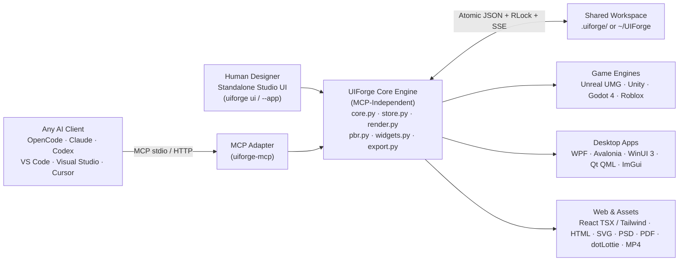

<div align="center">

**English** · [Türkçe](README.tr.md)

# UIForge (`uiforge-mcp`)

### Open-source, 100% local UI design studio & MCP server — built for humans, AI agents, or both working live together.

**Design game HUDs, menus, desktop apps, and websites visually in Studio UI, drive them from any MCP AI client, or collaborate side-by-side in Combined Mode — with zero subscriptions, zero call limits, and zero diffusion hallucinations.**

[](https://github.com/TENETTE/uiforge-mcp/actions/workflows/tests.yml)
[](#three-ways-to-run-uiforge)
[](#tools-and-capabilities)
[](#what-you-can-ship)
[_%2B_CPU_SIMD-76b900?style=flat-square)](#performance-and-gpu-backends)
[](LICENSE)

[Why UIForge](#why-uiforge) · [Three Modes](#three-ways-to-run-uiforge) · [Studio UI Tour](#studio-ui-tour) · [Quick Start](#quick-start) · [What You Can Ship](#what-you-can-ship) · [Showcases](#showcases) · [Performance](#performance-and-gpu-backends) · [FAQ](#faq)

```bash
# Human Mode — open the standalone Studio UI (no MCP client or AI IDE required)
uvx --from git+https://github.com/TENETTE/uiforge-mcp uiforge

# Combined Mode — Studio UI + MCP server synced live on the same workspace
uvx --from git+https://github.com/TENETTE/uiforge-mcp uiforge combined
```

<br />


</div>

---

## Why UIForge?

Modern design platforms gate UI workflows behind per-seat subscriptions, metered MCP call limits, cloud lock-in, or unpredictable diffusion models that hallucinate crooked text and uneditable rasters. **UIForge (`uiforge-mcp`)** solves this with a single **100% local, MIT-licensed, deterministic graphics and code-generation engine** accessible both through a **standalone visual Studio UI** and through the **Model Context Protocol (MCP)**:

- **No MCP required to use the product:** Want to design directly with sliders, PBR swatches, frames, icons, live bindings, and one-click engine export? Run `uiforge` and work directly in your browser or frameless desktop window (`--app`) — zero AI IDE, zero API keys, and zero runtime dependency on the `mcp` SDK.
- **Universal across AI clients (provider-neutral):** Want an AI agent to design, audit, iterate, and export? Run `uiforge-mcp` with OpenCode, Claude Code, OpenAI Codex, VS Code, Visual Studio, Antigravity, Cursor, Windsurf, ChatGPT, or any MCP-compatible client.
- **One shared core engine, zero duplicated logic:** Human Studio UI and MCP Mode execute the **exact same core operations, renderer, PBR shaders, widget layout, and engine exporters** (`core.py` + `store.py`). Outputs created in the UI are immediately usable from MCP, and vice versa.
- **Deterministic vector + Cook-Torrance GGX PBR:** Every pixel comes from editable vector shapes, HarfBuzz-shaped typography, 39 physically-based Cook-Torrance GGX materials with `.hdr`/`.exr` IBL + ACES filmic tone mapping, and keyframe animations — never blurry diffusion outputs.

---

## Three Ways to Run UIForge

Switch freely between modes at any time — all three read and write the exact same `.uiforge/` (or `~/UIForge`) workspace format:

| Mode | Command | Best For | Requires MCP / AI IDE? |
| --- | --- | --- | :---: |
| **Human Mode (UI Mode)** | `uiforge` or `uiforge ui` (`--app` for native window) | Designing, browsing 39 PBR materials & 142 icons, tuning live bindings, auditing WCAG contrast, and exporting to engines visually | **No** |
| **MCP Mode** | `uiforge-mcp` or `uiforge mcp` (`--transport stdio\|http`) | Headless AI agent workflows in OpenCode, Claude Code, Codex, VS Code, Visual Studio, Antigravity, Cursor, Windsurf, ChatGPT | Yes |
| **Combined Mode (MCP + UI)** | `uiforge combined` or `uiforge serve --mode combined` | Human and AI editing the **same project simultaneously** with live SSE canvas updates, atomic disk sync, and unified `[MCP]` + `[UI]` Activity Log | Optional (also syncs across separate processes) |

> **Cross-process sync included:** Even if your AI IDE launches `uiforge-mcp` on its own and you open `uiforge ui` in a separate terminal pointing at the same workspace, UIForge's atomic file writes (`mkstemp` + `fsync` + `os.replace`) and automatic disk-change watcher keep both sides in sync without data corruption.

### Shared Core Architecture



---

## Studio UI Tour

Every screenshot below was captured directly from the live running UIForge Studio (no mockups). The Studio itself features a Cook-Torrance PBR emblem and 3 starter previews forged with UIForge's own engine, **Dark Atelier & Light Studio themes**, **`Ctrl+K` Command Palette** (fuzzy search across all 97 operations, 39 PBR materials, 142 icons, 9 frames, and canvases), **8-point live resize handles**, **magnetic alignment snap guides**, **`Shift+Click` multi-select + distribute**, **double-click inline text editing**, **live Cook-Torrance PBR parameter tuning & custom material saving**, **Color-Blindness (`Deuteranopia`/`Protanopia`/`Tritanopia`/`Grayscale`) & `Pseudo-Long`/`Pseudo-RTL` simulator**, **Multi-Device Matrix** (`1080p`/`21:9`/`Steam Deck`/`Mobile`), **Visual Variations Explorer**, **CSS `:root` / Tailwind v4 `@theme` / shadcn token import**, and a **Motion Builder + `dotLottie v2`/GIF exporter**.

### 1. Instant 3-Template Studio Launcher (Zero MCP Required)

Open `uiforge` and launch straight into a **Tactical Sci-Fi HUD**, **Fantasy RPG Forge**, **Desktop & SaaS App**, blank canvas, or screenshot import — with zero AI IDE or cloud account.


### 2. Cook-Torrance PBR Material Forge & 142 Built-in Vector Icons

Browse all **39 live-rendered Cook-Torrance GGX PBR swatches** (`gold`, `hammered_gold`, `chrome`, `obsidian`, `jade`, `gem`, `liquid_glass`, `energy_shield`, `carbon_twill`, and more), inspect and reposition elements with the quick Align/Z-Order bar or arrow keys, apply **9 parametric AAA frames**, and drop **142 pure-MIT editable vector icons** with one click.


### 3. One-Click Engine, Desktop & Web Delivery + Inline Code Inspector

Export the active canvas directly to **Unreal Engine 5 UMG**, **Unity (UI Toolkit & uGUI)**, **Godot 4**, **Roblox**, **C# .NET (WPF / Avalonia / WinUI 3)**, **C++ (Qt 6 QML / Dear ImGui)**, **React TSX / Tailwind**, **Interactive HTML/CSS**, **PNG / SVG / PSD / PBR Maps** — inspect and copy the generated code or preview the exported web screen right inside Studio.


### 4. Responsive Layout & Live Data Bindings

Works cleanly on wide monitors and compact split-screen viewports (`900px` drawer mode). Test reactive `set_binding` variables, interaction states, WCAG contrast audits, and pixel visual diffs (`Before | After | Heatmap`) in real time.


---

## Quick Start

Install [uv](https://docs.astral.sh/uv/) (`winget install astral-sh.uv`, `brew install uv`, or `pip install uv`). Python **3.10+** is supported on Windows, macOS, and Linux.

### Option A — Human Mode (Standalone UI, No MCP Needed)

```bash
# Launch Studio UI directly in your browser (http://127.0.0.1:8766)
uvx --from git+https://github.com/TENETTE/uiforge-mcp uiforge

# Or open as a frameless native desktop window (uses pywebview or Edge/Chrome --app)
uvx --from git+https://github.com/TENETTE/uiforge-mcp uiforge ui --app

# Point at a specific project workspace
uvx --from git+https://github.com/TENETTE/uiforge-mcp uiforge ui --workspace ./my-game/.uiforge
```

**Install persistently with pip / uv (including optional frameless desktop wrapper):**

```bash
pip install "uiforge-mcp @ git+https://github.com/TENETTE/uiforge-mcp"
# Optional: native desktop window via pywebview
pip install "uiforge-mcp[desktop] @ git+https://github.com/TENETTE/uiforge-mcp"
uiforge
```

> **Zero-MCP standalone environment:** Human Mode has zero runtime dependency on the `mcp` package. Even in an environment where only the core imaging libraries (`pillow`, `numpy`, `opencv-python-headless`, `uharfbuzz`, `pyclipper`) are installed and `mcp` is absent, `uiforge ui` boots and runs all 97 core operations cleanly.

### Option B — MCP Mode (Any AI Client / IDE)

Auto-detect your GPU hardware (`nvidia` / `amd` / `intel` / `apple` / `cpu`) and safely merge UIForge into your client's config without overwriting existing MCP servers:

```bash
# 1. Inspect GPU, active backend, available modes, and tool token footprint
uvx --from git+https://github.com/TENETTE/uiforge-mcp uiforge-mcp doctor

# 2. Configure any supported MCP client automatically
uvx --from git+https://github.com/TENETTE/uiforge-mcp uiforge-mcp setup opencode --write
uvx --from git+https://github.com/TENETTE/uiforge-mcp uiforge-mcp setup claude --write
uvx --from git+https://github.com/TENETTE/uiforge-mcp uiforge-mcp setup codex --write
uvx --from git+https://github.com/TENETTE/uiforge-mcp uiforge-mcp setup vscode --scope project --write
uvx --from git+https://github.com/TENETTE/uiforge-mcp uiforge-mcp setup visualstudio --write
uvx --from git+https://github.com/TENETTE/uiforge-mcp uiforge-mcp setup antigravity --write
uvx --from git+https://github.com/TENETTE/uiforge-mcp uiforge-mcp setup cursor --write
uvx --from git+https://github.com/TENETTE/uiforge-mcp uiforge-mcp setup windsurf --write

# 3. Remote / Streamable HTTP clients (e.g. ChatGPT Apps/Connectors) — authenticated + sandboxed
uvx --from git+https://github.com/TENETTE/uiforge-mcp uiforge-mcp serve --transport http --port 8765 --auth-token YOUR_SECRET
```

See [`configs/README.md`](configs/README.md) for manual JSON / TOML snippets (including OpenCode, OpenAI Codex, Claude Code, VS Code, Visual Studio, Antigravity, Cursor, Windsurf, and ChatGPT).

### Option C — Combined Mode (Human Studio UI + MCP Together)

```bash
# Run Studio UI (port 8766) + MCP server (stdio or HTTP) on the exact same live workspace
uiforge combined
uiforge combined --transport http --port 8765 --ui-port 8766 --auth-token YOUR_SECRET

# Or switch modes via environment variable
UIFORGE_MODE=combined uiforge
```

### Token-Saving Toolsets for AI Agents

Need a smaller MCP context footprint? Filter exposed tools by workflow and compress schemas (cuts tool-list tokens by up to **77%**):

```bash
uiforge-mcp mcp --toolset core --compact      # Essential drawing, theme, preview & PNG/SVG (~7.8K tokens)
uiforge-mcp mcp --toolset game --compact      # Game HUDs, frames, PBR maps, animations & engine export
uiforge-mcp mcp --toolset desktop --compact   # WPF, Avalonia, WinUI 3, Qt 6 QML & Dear ImGui
uiforge-mcp mcp --toolset web --compact       # Websites, React TSX/Tailwind & interactive prototypes
```

---

## Compared to Paid Design Tools

| Capability | **UIForge (`uiforge-mcp`)** | Figma + MCP | Pencil (`pen.dev`) | Rive |
| --- | :---: | :---: | :---: | :---: |
| **Price & license** | **\$0 · MIT Open Source** | \$16–\$90/seat/mo | \$16–\$48/mo | \$9–\$120/mo |
| **Standalone UI without MCP** | ✅ `uiforge` (browser or `--app`) | ✅ | ✅ | ✅ |
| **MCP tool calls** | **Unlimited · Local** | Metered quotas | Metered agent-days | — |
| **Runs 100% offline** | ✅ | ❌ Cloud | ✅ | ❌ Cloud |
| **Git-local project files** | ✅ Auto `.uiforge/` JSON | ❌ | ✅ `.pen` | ❌ Binary `.riv` |
| **Game Engines (UE UMG / Unity / Godot / Roblox)** | ✅ All 4 + controllers + native widgets | ❌ Manual rebuild | ❌ Web/HTML | Runtime plugin |
| **Desktop Apps (WPF / Avalonia / WinUI / Qt / ImGui)** | ✅ Native XAML / QML / C++17 + ViewModel | ❌ | ❌ | ❌ |
| **Cook-Torrance GGX PBR + Custom `.hdr`/`.exr` IBL** | ✅ 39 built-in + custom HDRI | ❌ | Limited | ❌ |
| **3D Diegetic Perspective & Curved Visor HUD** | ✅ `perspective` / `visor_curve` | ❌ | ❌ | ❌ |
| **Built-in Pure-MIT Vector Icons** | ✅ 142 editable vector icons | Plugins | Partial | ❌ |
| **Engine PBR Texture Maps (Normal/ORM/CanvasTexture)** | ✅ `export_pbr_maps` | ❌ | ❌ | ❌ |
| **Parametric AAA Frames (`add_frame`)** | ✅ 9 editable presets | ❌ | ❌ | ❌ |
| **Screenshot → Editable Canvas** | ✅ `import_screenshot` v2 | ❌ | ❌ | ❌ |
| **Native Input / Scroll / Slider / Toggle / Dropdown** | ✅ Canvas + Web/React + Engines + Desktop | Design only | Partial | ❌ |
| **dotLottie v2 State Machine + MP4 / WebM / PSD / PDF** | ✅ All built-in | SVG / PDF | Partial | `.riv` |

---

## What You Can Ship

| Target | What You Get | Operation / Tool |
| --- | --- | --- |
| **Unreal Engine 5.5–5.8** | Complete Python **UMG `WidgetBlueprint` builder** (`WBP_<Name>_build_umg.py`) with 9-slice `SlateBrush`, `CanvasPanel`, `Image`, `TextBlock`, `EditableTextBox`, `ScrollBox`, `Slider`, `CheckBox`, `ComboBoxString`, plus `import_uiforge.py` and PBR map importer | `export_screen(engine="unreal")`, `export_asset`, `export_pbr_maps`, `write_engine_helpers` |
| **Unity 6** | UI Toolkit (`.uxml` + `.uss` + `Controller.cs`), **uGUI Canvas/RectTransform C# builder** (`unity-ugui`), 9-slice sprites + `UiForgeImporter.cs`, C# tokens | `export_screen(engine="unity" \| "unity-ugui")`, `export_asset`, `write_engine_helpers` |
| **Godot 4** | `.tscn` scenes + `_controller.gd` (data bindings, `sfx_requested` signals, gamepad `focus_neighbor_*`, native `LineEdit`/`ScrollContainer`/`HSlider`/`CheckButton`/`OptionButton`), `StyleBoxTexture .tres`, `CanvasTexture .tres` | `export_screen(engine="godot")`, `export_pbr_maps`, `export_asset`, `write_engine_helpers` |
| **Roblox Studio** | `LocalScript` ScreenGui builder with native controls, `SliceCenter` / `SliceScale` metadata, `UiForgeAssets.luau`, Luau tokens | `export_screen(engine="roblox")`, `export_asset`, `write_engine_helpers` |
| **C# / .NET Desktop** | **WPF** (`.xaml` + `.xaml.cs` + `INotifyPropertyChanged` ViewModel for .NET Framework 4.8 & .NET 8/9/10), **Avalonia** (`.axaml`), **WinUI 3** (`.xaml`) | `export_screen(engine="wpf" \| "avalonia" \| "winui")` |
| **C++ Desktop & Tools** | **Qt 6 Quick** (`.qml` with native `QtQuick.Controls`), **Dear ImGui** (self-contained C++17 `_ui.hpp` with `State` struct) | `export_screen(engine="qt-qml" \| "imgui")` |
| **React & TypeScript** | `<Screen>.jsx` or typed **`<Screen>.tsx`**, CSS or **Tailwind**, live widgets, `data` prop bindings, `onNavigate` / `onSfx`, keyboard & **Web Gamepad API** | `export_react` |
| **Websites & Prototypes** | Responsive HTML5/CSS3 with selectable text, live inputs/sliders/toggles/dropdowns/scrolls, links, overlays, View Transitions, `window.uiforgeSetData()` | `export_web`, `export_prototype` |
| **Engine PBR Texture Maps** | **Albedo, Tangent Normal (OpenGL `+Y` & DirectX `-Y`), Roughness, Metallic, AO, Height, ORM packed + Godot 4 `CanvasTexture .tres`** | `export_pbr_maps` |
| **Motion & Video** | **dotLottie v2 (`.lottie` multi-animation + interactive State Machine ZIP)**, vector Lottie JSON, H.264 MP4 / transparent VP9 WebM (streamed), sprite sheets, GIF / APNG / WebP, DOTween & Roblox ease JSON | `export_animation`, `export_layers` |
| **Atlases, Vector & Print** | **TexturePacker / Godot / Unity / CSS sprite atlases**, editable SVG, PackBits RLE PSD, multi-page vector PDF, iOS/Android/Web PNG sets, ICO, BMFont | `export_atlas`, `export_svg`, `export_psd`, `export_pdf`, `export_png`, `export_bitmap_font` |
| **Design Systems** | Developer spec, W3C DTCG JSON, CSS/USS/C#/GDScript/Luau tokens, **`DESIGN.md`** | `export_spec`, `export_theme` |

---

## Showcases

Every single image and animation below was rendered deterministically by UIForge itself (reproducible via `python examples/run_all.py`).

### 39 Built-in Cook-Torrance GGX PBR Materials

Rendered in linear HDR with dual-lobe GGX specular, curvature edge wear, 5 studio HDRI light tents (`bright`, `warm`, `dark`, `sunset`, `cyberpunk`) plus optional custom `.hdr`/`.exr` equirectangular IBL (`env_map`), OpenCV SIMD SDF bevels, clearcoat lacquer, linear & radial anisotropic brushed metal, subsurface scattering, crevice AO, HDR emission, and ACES filmic tone mapping.


### Real-time Engine PBR Texture Maps (`export_pbr_maps`)

Bake any 2D UI badge, button, or medallion into **Albedo, Tangent Normal (OpenGL / DirectX), Roughness, Metallic, AO, Height, ORM packed, and Godot 4 `CanvasTexture .tres`** so your game engine dynamically lights your UI.


### 9 Parametric AAA Frames (`add_frame`)

One call generates 100% editable vector + PBR frames across 9 presets (`rpg_gold`, `royal_ornate`, `fantasy_parchment`, `scifi_hud`, `cyber_tech`, `glass_card`, `medieval_iron`, `luxury_minimal`, `cartoon_thick`) returning the exact `inner_box` content region.


### Realistic Racing HUD & Full UI Kit


### Design Variations & Editable Vector Output

`make_variations` explores alternative palettes, shapes, and typography in one call; `export_svg` keeps vector paths, patterns, and filters editable ([design_tools.svg](examples/design_tools.svg)).


### Keyframe Animations

| Button entrance + shine | Rev gauge | Menu entrance and selection |
| --- | --- | --- |
|  |  |  |

<details>
<summary><strong>More showcases (lighting, layers, realistic kit, workflow, multi-resolution)</strong></summary>

**Lighting and shading**


**Layered painting**


**Realistic kit**


**Components, states, data templates & pixel art**


**Multi-resolution pin checks (16:9, 21:9, mobile)**


</details>

---

## Performance and GPU Backends

UIForge uses a pluggable compute pipeline (`UIFORGE_MCP_GPU=auto|cuda|wgpu|cpu`) with **zero mandatory GPU dependencies**:

| GPU Vendor / Platform | Install Extra | Runtime Backend |
| --- | --- | --- |
| **CPU-Only (Universal Default)** | `uiforge-mcp` (or `[cpu]`) | OpenCV C++ AVX2/NEON SIMD + NumPy (0 GPU deps) |
| **NVIDIA (CUDA 12 + WebGPU)** | `uiforge-mcp[nvidia]` (or `[gpu]`) | Fused CuPy CUDA 12 kernels + `wgpu` fallback |
| **AMD (Vulkan / DirectX 12)** | `uiforge-mcp[amd]` | Portable `wgpu` WGSL `@compute` shaders |
| **Intel Arc / Xe (Vulkan / D3D12)** | `uiforge-mcp[intel]` | Portable `wgpu` WGSL `@compute` shaders |
| **Apple Silicon (Metal)** | `uiforge-mcp[apple]` | Portable `wgpu` WGSL `@compute` shaders |

### Measured Benchmarks (Windows, Python 3.12, NVIDIA GeForce RTX 4060 Ti)

| Workload | CPU (OpenCV SIMD) | WebGPU (`wgpu` Vulkan) | CUDA 12 (`cupy`) | Notes |
| --- | ---: | ---: | ---: | --- |
| `512×512` exact Euclidean SDF (`distance_field`) | **2.84 ms** | — | — | `cv2.distanceTransform` C++ SIMD (~9× faster than NumPy JFA) |
| `512×512` shader (`fbm` + `ridged` + `voronoi`) | 150.2 ms | **4.64 ms** (32×) | **1.12 ms** (134×) | Bit-exact `uint32` hash (`max_diff < 1e-4` across CPU / WebGPU / CUDA) |
| `512×512` Cook-Torrance GGX PBR + Studio IBL | 289.5 ms | **40.53 ms** (7.1×) | — | WGSL `@compute` BRDF + ACES Filmic |
| 18 Cook-Torrance PBR cards (`1200×800`, cached) | 593 ms cold / **37.2 ms cached** | — | — | 128 MB LRU element render cache + bbox cropping |
| 21-frame `1280×720` HUD sprite sheet | **873 ms** | — | — | Static-layer pre-baking + parallel worker threads |

> **Hardware honesty note:** Hardware GPU benchmarks above were physically measured on an **NVIDIA GeForce RTX 4060 Ti** (CUDA 12 + Vulkan/D3D12 WebGPU). AMD, Intel, and Apple Silicon (Metal) GPUs are targeted through portable standard WGSL via `wgpu-py`, but have **not** been physically benchmarked on those machines yet. See [`docs/COMPATIBILITY.md`](docs/COMPATIBILITY.md) for the complete verification matrix.

---

## Tools and Capabilities

### Configurable Quality Tiers & Style Presets

Not every project should look dark, gritty, or ornate. Set the desired level once per workspace (`set_theme`) or per canvas (`update_canvas`), or switch live in Studio UI:

- **4 Quality Tiers (`quality`):** `"simple"` (clean flat/soft shading, 0 grain, minimal frames, 2× SS), `"standard"` (balanced bevels/detail, 3× SS), `"advanced"` (full Cook-Torrance PBR + rich ornaments, 4× SS), `"aaa"` (deepened micro-bevels, heightened edge wear & full ornate filigree, 4× SS).
- **9 Style Presets (`style_preset`):** `"kids"`, `"cartoon"`, `"stylized"`, `"minimal"`, `"web_saas"`, `"scifi"`, `"dark_fantasy"`, `"realistic"`, `"photorealistic"`.

<details>
<summary><strong>All 97 core operations / model-facing MCP tools (+ 2 SEP-1865 app-only tools, 4 Resources, 1 Template, 3 Prompts)</strong></summary>

| Group | Tools / Core Operations |
| --- | --- |
| **Canvas (9)** | `create_canvas`, `list_canvases`, `get_canvas`, `update_canvas`, `duplicate_canvas`, `delete_canvas`, `fit_canvas`, `resize_canvas`, `canvas_version` (incl. `visual_diff`) |
| **Layers (4)** | `create_layer`, `update_layer`, `delete_layer`, `set_layer` |
| **Drawing, Frames, Icons & Widgets (19)** | `add_rect`, `add_ellipse`, `add_line`, `add_polygon`, `add_path`, `add_arc`, `add_ticks`, `add_text`, `add_image`, `add_instance`, `add_svg`, `add_frame`, `add_icon`, `add_input`, `add_scroll`, `add_slider`, `add_toggle`, `add_dropdown`, `import_screenshot` |
| **Editing & Layout (18)** | `update_element`, `delete_elements`, `duplicate_element`, `boolean_elements`, `path_ops`, `restyle`, `find_elements`, `vectorize_image`, `move_elements`, `reorder_element`, `align_elements`, `arrange_elements`, `scatter`, `copy_elements`, `set_pin`, `batch`, `undo`, `redo` |
| **Data, States & i18n (6)** | `set_binding`, `set_state`, `delete_state`, `generate_from_template`, `set_strings`, `get_strings` |
| **Checks, Studio & MCP App (6)** | `live_preview`, `open_studio`, `review_canvas`, `inspect_pixels`, `view_image`, `preview_nine_slice` |
| **Animation (7)** | `create_animation`, `set_keyframes`, `delete_keyframes`, `get_animations`, `delete_animation`, `preview_animation`, `export_animation` |
| **Theme & Info (6)** | `set_theme`, `get_theme`, `make_palette`, `list_fonts`, `measure_text`, `guide` |
| **Preview & Explore (4)** | `preview`, `preview_resolutions`, `contact_sheet`, `make_variations` |
| **Export (12)** | `export_png`, `export_svg`, `export_pdf`, `export_web`, `export_react`, `export_asset`, `export_pbr_maps`, `export_layers`, `export_psd`, `export_atlas`, `export_bitmap_font`, `write_engine_helpers` |
| **Hand-off & Engines (6)** | `export_spec`, `export_theme`, `set_link`, `set_interaction`, `export_prototype`, `export_screen` |

- **App-only SEP-1865 tools (`visibility: ["app"]`, 0 model tokens):** `studio_app_state`, `studio_app_render`.
- **MCP Resources:** `uiforge://materials`, `uiforge://icons`, `uiforge://workspace`, `ui://uiforge/studio.html`, plus template `uiforge://guide/{topic}`.
- **MCP Prompts:** `design_game_hud`, `design_rpg_panel`, `audit_and_polish`.

</details>

### Example Prompts (MCP / Combined Mode)

```text
Start Combined Mode or open_studio so I can watch. Design a tactical sci-fi HUD with
scifi_hud frame, a shield bar using energy_shield material, native thruster slider,
auto-stabilizer toggle, flight profile dropdown, and status scroll list. Run review_canvas,
fix any WCAG warnings, then export for Unreal Engine 5 UMG and React TSX Tailwind.
```

---

## Security

- **Offline by design:** Zero outbound network calls. Studio UI (`uiforge ui`) and `live_preview` bind strictly to `127.0.0.1`, and `/api/export_preview` refuses any path outside workspace `exports/`.
- **Authenticated HTTP & export sandboxing:** Streamable HTTP transport (`--transport http`) automatically enables `--sandbox-exports`, refuses non-loopback binds without `--auth-token` (`UIFORGE_MCP_AUTH_TOKEN`), and verifies tokens with constant-time `hmac.compare_digest`.
- **Sandboxed formulas & DoS guards:** Both `shader.py` and `binding.py` validate ASTs against strict whitelists (no imports, attributes, or loops), cap exponentiation and string repetition, and enforce pixel/work budgets.
- **Injection-safe engine exports:** Engine paths and identifiers are allow-listed; generated scripts are written to disk, never executed; SVG `DOCTYPE` / `ENTITY` declarations are rejected.

Report security issues privately via [`SECURITY.md`](SECURITY.md).

---

## Requirements & Compatibility

- **Python:** 3.10, 3.11, 3.12, or 3.13 (Windows, macOS, Linux).
- **Optional extras:** `[nvidia]` / `[gpu]` (CUDA 12 + WebGPU), `[amd]` / `[intel]` / `[apple]` / `[wgpu]` (WebGPU), `[desktop]` (`pywebview` native window), `[ocr]` (`rapidocr-onnxruntime` for `import_screenshot`), `[video]` (`imageio-ffmpeg` for MP4/WebM), `[dev]` (`pytest`, `ruff`).
- **Workspace storage:** Automatically uses `.uiforge/` in the current directory if present (ideal for Git), otherwise `~/UIForge` (or `UIFORGE_MCP_DIR` / `--workspace`). Custom `.ttf`/`.otf` fonts dropped into `<workspace>/fonts/` are loaded automatically.
- **Detailed verification matrix:** See [`docs/COMPATIBILITY.md`](docs/COMPATIBILITY.md).

---

## FAQ

<details>
<summary><strong>Can I use UIForge without MCP or any AI IDE?</strong></summary>

Yes! Run `uiforge` (or `uiforge ui` / `uiforge ui --app`). Human Mode opens the full local Studio UI with zero MCP client, zero AI provider, and zero runtime requirement on the `mcp` package.

</details>

<details>
<summary><strong>Can I edit in the UI while an AI agent works on the same project?</strong></summary>

Yes! Run `uiforge combined` (single process) — or run your AI IDE's `uiforge-mcp` alongside a separate `uiforge ui` pointing at the same workspace. Atomic writes (`mkstemp` + `fsync` + `os.replace`), thread locking, and disk-change watching keep both sides synchronized.

</details>

<details>
<summary><strong>Which AI clients are supported in MCP Mode?</strong></summary>

Any MCP-compatible client: OpenCode, Claude Code, OpenAI Codex, VS Code, Visual Studio 2022/2026, Google Antigravity, Cursor, Windsurf, ChatGPT (Streamable HTTP), Goose, and custom agents. See [`configs/README.md`](configs/README.md).

</details>

<details>
<summary><strong>Does it use an image generation model?</strong></summary>

No. Every element is rendered locally from deterministic vector primitives, PBR shaders, lighting, and shaped typography. Place external illustrations or portraits via `add_image` (with crop, cutout, pan/zoom, or sprite-sheet playback).

</details>

---

## Documentation & Contributing

- **[`configs/README.md`](configs/README.md)** — Multi-mode launch & per-IDE MCP configuration templates
- **[`docs/GUIDE.md`](docs/GUIDE.md)** — Complete feature, material, animation, desktop & game-engine reference (Turkish)
- **[`docs/COMPATIBILITY.md`](docs/COMPATIBILITY.md)** — Verified 2026 engine, framework, GPU & client compatibility matrix
- **[`skill/uiforge-mcp/SKILL.md`](skill/uiforge-mcp/SKILL.md)** — Provider-neutral AI agent craft skill
- **[`llms.txt`](llms.txt)** — Concise machine-readable project index for AI coding tools
- **[`THIRD_PARTY_LICENSES.md`](THIRD_PARTY_LICENSES.md)** — Complete dependency & bundled SIL OFL-1.1 font audit
- **[`CHANGELOG.md`](CHANGELOG.md)** — Release history

```bash
git clone https://github.com/TENETTE/uiforge-mcp
cd uiforge-mcp
uv venv && uv pip install -e ".[dev]"
uv run pytest
```

PRs and issues are welcome — see [`CONTRIBUTING.md`](CONTRIBUTING.md) and [`CODE_OF_CONDUCT.md`](CODE_OF_CONDUCT.md).

## License

[MIT](LICENSE) — free for personal and commercial use. All 11 bundled font families are SIL OFL-1.1 (`OFL.txt` included in each directory); see [`THIRD_PARTY_LICENSES.md`](THIRD_PARTY_LICENSES.md). Everything you create with UIForge belongs to you.

Figma, Penpot, Pencil, Rive, Unity, Unreal Engine, Godot, Roblox, Photoshop, Illustrator, React, Tailwind CSS, Qt, and other product names are trademarks of their respective owners. UIForge is independent and not affiliated with or endorsed by them.
