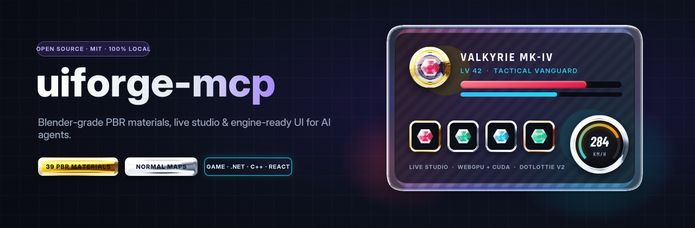
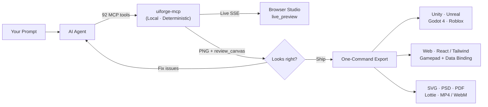
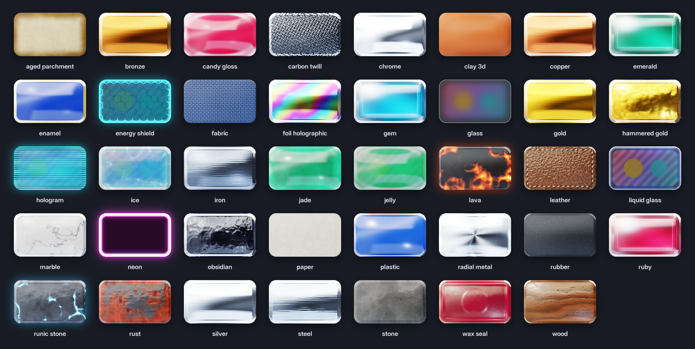
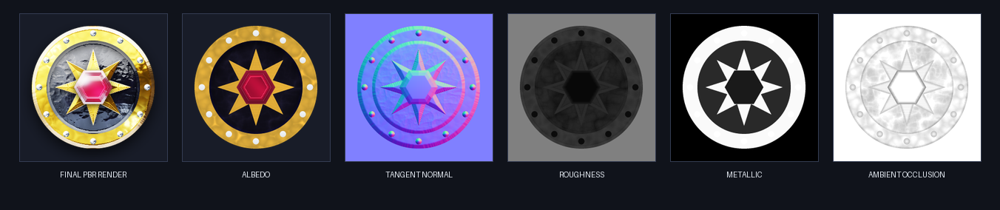
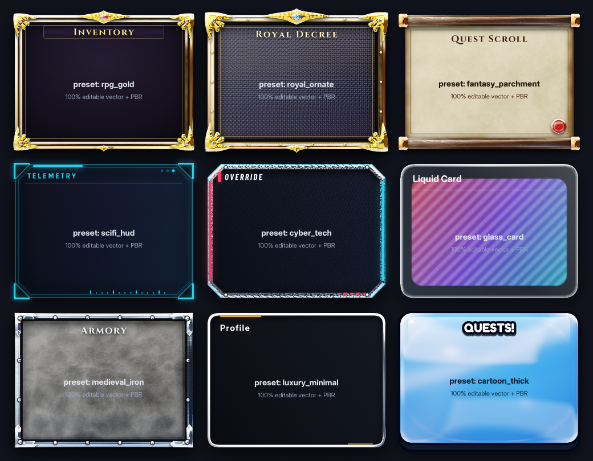
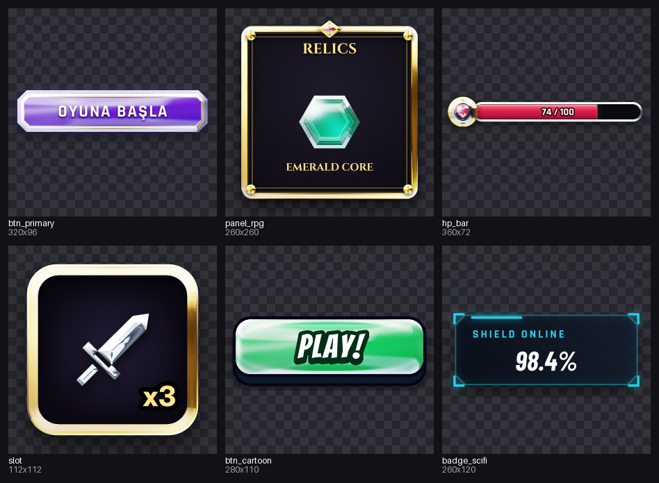
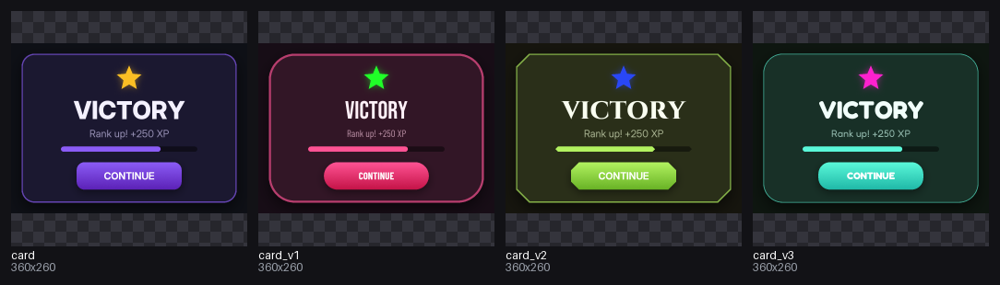
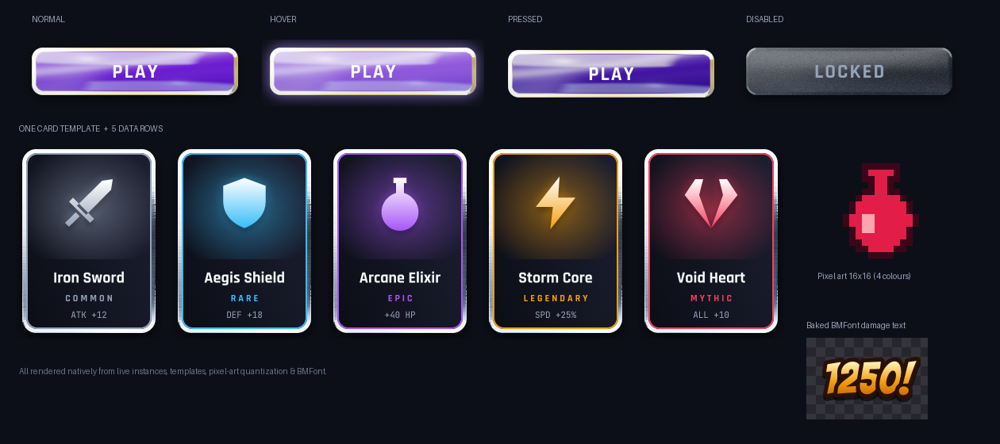
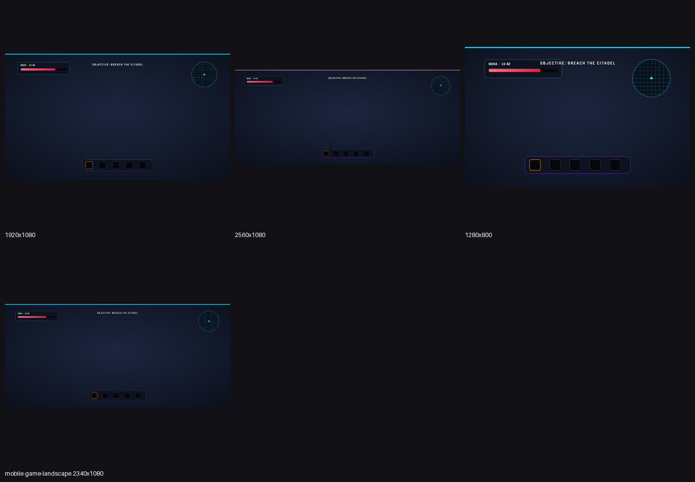

<div align="center">

**English** · [Türkçe](README.tr.md)

# uiforge-mcp

### Open-source local design, material, animation & engine-export MCP server for AI agents.

**Describe a game HUD, menu, or app screen. Watch it build live. Ship engine-ready art, interactive code, and video — with zero subscriptions, zero call limits, and zero image models.**

[](https://github.com/TENETTE/uiforge-mcp/actions/workflows/tests.yml)
[](#tools)
[](#materials)
[](#what-you-can-ship)
[-76b900?style=flat-square)](#performance)
[](LICENSE)

[Why uiforge-mcp](#why-uiforge-mcp) · [Quick start](#quick-start) · [What you can ship](#what-you-can-ship) · [Showcases](#showcases) · [Performance](#performance) · [Features](#features) · [Tools](#tools) · [FAQ](#faq)

```bash
claude mcp add uiforge -s user -- uvx --from git+https://github.com/TENETTE/uiforge-mcp uiforge-mcp
```

<br />



</div>

---

## Why uiforge-mcp?

Paid design platforms increasingly gate AI design workflows behind seat licenses, monthly MCP call limits, splash screens, or cloud lock-in. **uiforge-mcp** is a **100% local, MIT-licensed** alternative built from the ground up for AI coding & design agents:

- **Deterministic vector & Cook-Torrance PBR engine:** No diffusion hallucinations, no broken text, no upload to external APIs. Every pixel comes from editable vector shapes, HarfBuzz-shaped typography, physically-based Cook-Torrance GGX materials with HDR studio IBL + ACES filmic tone mapping, and keyframe tracks.
- **Closed visual feedback loop:** The agent draws, inspects the rendered PNG with `preview`, audits layout/contrast/alignment with `review_canvas`, fixes issues automatically, and lets **you** watch edits in real time via `live_preview` in your browser.
- **One canvas → every target:** Export the exact same design as Unity (UI Toolkit & uGUI), Unreal, Godot 4, or Roblox scenes and 9-slice sprites — plus editable SVG, RLE-compressed layered PSD, vector PDF, Lottie, MP4/WebM, websites, and React (CSS or Tailwind) with live data binding and gamepad navigation.

### Compared to paid tools

| Capability | **uiforge-mcp** | Figma + MCP | Pencil (`pen.dev`) | Rive | Envy UI |
| --- | :---: | :---: | :---: | :---: | :---: |
| **Price & license** | **\$0 · MIT Open Source** | \$16–\$90/seat/mo | \$16–\$48/mo | \$9–\$120/mo (splash on free) | Paid desktop app |
| **MCP tool calls** | **Unlimited · Local** | Metered (20/mo free, 200/day Pro) | 5 agent-days/mo free | CLI publish caps | — |
| **Runs 100% offline** | ✅ | ❌ Cloud | ✅ | ❌ Cloud editor | ✅ |
| **Git-local project files** | ✅ Auto `.uiforge/` | ❌ | ✅ `.pen` | ❌ Binary `.riv` | ✅ |
| **Live browser preview** | ✅ `live_preview` (SSE) | ✅ | ✅ | ✅ | ✅ |
| **Unity / Unreal / Godot / Roblox export** | ✅ All 4 + controllers + native widgets | ❌ Manual rebuild | ❌ Web/HTML | Partial (runtime plugin) | Godot / Unity / Web |
| **C# .NET (WPF/Avalonia/WinUI) & C++ (Qt/ImGui)** | ✅ Native XAML / QML / ImGui + ViewModel | ❌ | ❌ | ❌ | ❌ |
| **Cook-Torrance GGX PBR + Custom HDRI** | ✅ 39 built-in + `.hdr` / `.exr` IBL | ❌ | Limited | ❌ | ❌ |
| **Engine PBR Maps (Normal/ORM/CanvasTexture)** | ✅ `export_pbr_maps` | ❌ | ❌ | ❌ | ❌ |
| **Parametric AAA Frames (`add_frame`)** | ✅ 9 editable presets (filigree/rivets) | ❌ | ❌ | ❌ | ❌ |
| **Screenshot → Editable Canvas** | ✅ `import_screenshot` (OpenCV + optional OCR) | ❌ | ❌ | ❌ | ❌ |
| **Data binding & dotLottie v2 state machine** | ✅ `set_binding` + `set_interaction` + `.lottie` v2 | Variables only | Variables only | ✅ | ✅ |
| **Native Scroll & Input widgets** | ✅ Canvas + Web/React + Engines + Desktop | Design only | Partial | ❌ | Partial |
| **Web & React (TSX / Tailwind) + Gamepad** | ✅ | Via Code Connect | HTML/code | Web runtime | Web runtime |
| **SVG / PSD / PDF / dotLottie v2 / MP4 / Atlases** | ✅ All built-in | SVG / PDF | Partial | `.riv` | — |

---

## Quick start

Install [uv](https://docs.astral.sh/uv/) (`winget install astral-sh.uv`, `brew install uv`, or `pip install uv`). First launch downloads dependencies in ~30 seconds.

### Multi-IDE One-Command Setup (OpenCode, Claude Code, VS Code, Visual Studio, Antigravity, Cursor, Windsurf, ChatGPT)

Auto-detect your GPU architecture (`nvidia` / `amd` / `intel` / `apple` / `cpu`) and configure any MCP client automatically:

```bash
# Inspect your GPU, active backend, and installed tools
uvx --from git+https://github.com/TENETTE/uiforge-mcp uiforge-mcp doctor

# Auto-configure your IDE (merges safely without overwriting existing servers)
uvx --from git+https://github.com/TENETTE/uiforge-mcp uiforge-mcp setup opencode --write
uvx --from git+https://github.com/TENETTE/uiforge-mcp uiforge-mcp setup claude --write
uvx --from git+https://github.com/TENETTE/uiforge-mcp uiforge-mcp setup visualstudio --write
uvx --from git+https://github.com/TENETTE/uiforge-mcp uiforge-mcp setup vscode --scope project --write
uvx --from git+https://github.com/TENETTE/uiforge-mcp uiforge-mcp setup antigravity --write
uvx --from git+https://github.com/TENETTE/uiforge-mcp uiforge-mcp setup cursor --write

# ChatGPT Apps / Connectors (Streamable HTTP MCP server)
uvx --from git+https://github.com/TENETTE/uiforge-mcp uiforge-mcp serve --transport http --port 8765
```

See [`configs/README.md`](configs/README.md) for manual JSON snippets and [`docs/COMPATIBILITY.md`](docs/COMPATIBILITY.md) for the full 2026 engine/API compatibility matrix.

### GPU Architecture Extras (No Unnecessary Bloat)

| GPU Vendor / Architecture | Install Extra | Runtime Used |
| --- | --- | --- |
| **NVIDIA (CUDA 12 + WebGPU)** | `uiforge-mcp[nvidia]` (or `[gpu]`) | Fused CuPy CUDA 12 + `wgpu` fallback |
| **AMD (Vulkan / DirectX 12)** | `uiforge-mcp[amd]` | Shared portable `wgpu` WGSL compute |
| **Intel Arc / Xe (Vulkan / D3D12)** | `uiforge-mcp[intel]` | Shared portable `wgpu` WGSL compute |
| **Apple Silicon (Metal)** | `uiforge-mcp[apple]` | Shared portable `wgpu` WGSL compute |
| **CPU-Only (Universal)** | `uiforge-mcp` (default / `[cpu]`) | OpenCV C++ SIMD + NumPy (0 GPU deps) |

### Configurable Quality Tiers & Visual Style Presets

Not every project should look dark, gritty or AAA. Choose the exact visual style and rendering complexity per workspace (`set_theme`) or per canvas (`update_canvas`):
- **4 Quality Tiers (`quality`):** `"simple"` (clean flat/soft shading, 0 grain, minimal frame geometry, 2× SS), `"standard"` (balanced bevels/detail, 3× SS), `"advanced"` (full Cook-Torrance PBR + rich ornaments, 4× SS), `"aaa"` (deepened micro-bevels, heightened edge wear & full ornate details, 4× SS).
- **9 Style Presets (`style_preset`):** `"kids"`, `"cartoon"`, `"stylized"`, `"minimal"`, `"web_saas"`, `"scifi"`, `"dark_fantasy"`, `"realistic"`, `"photorealistic"` — automatically seeds matching palette tokens, spacing/radius scales, named styles, lighting studio, and default frame style (`add_frame(preset="auto")`).

### Claude Code

```bash
claude mcp add uiforge -s user -- uvx --from git+https://github.com/TENETTE/uiforge-mcp uiforge-mcp
```

### Cursor, Windsurf, Claude Desktop, Antigravity & other MCP clients

Add to your MCP config (`~/.cursor/mcp.json`, Claude Desktop config, or `.vscode/mcp.json` using `"servers"` instead of `"mcpServers"`):

```json
{
  "mcpServers": {
    "uiforge": {
      "command": "uvx",
      "args": ["--from", "git+https://github.com/TENETTE/uiforge-mcp", "uiforge-mcp"]
    }
  }
}
```

Restart your client afterwards.

<details>
<summary><strong>Optional extras: NVIDIA GPU (CUDA), Video (ffmpeg), Git-local mode & Agent Skill</strong></summary>

- **Cross-GPU WebGPU acceleration (`[wgpu]`):** Compiles shaders & Cook-Torrance PBR to standard WGSL `@compute` via `wgpu-py` (Vulkan / DirectX 12 / Metal; **32× faster** shaders & **7.1× faster** PBR vs CPU on RTX 4060 Ti Vulkan). Select via `UIFORGE_MCP_GPU=wgpu|cuda|cpu|auto`. *(Honesty note: physically verified on NVIDIA RTX 4060 Ti Vulkan/D3D12; AMD, Intel and Apple Silicon Metal are architecturally targeted via standard WGSL but not physically tested.)*
  ```bash
  uvx --from "uiforge-mcp[wgpu] @ git+https://github.com/TENETTE/uiforge-mcp" uiforge-mcp
  ```
- **NVIDIA GPU acceleration (`[gpu]`):** Compiles shader fills & materials into fused CUDA C++ kernels via CuPy + CUDA 12 (~1 GB download; **130× faster** GPU shaders on RTX 4060 Ti). Falls back transparently to WebGPU or CPU with identical output. Disable anytime with `UIFORGE_MCP_GPU=0`.
  ```bash
  claude mcp add uiforge -s user -- uvx --from "uiforge-mcp[gpu] @ git+https://github.com/TENETTE/uiforge-mcp" uiforge-mcp
  ```
- **MP4 / WebM video (`[video]`):** Uses `ffmpeg` from PATH (`winget install ffmpeg`, `brew install ffmpeg`), or install the `[video]` extra to bundle one.
- **Git-local project workspace:** Create a `.uiforge/` folder in your project root and the server automatically stores sorted, diff-friendly project JSONs right alongside your code (otherwise defaults to `~/UIForge`, or set `UIFORGE_MCP_DIR`).
- **Agent Skill:** [`skill/uiforge-mcp/SKILL.md`](skill/uiforge-mcp/SKILL.md) teaches your agent UI craft (layer order, 2.5D lighting, 9-slice rules, timing curves, review pass, and engine hand-off). Copy `skill/uiforge-mcp/` to `~/.claude/skills/` (or upload as zip in Claude Settings → Capabilities → Skills).

</details>

### First prompts to try

```text
Start live_preview so I can watch. Design a sci-fi main menu with liquid_glass panels,
four buttons with hover/press states and click SFX, bind a player level variable,
review it, then export as Tailwind React and a Unity UI Toolkit scene with controller.
```

More ideas:
- *"Build a racing rev gauge using `radial_metal` and `carbon_twill`, animate the needle, and export separated layers for Unity."*
- *"Create an RPG health bar bound to `hp / max_hp` that turns crimson under 25%, preview it at 80% and 15%, then export for Godot 4 with controller."*
- *"Show me 3 visual directions for this victory modal with `make_variations`, then polish the second one."*
- *"Build a medieval inventory frame with `hammered_gold`, `leather` stitching, and `aged_parchment`."*
- *"Translate this HUD into Arabic and Japanese and run `review_canvas` to catch clipping."*

### Update

```bash
uv cache clean uiforge-mcp
```

---

## How it works



---

## What you can ship

| Target | What you get | Tools |
| --- | --- | --- |
| **Unity** | 9-slice sprites + `UiForgeImporter.cs`, UI Toolkit (`.uxml` + `.uss` + `Controller.cs`), **uGUI Canvas/RectTransform builder** (`unity-ugui`), C# tokens | `export_asset`, `export_screen`, `write_engine_helpers` |
| **Godot 4** | `.tscn` scenes + `_controller.gd` (data binding, SFX signals, gamepad `focus_neighbor_*`), `StyleBoxTexture .tres`, GDScript tokens | `export_screen`, `export_asset`, `write_engine_helpers` |
| **Unreal Engine** | Box brushes with normalized margins, automated Python editor import script | `export_asset`, `write_engine_helpers` |
| **Roblox** | `LocalScript` ScreenGui builder, `SliceCenter` / `SliceScale` metadata, `UiForgeAssets.luau`, Luau tokens | `export_screen`, `export_asset`, `write_engine_helpers` |
| **C# / .NET Desktop** | **WPF** (`.xaml` + `.xaml.cs` + `INotifyPropertyChanged` ViewModel for .NET Framework 4.8 & .NET 8/9), **Avalonia** (`.axaml`), **WinUI 3** (`.xaml`) with native `TextBox`/`PasswordBox`/`ScrollViewer` | `export_screen` |
| **C++ Desktop & Tools** | **Qt 6 Quick** (`.qml` with `TextField`, `ScrollView`, properties & signals), **Dear ImGui** (self-contained C++17 `_ui.hpp` with `State`, `InputTextWithHint`, `BeginChild`) | `export_screen` |
| **Engine PBR Maps** | **Albedo, Tangent Normal (OpenGL & DirectX), Roughness, Metallic, AO, Height, ORM packed + Godot 4 `CanvasTexture .tres`** for live dynamic engine lighting | `export_pbr_maps` |
| **React & TypeScript** | `<Screen>.jsx` or typed **`<Screen>.tsx`**, CSS or **Tailwind utilities**, live `<input>` / scrollable views, `data` prop bindings, `onNavigate` / `onSfx`, keyboard & **Gamepad API** navigation | `export_react` |
| **Websites & Prototypes** | Responsive HTML/CSS with real selectable text, live inputs & scroll containers, links, overlays, View Transitions, `window.uiforgeSetData()`, gamepad focus | `export_web`, `export_prototype` |
| **Motion & Video** | **dotLottie v2 (`.lottie` multi-animation + interactive State Machine ZIP)**, vector Lottie JSON, H.264 MP4 / transparent VP9 WebM (streamed), sprite sheets, GIF / APNG / WebP, DOTween & Roblox ease JSON | `export_animation`, `export_layers` |
| **Atlases, Design & Print** | **TexturePacker / Godot `AtlasTexture` / Unity / CSS sprite atlases**, editable SVG, PackBits RLE PSD, vector PDF, iOS/Android/Web sets, ICO, BMFont | `export_atlas`, `export_svg`, `export_psd`, `export_pdf`, `export_png`, `export_bitmap_font` |
| **Design Systems** | Developer spec, W3C DTCG JSON, CSS/USS/C#/GDScript/Luau tokens, **`DESIGN.md`** | `export_spec`, `export_theme` |

---

## Showcases

Every single image and animation below was rendered directly by `uiforge-mcp` (reproducible via `python examples/run_all.py`).

### Materials

**39 built-in photorealistic Cook-Torrance GGX PBR materials** rendered in linear HDR with dual-lobe GGX specular, curvature edge wear, 5 studio HDRI light tents (`bright`, `warm`, `dark`, `sunset`, `cyberpunk`) plus optional custom `.hdr`/`.png` equirectangular IBL (`env_map`), OpenCV SIMD SDF bevels, clearcoat lacquer, linear & radial anisotropic brushed metal, subsurface scattering wrap, crevice AO, HDR emission, and ACES filmic tone mapping.



### Real-time Engine PBR Texture Maps (`export_pbr_maps`)

**Unique to uiforge-mcp:** Bake any 2D UI badge, medallion, button, or frame directly into **Albedo, Tangent Normal (OpenGL `+Y` / DirectX `-Y`), Roughness, Metallic, Ambient Occlusion, Height, ORM packed, and Godot 4 `CanvasTexture .tres`** so your game engine dynamically lights your UI with real lights.



### Parametric AAA Frames (`add_frame`)

One tool call builds editable, layered vector + PBR frames across **9 presets** (`rpg_gold`, `royal_ornate`, `fantasy_parchment`, `scifi_hud`, `cyber_tech`, `glass_card`, `medieval_iron`, `luxury_minimal`, `cartoon_thick`) with cubic-Bézier corner filigree, winged gem crests, forged iron clasps, perimeter rivets, and telemetry ticks — returning the exact `inner_box` safe area.



### A full UI kit

Buttons, panels, bars, slots and badges from one token theme, audited side by side with `contact_sheet`.



### A realistic racing HUD

Dark glass panels, carbon and brushed metal, a rev gauge with ticks, a needle and LED segments, telemetry in tabular figures.


### Design variations

`make_variations` explores alternative palette, shape, and typography directions in one call.



### Design tools in one screen

Exact booleans, squircle smoothing, fill stacks, wrapping auto layout, frosted glass, individual side strokes, truncated text, and light/dark modes — also exported as an [editable SVG](examples/design_tools.svg).


### Animation

| Button entrance + shine | Rev gauge | Menu entrance and selection |
| --- | --- | --- |
|  |  |  |

<details>
<summary><strong>More showcases (lighting, layers, realistic kit, workflow, multi-resolution)</strong></summary>

**Lighting and shading**


**Layered painting**


**Realistic kit**


**Components, states, data templates & pixel art**


**Multi-resolution pin checks (16:9, 21:9, mobile)**


</details>

---

## Performance

Built for fast agent iteration loops with **OpenCV C++ SIMD** on CPU, **WebGPU WGSL (`wgpu-py`)** across GPU vendors, and **Fused CUDA 12** on NVIDIA GPUs (measured on Windows, Python 3.12, NVIDIA GeForce RTX 4060 Ti):

| Workload | CPU (OpenCV SIMD) | WebGPU (`wgpu` Vulkan) | CUDA 12 (`cupy`) | Highlights |
| --- | ---: | ---: | ---: | --- |
| `512×512` exact Euclidean SDF (`distance_field`) | **2.84 ms** | — | — | `cv2.distanceTransform` C++ SIMD (~9× faster than NumPy JFA) |
| `512×512` shader (`fbm` + `ridged` + `voronoi`) | 150.2 ms | **4.64 ms** (32×) | **1.12 ms** (134×) | Bit-exact `u32` hash (`max_diff < 1e-4` across CPU / WebGPU / CUDA) |
| `512×512` Cook-Torrance GGX PBR + Studio IBL | 289.5 ms | **40.53 ms** (7.1×) | — | WGSL `@compute` BRDF + ACES Filmic shader |
| 18 Cook-Torrance PBR cards (`1200×800`, cached) | 593 ms cold / **37.2 ms cached** | — | — | 128 MB LRU element render cache + bbox crop |
| 21-frame `1280×720` HUD sprite sheet | **873 ms** | — | — | Static-layer pre-baking + parallel worker threads (4.7× faster) |

> **Platform honesty note:** Hardware GPU benchmarks above were measured on an **NVIDIA GeForce RTX 4060 Ti** (CUDA 12 + Vulkan/D3D12 WebGPU). AMD, Intel, and Apple Silicon (Metal) GPUs are targeted through portable standard WGSL via `wgpu-py`, but have **not** been physically benchmarked on those machines yet.

Key engine optimizations:
- **OpenCV C++ SIMD Primitives:** Exact L2 `distanceTransform`, Scharr normal gradients, `GaussianBlur`, morphological disc dilation/erosion, and `remap` optical liquid-glass warping run in native AVX2/NEON C++.
- **Fused CUDA AST Compiler:** Sandboxed shader ASTs compile directly into a single register-only CUDA C++ kernel on GPU with bit-exact `uint32` noise hashing across CPU and GPU.
- **Smart Bbox Cropping & Caching:** PBR & shaders evaluate strictly inside element bounds (skipping empty shadow padding), styled layers crop to element bounds, and static animation layers bake once.
- **Low-Memory I/O:** MP4/WebM frames stream directly into `ffmpeg` stdin; PSD layers write with PackBits RLE compression.

---

## Features

- **Cook-Torrance GGX PBR Materials & Shaders:** 39 built-in photorealistic materials (`chrome`, `gold`, `silver`, `bronze`, `copper`, `steel`, `iron`, `radial_metal`, `hammered_gold`, `rust`, `wood`, `stone`, `runic_stone`, `marble`, `obsidian`, `jade`, `gem`, `ruby`, `emerald`, `lava`, `ice`, `leather`, `paper`, `aged_parchment`, `fabric`, `carbon_twill`, `wax_seal`, `enamel`, `glass`, `liquid_glass`, `hologram`, `energy_shield`, `foil_holographic`, `neon`, `plastic`, `candy_gloss`, `clay_3d`, `rubber`, `jelly`), `style.pbr` physical overrides (metallic, roughness, clearcoat, IOR, anisotropy, SSS, studio IBL, ACES tone mapping), custom theme materials, and sandboxed shader DSL with `d`/`edge` SDF inputs, `height` bump output, `ridged`/`turbulence`/`fbm`/`voronoi` noise, and animated `shine` sweeps.
- **Vector Geometry:** Exact scanline winding-number rasterizer (4× supersampled), squircle corner smoothing, cut corners, ellipses, stars/polygons, tapered/wiggled/arrowed lines, arcs, gauge ticks, SVG import, exact `pyclipper` booleans, offset/outline/flatten/simplify, arrays, scatter, and `vectorize_image`.
- **Reactive Data Binding & State Machine:** `set_binding` variables & sandboxed expressions for live bars, colors, visibility, and `{placeholders}`; `set_interaction` triggers (`load`, `hover`, `press`, `click`, `key:*`, `end:*`) with `sfx` audio event hooks; arrow-key + Web Gamepad API navigation in Web/React and controller scripts in Unity/Godot/Roblox.
- **Live Preview Studio:** `live_preview("start")` serves a zero-dependency `127.0.0.1` SSE browser studio that auto-reloads on every agent call with ID overlays, safe-area guides, backdrops, and coordinate inspection.
- **Typography & Global Localization:** 10 bundled OFL fonts + system/user fonts, HarfBuzz + BiDi shaping for Arabic, Hebrew, Indic, Thai, and CJK with automatic Noto fallback, color emoji, OpenType features, variable axes, text on arcs/paths, text-to-outlines, string tables, and pseudo-localization (`pseudo`, `pseudo-long`, `pseudo-rtl`).
- **Layout, Design Systems & Self-Review:** Live Flex/Grid auto layout (`row`, `column`, `grid`, `wrap`, `hug`, `fill`, `span`), edge pins, device safe areas, OKLCH WCAG palettes (`make_palette`), light/dark/team modes, W3C DTCG & `DESIGN.md`, `review_canvas` lint, color-blindness simulation, and named version history.

---

## Tools

<details>
<summary><strong>All 92 MCP tools (+ 3 Resources & 3 Workflow Prompts)</strong></summary>

| Group | Tools |
| --- | --- |
| **Canvas** | `create_canvas`, `list_canvases`, `get_canvas`, `update_canvas`, `duplicate_canvas`, `delete_canvas`, `fit_canvas`, `resize_canvas`, `canvas_version` |
| **Layers** | `create_layer`, `update_layer`, `delete_layer`, `set_layer` |
| **Drawing, Frames & Widgets** | `add_rect`, `add_ellipse`, `add_line`, `add_polygon`, `add_path`, `add_arc`, `add_ticks`, `add_text`, `add_image`, `add_instance`, `add_svg`, **`add_frame`**, **`add_input`**, **`add_scroll`**, **`import_screenshot`** |
| **Editing** | `update_element`, `delete_elements`, `duplicate_element`, `boolean_elements`, `path_ops`, `restyle`, `find_elements`, `vectorize_image`, `move_elements`, `reorder_element`, `align_elements`, `arrange_elements`, `scatter`, `copy_elements`, `set_pin`, `batch`, `undo`, `redo` |
| **Data, states & i18n** | `set_binding`, `set_state`, `delete_state`, `generate_from_template`, `set_strings`, `get_strings` |
| **Checks & Live Studio** | `live_preview`, `review_canvas`, `inspect_pixels`, `view_image`, `preview_nine_slice` |
| **Animation** | `create_animation`, `set_keyframes`, `delete_keyframes`, `get_animations`, `delete_animation`, `preview_animation`, `export_animation` |
| **Theme & Info** | `set_theme`, `get_theme`, `make_palette`, `list_fonts`, `measure_text`, `guide` |
| **Preview & Explore** | `preview`, `preview_resolutions`, `contact_sheet`, `make_variations` |
| **Export** | `export_png`, `export_svg`, `export_pdf`, `export_web`, `export_react`, `export_asset`, **`export_pbr_maps`**, `export_layers`, `export_psd`, `export_atlas`, `export_bitmap_font`, `write_engine_helpers` |
| **Hand-off & Engines** | `export_spec`, `export_theme`, `set_link`, `set_interaction`, `export_prototype`, `export_screen` |

Read-only tools carry `readOnlyHint=True` and destructive tools carry `destructiveHint=True` via MCP `ToolAnnotations`. Native MCP Resources (`uiforge://materials`, `uiforge://workspace`, `uiforge://guide/{topic}`) and Prompts (`design_game_hud`, `design_rpg_panel`, `audit_and_polish`) aid agent discovery while keeping server instructions under 2k chars. See [THIRD_PARTY_LICENSES.md](THIRD_PARTY_LICENSES.md) for full dependency & OFL font attribution.

</details>

---

## Security

- **Offline by design:** Zero outbound network calls. `live_preview` binds strictly to `127.0.0.1`.
- **Sandboxed formulas:** Both `shader.py` and `binding.py` validate ASTs against strict whitelists (no imports, attributes, subscripts, or loops) and enforce pixel/work budgets before execution.
- **Injection-safe engine export:** Engine paths and asset IDs are allow-listed; generated engine scripts are written to disk, never executed; SVG `DOCTYPE` / `ENTITY` declarations are refused.

Report security issues privately via [SECURITY.md](SECURITY.md).

---

## FAQ

<details>
<summary><strong>Which AI clients are supported?</strong></summary>

Any MCP-compatible client: Claude Code, Claude Desktop, Cursor, Windsurf, VS Code, Antigravity, Goose, Codex, and custom agents.

</details>

<details>
<summary><strong>Does it use an image generation model?</strong></summary>

No. Every element is built from deterministic vector primitives, shaders, lighting, and typography rendered locally. Need character art or portraits? Place them with `add_image` (with crop, background cutout, pan/zoom, or sprite-sheet playback).

</details>

<details>
<summary><strong>Where are my project files saved?</strong></summary>

If your working directory contains a `.uiforge/` folder, it uses that automatically (ideal for Git). Otherwise it uses `~/UIForge` (or `UIFORGE_MCP_DIR`). Custom `.ttf`/`.otf` fonts dropped into `<workspace>/fonts/` are picked up automatically.

</details>

<details>
<summary><strong>How much context window do 92 tools consume?</strong></summary>

Tool schemas are concise and long references live behind `guide(topic)` and MCP Resources instead of server instructions (~2.0k chars). Clients with on-demand tool loading (Claude Code, Antigravity) pay minimal context overhead.

</details>

---

## Documentation & Contributing

- **[docs/GUIDE.md](docs/GUIDE.md)** — Full feature, style, animation, and engine reference (Turkish)
- **[skill/uiforge-mcp/SKILL.md](skill/uiforge-mcp/SKILL.md)** — Agent UI craft skill (Turkish)
- **[THIRD_PARTY_LICENSES.md](THIRD_PARTY_LICENSES.md)** — Dependency & bundled SIL OFL-1.1 font audit
- **[CHANGELOG.md](CHANGELOG.md)** — Release history

```bash
git clone https://github.com/TENETTE/uiforge-mcp
cd uiforge-mcp
uv venv && uv pip install -e ".[dev]"
uv run pytest
```

`python examples/run_all.py` rebuilds every showcase image. PRs and issues welcome — see [CONTRIBUTING.md](CONTRIBUTING.md).

## License

[MIT](LICENSE) — free for personal and commercial use. Bundled fonts are SIL OFL-1.1 (`OFL.txt` in each font directory); see [THIRD_PARTY_LICENSES.md](THIRD_PARTY_LICENSES.md) for the complete license audit. Everything you create with it is yours.

Figma, Penpot, Pencil, Rive, Envy, Unity, Unreal Engine, Godot, Roblox, Photoshop, Illustrator, Inkscape, React, Tailwind CSS, and other product names are trademarks of their respective owners. This project is independent and not affiliated with or endorsed by them.
