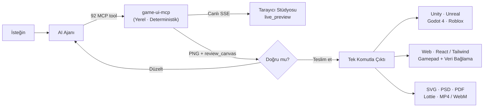
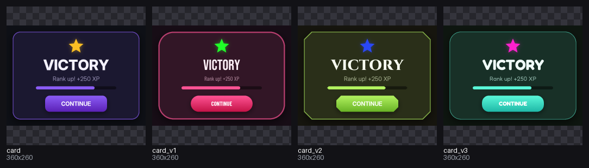

<div align="center">

[English](README.md) · **Türkçe**

# game-ui-mcp

### Yapay zekâ ajanları için açık kaynaklı, yerel tasarım, materyal, animasyon ve oyun motoru dışa aktarma MCP sunucusu.

**Oyun HUD'u, menü ya da uygulama ekranını anlat. Canlı izle. Abonelik, çağrı limiti ya da görsel üretim modeli olmadan motora hazır görseli, etkileşimli kodu ve videoyu al.**

[](https://github.com/TENETTE/game-ui-mcp/actions/workflows/tests.yml)
[](#toollar)
[](#materyaller)
[](#neye-çıktı-verir)
[-76b900?style=flat-square)](#performans)
[](LICENSE)

[Neden game-ui-mcp](#neden-game-ui-mcp) · [Hızlı başlangıç](#hızlı-başlangıç) · [Neye çıktı verir](#neye-çıktı-verir) · [Örnekler](#örnekler) · [Performans](#performans) · [Özellikler](#özellikler) · [Tool'lar](#toollar) · [SSS](#sss)

```bash
claude mcp add game-ui -s user -- uvx --from git+https://github.com/TENETTE/game-ui-mcp game-ui-mcp
```

<br />


</div>

---

## Neden game-ui-mcp?

Ücretli tasarım araçları yapay zekâ iş akışlarını kişi başı aboneliklerle, aylık MCP çağrı kotalarıyla, filigranlarla ya da bulut bağımlılığıyla kısıtlıyor. **game-ui-mcp**, yapay zekâ kodlama ve tasarım ajanları için sıfırdan kurulmuş **%100 yerel, MIT lisanslı** açık kaynak çözümdür:

- **Deterministik vektör ve Cook-Torrance PBR motoru:** Difüzyon halüsinasyonu yok, bozuk yazı yok, internete veri yüklenmez. Her piksel düzenlenebilir vektör şekillerden, HarfBuzz yazı motorundan, HDR stüdyo yansımalı ve ACES ton eşlemeli Cook-Torrance GGX PBR materyallerden ve keyframe izlerinden üretilir.
- **Kapalı görsel geri bildirim döngüsü:** Ajan çizer, `preview` ile kendi çıktısına bakar, `review_canvas` ile kontrast/hizalama/taşma denetimi yapar, hataları düzeltir; sen de `live_preview` ile tarayıcıda her adımı canlı izlersin.
- **Tek canvas → her hedef:** Aynı tasarım Unity (UI Toolkit ve uGUI), Unreal, Godot 4 ve Roblox için sahne + kontrol betiği + 9-slice sprite olarak çıkar; ayrıca düzenlenebilir SVG, RLE sıkıştırmalı katmanlı PSD, vektör PDF, Lottie, MP4/WebM, web sitesi ve canlı veri bağlı + gamepad destekli React (CSS veya Tailwind) üretir.

### Ücretli araçlarla karşılaştırma

| Özellik | **game-ui-mcp** | Figma + MCP | Pencil (`pen.dev`) | Rive | Envy UI |
| --- | :---: | :---: | :---: | :---: | :---: |
| **Fiyat ve lisans** | **\$0 · MIT Açık Kaynak** | \$16–\$90/kişi/ay | \$16–\$48/ay | \$9–\$120/ay (ücretsizde splash) | Ücretli masaüstü |
| **MCP çağrı limiti** | **Sınırsız · Yerel** | Kotalı (ücretsiz 20/ay, Pro 200/gün) | Ücretsiz 5 ajan-günü/ay | CLI yayın kotası | — |
| **%100 çevrimdışı çalışma** | ✅ | ❌ Bulut | ✅ | ❌ Bulut editör | ✅ |
| **Git içinde proje dosyaları** | ✅ Otomatik `.gameui/` | ❌ | ✅ `.pen` | ❌ Kapalı `.riv` | ✅ |
| **Canlı tarayıcı önizlemesi** | ✅ `live_preview` (SSE) | ✅ | ✅ | ✅ | ✅ |
| **Unity / Unreal / Godot / Roblox** | ✅ 4 motor + controller + yerel bileşenler | ❌ Elle kurulum | ❌ Web/HTML | Kısmi (eklenti runtime) | Godot / Unity / Web |
| **C# .NET (WPF/Avalonia/WinUI) & C++ (Qt/ImGui)** | ✅ Yerel XAML / QML / ImGui + ViewModel | ❌ | ❌ | ❌ | ❌ |
| **Cook-Torrance GGX PBR + Özel HDRI** | ✅ 39 hazır + `.hdr` / `.exr` IBL | ❌ | Kısıtlı | ❌ | ❌ |
| **Motor PBR Haritaları (Normal/ORM/CanvasTexture)** | ✅ `export_pbr_maps` | ❌ | ❌ | ❌ | ❌ |
| **Parametrik AAA Çerçeveler (`add_frame`)** | ✅ 9 stil (filigran/perçin/kalkan) | ❌ | ❌ | ❌ | ❌ |
| **Ekran Görüntüsünden Canvas (`import_screenshot`)** | ✅ OpenCV kontur/palet + isteğe bağlı OCR | ❌ | ❌ | ❌ | ❌ |
| **Veri bağlama ve dotLottie v2 durum makinesi** | ✅ `set_binding` + `set_interaction` + `.lottie` v2 | Yalnızca değişken | Yalnızca değişken | ✅ | ✅ |
| **Yerel Scroll & Input bileşenleri** | ✅ Canvas + Web/React + Motorlar + Masaüstü | Yalnız tasarım | Kısmi | ❌ | Kısmi |
| **Web & React (TSX / Tailwind) + Gamepad** | ✅ | Code Connect ile | HTML/kod | Web runtime | Web runtime |
| **SVG / PSD / PDF / dotLottie v2 / MP4 / Atlas** | ✅ Hepsi yerleşik | SVG / PDF | Kısmi | `.riv` | — |

---

## Hızlı başlangıç

[uv](https://docs.astral.sh/uv/) kurulu olsun (`winget install astral-sh.uv`, `brew install uv` ya da `pip install uv`). İlk açılış bağımlılıkları ~30 saniyede indirir.

### Tüm AI IDE'leri İçin Tek Komutla Kurulum (OpenCode, Claude Code, VS Code, Visual Studio, Antigravity, Cursor, Windsurf, ChatGPT)

GPU mimarini otomatik algıla (`nvidia` / `amd` / `intel` / `apple` / `cpu`) ve kullandığın IDE'yi tek komutla yapılandır:

```bash
# GPU, aktif arka uç ve kurulu araçları denetle
uvx --from git+https://github.com/TENETTE/game-ui-mcp game-ui-mcp doctor

# IDE yapılandırmasını otomatik yaz (mevcut diğer MCP sunucularını koruyarak birleştirir)
uvx --from git+https://github.com/TENETTE/game-ui-mcp game-ui-mcp setup opencode --write
uvx --from git+https://github.com/TENETTE/game-ui-mcp game-ui-mcp setup claude --write
uvx --from git+https://github.com/TENETTE/game-ui-mcp game-ui-mcp setup visualstudio --write
uvx --from git+https://github.com/TENETTE/game-ui-mcp game-ui-mcp setup vscode --scope project --write
uvx --from git+https://github.com/TENETTE/game-ui-mcp game-ui-mcp setup antigravity --write
uvx --from git+https://github.com/TENETTE/game-ui-mcp game-ui-mcp setup cursor --write

# ChatGPT (Streamable HTTP MCP sunucusu)
uvx --from git+https://github.com/TENETTE/game-ui-mcp game-ui-mcp serve --transport http --port 8765
```

Elle yapılandırma örnekleri için [`configs/README.md`](configs/README.md), güncel 2026 motor/API uyumluluk matrisi için [`docs/COMPATIBILITY.md`](docs/COMPATIBILITY.md) dosyasına bak.

### GPU Mimarisine Göre Ayrı Kurulum (Gereksiz Paket Tekrarı Olmadan)

| GPU Mimarisi | Kurulum Eki | Kullanılan Arka Uç |
| --- | --- | --- |
| **NVIDIA (CUDA 12 + WebGPU)** | `game-ui-mcp[nvidia]` (veya `[gpu]`) | Birleşik CuPy CUDA 12 + `wgpu` yedek |
| **AMD (Vulkan / DirectX 12)** | `game-ui-mcp[amd]` | Ortak taşınabilir `wgpu` WGSL compute |
| **Intel Arc / Xe (Vulkan / D3D12)** | `game-ui-mcp[intel]` | Ortak taşınabilir `wgpu` WGSL compute |
| **Apple Silicon (Metal)** | `game-ui-mcp[apple]` | Ortak taşınabilir `wgpu` WGSL compute |
| **Yalnızca CPU (Evrensel)** | `game-ui-mcp` (varsayılan / `[cpu]`) | OpenCV C++ SIMD + NumPy (0 GPU bağımlılığı) |

### Seçilebilir Kalite Seviyeleri ve Tasarım Stilleri

Her çıktı AAA veya aşırı detaylı olmak zorunda değil. Proje (`set_theme`) veya tek canvas (`update_canvas`) bazında kalite ve stil seçilebilir:
- **4 Kalite Seviyesi (`quality`):** `"simple"` (düz/temiz gölgeleme, 0 gren, sade çerçeve, 2× SS), `"standard"` (dengeli bevel/detay, 3× SS), `"advanced"` (tam Cook-Torrance PBR + zengin süsleme, 4× SS), `"aaa"` (derin mikro-pah, belirgin kenar aşınması, tam süsleme, 4× SS).
- **9 Stil Profili (`style_preset`):** `"kids"`, `"cartoon"`, `"stylized"`, `"minimal"`, `"web_saas"`, `"scifi"`, `"dark_fantasy"`, `"realistic"`, `"photorealistic"` — renk paleti, köşe/boşluk token'ları, isimlendirilmiş stiller, stüdyo ışığı ve otomatik çerçeve stilini (`add_frame(preset="auto")`) tek çağrıda kurar.

### Claude Code

```bash
claude mcp add game-ui -s user -- uvx --from git+https://github.com/TENETTE/game-ui-mcp game-ui-mcp
```

### Cursor, Windsurf, Claude Desktop, Antigravity ve diğer MCP istemcileri

MCP ayar dosyana ekle (VS Code `.vscode/mcp.json` içinde `"mcpServers"` yerine `"servers"` kullanılır):

```json
{
  "mcpServers": {
    "game-ui": {
      "command": "uvx",
      "args": ["--from", "git+https://github.com/TENETTE/game-ui-mcp", "game-ui-mcp"]
    }
  }
}
```

Kaydettikten sonra istemciyi yeniden başlat.

<details>
<summary><strong>İsteğe bağlı ekler: NVIDIA GPU (CUDA), Video (ffmpeg), Git-yerel modu ve Skill</strong></summary>

- **Çapraz GPU WebGPU hızlandırması (`[wgpu]`):** `wgpu-py` (Vulkan / DirectX 12 / Metal) üzerinden shader'ları ve Cook-Torrance PBR'ı standart WGSL `@compute` olarak çalıştırır (RTX 4060 Ti Vulkan'da shader'da **32×**, PBR'da **7.1×** hızlanma). `GAME_UI_MCP_GPU=wgpu|cuda|cpu|auto` ile seçilir. *(Not: NVIDIA RTX 4060 Ti Vulkan/D3D12 üzerinde fiziksel test edildi; AMD, Intel ve Apple Silicon Metal standart WGSL ile mimari olarak hedeflendi ancak o donanımlarda fiziksel test edilmedi.)*
  ```bash
  uvx --from "game-ui-mcp[wgpu] @ git+https://github.com/TENETTE/game-ui-mcp" game-ui-mcp
  ```
- **NVIDIA GPU hızlandırması (`[gpu]`):** Shader ve materyalleri CuPy + CUDA 12 ile tek bir birleşik CUDA C++ çekirdeğine derler (~1 GB indirir; RTX 4060 Ti'de **130× daha hızlı** GPU shader). CUDA yoksa aynı sonuçla WebGPU veya CPU'ya döner. Kapatmak için `GAME_UI_MCP_GPU=0`.
  ```bash
  claude mcp add game-ui -s user -- uvx --from "game-ui-mcp[gpu] @ git+https://github.com/TENETTE/game-ui-mcp" game-ui-mcp
  ```
- **MP4 / WebM video (`[video]`):** PATH'teki `ffmpeg`'i kullanır (`winget install ffmpeg`, `brew install ffmpeg`); yoksa `[video]` eki bir tane kurar.
- **Git-yerel proje modu:** Proje kökünde `.gameui/` klasörü açtığında server tasarım dosyalarını kodun yanında, sıralı ve Git diff dostu JSON olarak tutar (yoksa `~/GameUI` veya `GAME_UI_MCP_DIR` kullanılır).
- **Ajan Skill'i:** [`skill/game-ui-mcp/SKILL.md`](skill/game-ui-mcp/SKILL.md) ajana işin inceliklerini öğretir (katman sırası, 2.5B ışık, 9-slice, animasyon zamanlaması, kontrol turu, motora teslim). Claude Code'da `~/.claude/skills/` altına kopyala.

</details>

### İlk deneme istemleri

```text
Canlı izlemem için live_preview başlat. liquid_glass panelli bir bilim kurgu ana menüsü
tasarla: hover/press durumlu ve tıklama SFX'li dört buton, oyuncu seviye değişkeni bağla,
denetle, sonra Tailwind React ve Unity UI Toolkit sahnesi + controller olarak ver.
```

Başka fikirler:
- *"Yarış oyunu için `radial_metal` ve `carbon_twill` kullanan devir saati çiz, ibreyi canlandır ve ayrı katmanlar olarak dışa aktar."*
- *"`hp / max_hp` değişkenine bağlı, %25 altında kırmızıya dönen bir RPG can barı yap; %80 ve %15 değerleriyle önizle, sonra Godot 4 sahnesi ve controller betiğiyle ver."*
- *"Bu zafer ekranı için `make_variations` ile üç farklı yön göster, sonra ikincisini geliştir."*
- *"`hammered_gold`, dikişli `leather` ve `aged_parchment` ile ortaçağ envanter paneli yap."*
- *"Bu HUD'u Arapça ve Japoncaya çevir, `review_canvas` ile taşma kontrolü yap."*

### Güncelle

```bash
uv cache clean game-ui-mcp
```

---

## Nasıl çalışır



---

## Neye çıktı verir

| Hedef | Ne alırsın | Tool'lar |
| --- | --- | --- |
| **Unity** | 9-slice sprite + `GameUiImporter.cs`, UI Toolkit (`.uxml` + `.uss` + `Controller.cs`), **uGUI Canvas/RectTransform oluşturucu** (`unity-ugui`), C# token'ları | `export_asset`, `export_screen`, `write_engine_helpers` |
| **Godot 4** | `.tscn` sahne + `_controller.gd` (veri bağlama, SFX sinyali, gamepad `focus_neighbor_*`), `StyleBoxTexture .tres`, GDScript token'ları | `export_screen`, `export_asset`, `write_engine_helpers` |
| **Unreal Engine** | Margin'li Box brush, otomatik Python editör içe aktarma betiği | `export_asset`, `write_engine_helpers` |
| **Roblox** | `LocalScript` ScreenGui oluşturucu, `SliceCenter` / `SliceScale`, `GameUiAssets.luau`, Luau token'ları | `export_screen`, `export_asset`, `write_engine_helpers` |
| **C# / .NET Masaüstü** | **WPF** (.NET Framework 4.8 & .NET 8/9 için `.xaml` + `.xaml.cs` + `INotifyPropertyChanged` ViewModel), **Avalonia** (`.axaml`), **WinUI 3** (`.xaml`); yerel `TextBox`/`PasswordBox`/`ScrollViewer` | `export_screen` |
| **C++ Masaüstü ve Araçlar** | **Qt 6 Quick** (`TextField`, `ScrollView`, sinyal/özellikli `.qml`), **Dear ImGui** (tek başlıklı C++17 `_ui.hpp`, `State` struct, `InputTextWithHint`, `BeginChild`) | `export_screen` |
| **Motor PBR Haritaları** | **Albedo, Tangent Normal (OpenGL & DirectX), Roughness, Metallic, AO, Height, ORM paketli + Godot 4 `CanvasTexture .tres`** (gerçek zamanlı motor ışığıyla canlı UI aydınlatma) | `export_pbr_maps` |
| **React & TypeScript** | `<Ekran>.jsx` veya tipli **`<Ekran>.tsx`**, CSS veya **Tailwind sınıfları**, canlı `<input>` / kaydırılabilir listeler, `data` prop bağlama, `onNavigate` / `onSfx`, klavye ve **Gamepad API** gezinme | `export_react` |
| **Web ve Prototip** | Gerçek seçilebilir yazılı responsive HTML/CSS, canlı giriş kutuları ve kaydırma alanları, linkler, üst pencereler, View Transitions, `window.gameuiSetData()`, gamepad odağı | `export_web`, `export_prototype` |
| **Hareket ve Video** | **dotLottie v2 (`.lottie` çoklu animasyon + etkileşimli Durum Makinesi ZIP)**, vektör Lottie JSON, H.264 MP4 / saydam VP9 WebM (akışlı), sprite sheet, GIF / APNG / WebP, DOTween ve Roblox ease JSON | `export_animation`, `export_layers` |
| **Atlas, Tasarım ve Baskı** | **TexturePacker / Godot `AtlasTexture` / Unity / CSS sprite atlasları**, düzenlenebilir SVG, PackBits RLE PSD, vektör PDF, iOS/Android/Web setleri, ICO, BMFont | `export_atlas`, `export_svg`, `export_psd`, `export_pdf`, `export_png`, `export_bitmap_font` |
| **Tasarım Sistemi** | Geliştirici ölçü dökümü, W3C DTCG JSON, CSS/USS/C#/GDScript/Luau token'ları, **`DESIGN.md`** | `export_spec`, `export_theme` |

---

## Örnekler

Aşağıdaki her görsel ve animasyon doğrudan `game-ui-mcp` tarafından çizildi (`python examples/run_all.py` hepsini yeniden üretir).

### Materyaller

Lineer-HDR **Cook-Torrance GGX PBR**, çift loblu specular, kenar aşınması (`wear`), 5 HDR stüdyo çadırı (`bright`, `warm`, `dark`, `sunset`, `cyberpunk`) + isteğe bağlı özel `.hdr`/`.png` çevre haritası (`env_map`), OpenCV SIMD SDF pahları, clearcoat vernik, doğrusal ve radyal anizotropik metal, yüzey altı saçılım (SSS), kenar AO, HDR ışıma ve ACES filmic ton eşlemeyle **39 hazır fotogerçekçi materyal**.


### Gerçek Zamanlı Motor PBR Doku Haritaları (`export_pbr_maps`)

**Yalnızca game-ui-mcp'de:** Herhangi bir 2B UI rozetini, madalyonu, butonu veya çerçeveyi tek çağrıda **Albedo, Tangent Normal (OpenGL `+Y` / DirectX `-Y`), Roughness, Metallic, Ambient Occlusion, Height, ORM paketli ve Godot 4 `CanvasTexture .tres`** olarak dışa aktar; oyun motorunun gerçek ışıkları 2B arayüzünü canlı aydınlatsın.


### Parametrik AAA Çerçeveler (`add_frame`)

Tek tool çağrısıyla **9 stilde** (`rpg_gold`, `royal_ornate`, `fantasy_parchment`, `scifi_hud`, `cyber_tech`, `glass_card`, `medieval_iron`, `luxury_minimal`, `cartoon_thick`) kübik Bézier köşe filigranları, kanatlı mücevher armaları, dövme demir köşe tokaları, çevre perçinleri ve telemetri çentikleriyle %100 düzenlenebilir vektör + PBR çerçeveler kurar ve içerik için güvenli `inner_box` koordinatlarını döner.


### Bütün bir UI kiti

Tek token temasından buton, panel, bar, slot ve rozetler; `contact_sheet` ile yan yana kontrol.


### Gerçekçi yarış HUD'u

Koyu cam paneller, karbon ve fırçalı metal, çentikli devir saati, ibre ve LED sırası, sabit genişlikli rakamlarla telemetri.


### Tasarım varyasyonları

`make_variations` tek çağrıda alternatif palet, şekil ve tipografi yönlerini üretip yan yana dizer.



### Tek ekranda tasarım araçları

Kesin boolean şekiller, squircle yumuşatılmış köşe, dolgu yığını, satır atlayan canlı yerleşim, buzlu cam, tek kenar kontur, kırpılan yazı ve açık/koyu mod; aynı ekran [düzenlenebilir SVG](examples/design_tools.svg) olarak da çıkar.


### Animasyon

| Buton girişi + parlama | Devir saati | Menü girişi ve seçim |
| --- | --- | --- |
|  |  |  |

<details>
<summary><strong>Daha fazla örnek (ışık, katmanlar, gerçekçi kit, iş akışı, çoklu çözünürlük)</strong></summary>

**Işık ve gölgeleme**


**Kat kat boyama**


**Gerçekçi kit**


**Bileşen, durum, veri şablonları ve piksel sanat**


**Çoklu çözünürlük pin testi (16:9, 21:9, mobil)**


</details>

---

## Performans

CPU üzerinde **OpenCV C++ SIMD**, çapraz GPU'da **WebGPU WGSL (`wgpu-py`)** ve NVIDIA GPU üzerinde **Birleşik CUDA 12** ile hızlı ajan iterasyonları için optimize edildi (Windows, Python 3.12, NVIDIA GeForce RTX 4060 Ti ölçümleri):

| İş Yükü | CPU (OpenCV SIMD) | WebGPU (`wgpu` Vulkan) | CUDA 12 (`cupy`) | Öne Çıkanlar |
| --- | ---: | ---: | ---: | --- |
| `512×512` kesin Öklid SDF (`distance_field`) | **2.84 ms** | — | — | `cv2.distanceTransform` C++ SIMD (NumPy JFA'dan ~9× hızlı) |
| `512×512` shader (`fbm` + `ridged` + `voronoi`) | 150.2 ms | **4.64 ms** (32×) | **1.12 ms** (134×) | CPU / WebGPU / CUDA arasında bit-birebir `u32` hash (`max_diff < 1e-4`) |
| `512×512` Cook-Torrance GGX PBR + Studio IBL | 289.5 ms | **40.53 ms** (7.1×) | — | WGSL `@compute` BRDF + ACES Filmic shader |
| 18 Cook-Torrance PBR kartı (`1200×800`, cache) | 593 ms soğuk / **37.2 ms cache** | — | — | 128 MB LRU eleman render önbelleği + bbox kırpma |
| 21 kare `1280×720` HUD sprite sheet | **873 ms** | — | — | Statik katman ön-pişirme + paralel iş parçacıkları (4.7× hızlı) |

> **Donanım doğrulama notu:** Yukarıdaki GPU ölçümleri **NVIDIA GeForce RTX 4060 Ti** (CUDA 12 + Vulkan/D3D12 WebGPU) üzerinde fiziksel olarak doğrulandı. AMD, Intel ve Apple Silicon (Metal) GPU'lar standart WGSL (`wgpu-py`) ile mimari olarak hedeflendi, ancak o cihazlarda henüz fiziksel olarak test edilmedi.

Temel motor optimizasyonları:
- **OpenCV C++ SIMD:** Kesin L2 `distanceTransform`, Scharr normal gradyanları, `GaussianBlur`, morfolojik disk dilasyon/erozyon ve `remap` sıvı cam kırılması doğrudan AVX2/NEON C++ üzerinde çalışır.
- **Birleşik CUDA AST Derleyicisi:** Kum havuzlu shader AST'si GPU'da tek bir register-içi CUDA C++ çekirdeğine derlenir; CPU ve GPU arasında bit-birebir `uint32` gürültü hash'i kullanır.
- **Akıllı Bbox Kırpma ve Önbellekleme:** PBR ve shader'lar yalnızca eleman maskesi içinde çalışır (boş gölge payını atlar), katman stilleri eleman sınırına kırpılır, animasyonlarda statik katmanlar bir kez çizilir.
- **Düşük Bellekli G/Ç:** MP4/WebM kareleri doğrudan `ffmpeg` stdin'e akıtılır; PSD katmanları PackBits RLE sıkıştırmayla yazılır.

---

## Özellikler

- **Cook-Torrance GGX PBR Materyaller ve Shader'lar:** 39 hazır fotogerçekçi materyal (`chrome`, `gold`, `silver`, `bronze`, `copper`, `steel`, `iron`, `radial_metal`, `hammered_gold`, `rust`, `wood`, `stone`, `runic_stone`, `marble`, `obsidian`, `jade`, `gem`, `ruby`, `emerald`, `lava`, `ice`, `leather`, `paper`, `aged_parchment`, `fabric`, `carbon_twill`, `wax_seal`, `enamel`, `glass`, `liquid_glass`, `hologram`, `energy_shield`, `foil_holographic`, `neon`, `plastic`, `candy_gloss`, `clay_3d`, `rubber`, `jelly`), `style.pbr` fiziksel kontrolü (metallic, roughness, clearcoat, IOR, anisotropy, SSS, studio IBL, ACES), özel tema materyalleri, `d`/`edge` SDF girişli ve `height` kabartma çıkışlı shader dili ve canlandırılabilir `shine` parlaması.
- **Vektör Geometri:** Tam piksel merkezli scanline rasterizer (4× supersampling), squircle yumuşatılmış köşe, kesik köşe, elips, çokgen/yıldız, incelen/dalgalı/oklu çizgiler, yay, gösterge çentikleri, SVG içe aktarma, kesin `pyclipper` boolean, offset/outline/flatten/simplify, diziler, serpiştirme ve `vectorize_image`.
- **Veri Bağlama ve Durum Makinesi:** Bar genişliği, renk, görünürlük ve `{yer_tutucu}` metinlerini süren `set_binding` değişkenleri ve güvenli ifadeler; `sfx` ses olayı destekli `set_interaction` kuralları; Web/React'te ok tuşları + Web Gamepad API odağı ve Unity/Godot/Roblox için hazır controller betikleri.
- **Canlı Önizleme Stüdyosu:** `live_preview("start")` her değişiklikte otomatik yenilenen, ID/kılavuz/zemin geçişli ve koordinat göstergeli sıfır bağımlılıklı yerel (`127.0.0.1`) SSE tarayıcı stüdyosu açar.
- **Tipografi ve Çoklu Dil:** 10 gömülü OFL font + sistem/kullanıcı fontları, Arapça/İbranice/Hint/Tayca/CJK için HarfBuzz + BiDi şekillendirme ve otomatik Noto yedekleme, renkli emoji, OpenType özellikleri, değişken eksenler, yay/yol üstünde yazı, dil tabloları ve sahte yerelleştirme.
- **Yerleşim, Tasarım Sistemi ve Öz Denetim:** Canlı Flex/Grid otomatik yerleşim, ekran kenarına sabitleme, güvenli alanlı cihaz hazırları, OKLCH WCAG paletleri (`make_palette`), açık/koyu/takım modları, W3C DTCG ve `DESIGN.md`, `review_canvas` tasarım denetimi, renk körlüğü simülasyonu ve sürüm geçmişi.

---

## Tool'lar

<details>
<summary><strong>92 MCP tool'unun hepsi (+ 3 MCP Kaynağı & 3 İş Akışı Prompt'u)</strong></summary>

| Grup | Tool'lar |
| --- | --- |
| **Canvas** | `create_canvas`, `list_canvases`, `get_canvas`, `update_canvas`, `duplicate_canvas`, `delete_canvas`, `fit_canvas`, `resize_canvas`, `canvas_version` |
| **Katmanlar** | `create_layer`, `update_layer`, `delete_layer`, `set_layer` |
| **Çizim, Çerçeve & Bileşen** | `add_rect`, `add_ellipse`, `add_line`, `add_polygon`, `add_path`, `add_arc`, `add_ticks`, `add_text`, `add_image`, `add_instance`, `add_svg`, **`add_frame`**, **`add_input`**, **`add_scroll`**, **`import_screenshot`** |
| **Düzenleme** | `update_element`, `delete_elements`, `duplicate_element`, `boolean_elements`, `path_ops`, `restyle`, `find_elements`, `vectorize_image`, `move_elements`, `reorder_element`, `align_elements`, `arrange_elements`, `scatter`, `copy_elements`, `set_pin`, `batch`, `undo`, `redo` |
| **Veri, durum ve dil** | `set_binding`, `set_state`, `delete_state`, `generate_from_template`, `set_strings`, `get_strings` |
| **Denetim ve Canlı Stüdyo** | `live_preview`, `review_canvas`, `inspect_pixels`, `view_image`, `preview_nine_slice` |
| **Animasyon** | `create_animation`, `set_keyframes`, `delete_keyframes`, `get_animations`, `delete_animation`, `preview_animation`, `export_animation` |
| **Tema ve bilgi** | `set_theme`, `get_theme`, `make_palette`, `list_fonts`, `measure_text`, `guide` |
| **Önizleme ve keşif** | `preview`, `preview_resolutions`, `contact_sheet`, `make_variations` |
| **Dışa aktarma** | `export_png`, `export_svg`, `export_pdf`, `export_web`, `export_react`, `export_asset`, **`export_pbr_maps`**, `export_layers`, `export_psd`, `export_atlas`, `export_bitmap_font`, `write_engine_helpers` |
| **Teslim ve Motorlar** | `export_spec`, `export_theme`, `set_link`, `set_interaction`, `export_prototype`, `export_screen` |

Salt okunur tool'lar `readOnlyHint=True`, silme tool'ları `destructiveHint=True` olarak işaretlidir. Yerleşik MCP Kaynakları (`gameui://materials`, `gameui://workspace`, `gameui://guide/{topic}`) ve Prompt'lar (`design_game_hud`, `design_rpg_panel`, `audit_and_polish`) ajanların hatasız çalışmasını sağlar (talimatlar ~2k karakter). Lisans ve gömülü font atıfları için [THIRD_PARTY_LICENSES.md](THIRD_PARTY_LICENSES.md).

</details>

---

## Güvenlik

- **Çevrimdışı tasarım:** Dışarıya ağ çağrısı yapmaz. `live_preview` yalnızca `127.0.0.1` üzerine bağlanır.
- **Kum havuzlu formüller:** Hem `shader.py` hem `binding.py` AST beyaz listesi uygular (import, öznitelik, döngü yok) ve çalışmadan önce iş/piksel bütçesini denetler.
- **Enjeksiyona karşı korumalı motor çıktısı:** Motor yolları ve asset ID'leri izin listesinden geçer; üretilen betikler diske yazılır, asla çalıştırılmaz; SVG `DOCTYPE` / `ENTITY` bildirimleri reddedilir.

Güvenlik açıklarını [SECURITY.md](SECURITY.md) üzerinden gizlice bildir.

---

## SSS

<details>
<summary><strong>Hangi yapay zekâ istemcileri destekleniyor?</strong></summary>

Yerel MCP sunucusu destekleyen her istemci: Claude Code, Claude Desktop, Cursor, Windsurf, VS Code, Antigravity, Goose, Codex ve özel ajanlar.

</details>

<details>
<summary><strong>Görsel üreten bir yapay zekâ modeli kullanıyor mu?</strong></summary>

Hayır. Her öğe yerel olarak çizilen deterministik vektör şekillerden, shader'lardan, ışıktan ve tipografiden oluşur. Hazır illüstrasyon veya karakter portresi gerekiyorsa `add_image` ile (kırpma, arka plan silme, kaydırma/yakınlaştırma ve sprite sheet oynatma desteğiyle) yerleştirebilirsin.

</details>

<details>
<summary><strong>Proje dosyalarım nerede saklanıyor?</strong></summary>

Çalışma dizininde `.gameui/` klasörü varsa otomatik onu kullanır (Git ile sürümlemek için ideal). Yoksa `~/GameUI` (veya `GAME_UI_MCP_DIR`) kullanılır. `<workspace>/fonts/` içine bırakılan `.ttf`/`.otf` fontlar otomatik tanınır.

</details>

<details>
<summary><strong>92 tool bağlam penceresinde ne kadar yer kaplar?</strong></summary>

Tool şemaları özdür; uzun referanslar sunucu talimatları yerine `guide(topic)` ve MCP Kaynakları arkasında durur (~2.0k karakter). Tool'ları gerektikçe yükleyen istemciler (Claude Code, Antigravity) çok düşük bağlam maliyeti öder.

</details>

---

## Belgeler ve Katkı

- **[docs/GUIDE.md](docs/GUIDE.md)** — Tüm özellik, stil, animasyon ve motor referansı
- **[skill/game-ui-mcp/SKILL.md](skill/game-ui-mcp/SKILL.md)** — Ajan tasarım kılavuzu (Skill)
- **[THIRD_PARTY_LICENSES.md](THIRD_PARTY_LICENSES.md)** — Bağımlılık ve gömülü SIL OFL-1.1 font lisans dökümü
- **[CHANGELOG.md](CHANGELOG.md)** — Sürüm geçmişi

```bash
git clone https://github.com/TENETTE/game-ui-mcp
cd game-ui-mcp
uv venv && uv pip install -e ".[dev]"
uv run pytest
```

`python examples/run_all.py` bu sayfadaki tüm örnek görselleri yeniden üretir. Issue ve PR'lara açığız — bkz. [CONTRIBUTING.md](CONTRIBUTING.md).

## Lisans

[MIT](LICENSE) — ticari kullanım dahil tamamen serbesttir. Gömülü fontlar SIL OFL-1.1 lisanslıdır (her font klasöründe `OFL.txt`); tam lisans denetimi için [THIRD_PARTY_LICENSES.md](THIRD_PARTY_LICENSES.md). Bununla ürettiğin her şey senindir.

Figma, Penpot, Pencil, Rive, Envy, Unity, Unreal Engine, Godot, Roblox, Photoshop, Illustrator, Inkscape, React, Tailwind CSS ve adı geçen diğer ürünler sahiplerinin markalarıdır. Bu proje bağımsızdır ve onlarla bağlantılı değildir.
