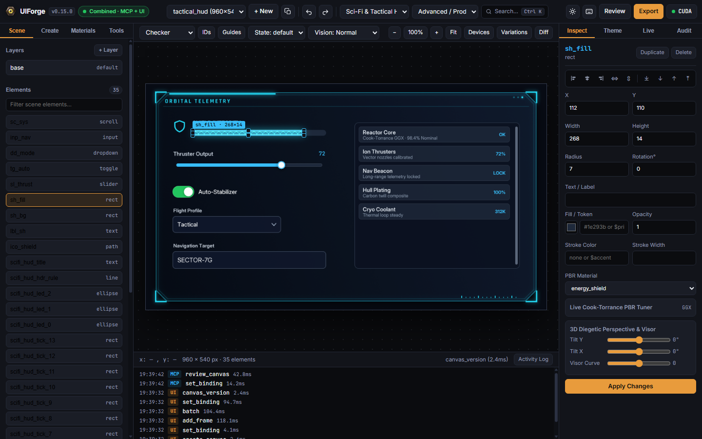
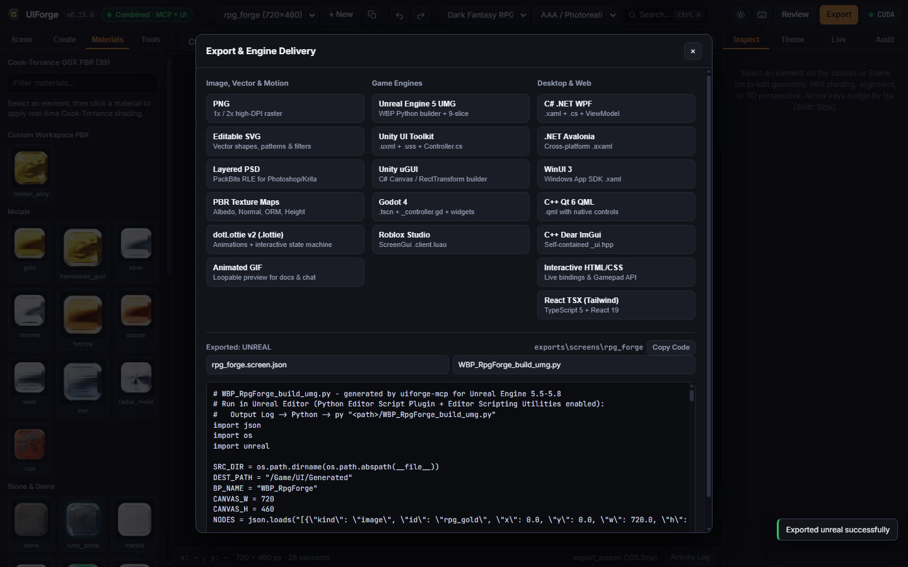

<div align="center">

[English](README.md) · **Türkçe**

<a href="#hızlı-başlangıç">
  
</a>

<br />

**%100 yerel, MIT lisanslı UI tasarım stüdyosu ve MCP sunucusu — bağımsız Studio UI ile kendi başına çalış, dilediğin MCP yapay zekâ istemcisini bağla ya da ikisini canlı ortak kullan.**

<p>
  <a href="https://pypi.org/project/uiforge-mcp/"></a>
  <a href="https://github.com/TENETTE/uiforge-mcp/actions/workflows/tests.yml"></a>
  <a href="pyproject.toml"></a>
  <a href="#üç-çalışma-modu"></a>
  <a href="LICENSE"></a>
</p>

<p>
  <a href="#hızlı-başlangıç">Hızlı Başlangıç</a> ·
  <a href="#üç-çalışma-modu">Üç Mod</a> ·
  <a href="#öne-çıkanlar">Öne Çıkanlar</a> ·
  <a href="#çıktı-hedefleri">Çıktılar</a> ·
  <a href="#performans">Performans</a> ·
  <a href="docs/SHOWCASES.md">Örnek Galerisi</a> ·
  <a href="configs/README.md">IDE Kurulumu</a>
</p>

</div>

---

## Hızlı Başlangıç

Python **3.10+** ve [uv](https://docs.astral.sh/uv/) (veya `pip`) yeterlidir. Abonelik yok, bulut çağrısı yok, difüzyon halüsinasyonu yok.

```bash
# 1. Human Mode — bağımsız Studio UI'ı aç (MCP istemcisi veya AI IDE gerekmez)
uvx --from uiforge-mcp uiforge
uvx --from uiforge-mcp uiforge ui --app   # çerçevesiz masaüstü penceresi

# 2. Combined Mode — Studio UI + MCP sunucusu aynı çalışma alanında canlı senkron
uvx --from uiforge-mcp uiforge combined

# 3. MCP Mode — dilediğin AI istemcisini tek komutla yapılandır (opencode, claude, codex, vscode, visualstudio, antigravity, cursor, windsurf)
uvx uiforge-mcp setup claude --write
```

<details>
<summary>Kalıcı kurulum, GPU hızlandırma ekleri ve token tasarruflu MCP toolset'leri</summary>

```bash
pip install uiforge-mcp

# İsteğe bağlı GPU hızlandırma ve masaüstü pencere ekleri
pip install "uiforge-mcp[nvidia]"   # CUDA 12 + WebGPU
pip install "uiforge-mcp[wgpu]"     # AMD / Intel / Apple Metal
pip install "uiforge-mcp[desktop]"  # pywebview yerel pencere

# MCP tool listesi token kullanımını %77'ye kadar azalt
uiforge-mcp mcp --toolset game --compact   # core | game | desktop | web | full
```

</details>

<br />



---

## Üç Çalışma Modu

Üç mod da **birebir aynı MCP'den bağımsız çekirdek motoru** (`core.py` + `store.py`) ve aynı `.uiforge/` (veya `~/UIForge`) çalışma alanını atomik JSON eşitlemeyle (`mkstemp` + `fsync` + `os.replace`) paylaşır.

| Mod | Komut | Ne Yapar | MCP Gerekli mi? |
| --- | --- | --- | :---: |
| **Human Mode** | `uiforge` / `uiforge ui --app` | Tarayıcıda veya çerçevesiz masaüstü penceresinde bağımsız Studio UI — `mcp` paketi olmadan bile çalışır | **Hayır** |
| **MCP Mode** | `uiforge-mcp` (`stdio` / `http`) | OpenCode, Claude Code, Codex, VS Code, Visual Studio, Antigravity, Cursor, Windsurf ve ChatGPT için MCP sunucusu | Evet |
| **Combined Mode** | `uiforge combined` | İnsan Studio UI + MCP sunucusu **aynı projede eş zamanlı** çalışır (canlı SSE, RLock ve ortak işlem günlüğü) | İsteğe bağlı |

---

## Öne Çıkanlar

- **Deterministik Vektör + Cook-Torrance GGX PBR:** 39 hazır materyal, özel `.hdr`/`.exr` IBL, canlı PBR ayar paneli ve özel materyal kaydetme, HarfBuzz BiDi/Hintçe tipografi ve 3B kavisli visor perspektifi.
- **Tam Özellikli Studio UI:** 3 hazır başlangıç şablonu, 8 noktalı boyutlandırma tutamakları, manyetik hizalama çizgileri, `Shift+Tık` çoklu seçim, satır içi metin düzenleme, `Ctrl+K` Komut Paleti, Koyu/Açık tema, Renk Körlüğü & Pseudo-Loc simülatörü, Çoklu Cihaz Matrisi, CSS/Tailwind/shadcn token içe aktarıcı ve WCAG kontrast denetimi.
- **100 Çekirdek İşlem + 142 Saf MIT Vektör İkon + 9 AAA Çerçeve:** Yerel `input`, `scroll`, `slider`, `toggle` ve `dropdown` bileşenleri, kompozit `add_button` / `add_progress_bar` / `add_stack`, `in: "<frame>.inner_box"` yerleşimi, `import_screenshot` v2 ve piksel `visual_diff`.

<table>
  <tr>
    <td width="50%" valign="top">
      <br />
      <strong>Cook-Torrance PBR Atölyesi &amp; 142 Vektör İkon</strong>
    </td>
    <td width="50%" valign="top">
      <br />
      <strong>Tek Tıkla Motor Teslimi &amp; Dahili Kod İnceleyici</strong>
    </td>
  </tr>
  <tr>
    <td width="50%" valign="top">
      <br />
      <strong>39 Hazır Cook-Torrance GGX Materyali</strong>
    </td>
    <td width="50%" valign="top">
      <br />
      <strong>9 Düzenlenebilir Parametrik AAA Çerçeve</strong>
    </td>
  </tr>
</table>

> **Daha fazlası:** [Tüm Örnek Galerisi (`docs/SHOWCASES.md`)](docs/SHOWCASES.md) — Studio karşılama ekranı, dar ekran görünümü, PBR Normal/ORM haritaları, yarış HUD'u, animasyonlar ve 100 aracın tam listesi.

---

## Çıktı Hedefleri

| Kategori | Desteklenen Çıktılar |
| --- | --- |
| **Oyun Motorları** | **Unreal Engine 5.5–5.8** (UMG Python `WidgetBlueprint` oluşturucu), **Unity 6** (UI Toolkit + uGUI C#), **Godot 4** (`.tscn` + `_controller.gd` + `.tres`), **Roblox** (`ScreenGui .client.luau`) |
| **Masaüstü Uygulamaları** | **C# .NET** (`WPF` XAML + ViewModel, `Avalonia`, `WinUI 3`), **C++** (`Qt 6 QML`, tek başlıklı `Dear ImGui` C++17) |
| **Web ve Token'lar** | **React 19 TSX / Tailwind**, **HTML5/CSS3** prototipler (canlı bağlama + Gamepad API), W3C DTCG, `DESIGN.md`, CSS `:root` / Tailwind v4 `@theme` / shadcn içe aktarma |
| **Varlıklar ve PBR Haritalar** | Albedo / Tangent Normal (OpenGL & DirectX) / Roughness / Metallic / AO / Height / ORM, PNG, düzenlenebilir SVG, PackBits PSD, PDF, sprite atlasları, BMFont |
| **Hareket ve Video** | **dotLottie v2** (`.lottie` + etkileşimli Durum Makinesi), Lottie JSON, H.264 MP4 / VP9 WebM, GIF, APNG, WebP, sprite sheet |

---

## Performans

**Windows 11, Python 3.12, NVIDIA GeForce RTX 4060 Ti** üzerinde fiziksel olarak ölçüldü (`UIFORGE_MCP_GPU=cpu|wgpu|auto`; zorunlu GPU bağımlılığı yoktur):

| İş Yükü | CPU (OpenCV SIMD) | WebGPU (`wgpu` Vulkan) | Hibrit `auto` (CUDA + WebGPU) |
| --- | ---: | ---: | ---: |
| `512×512` kesin Öklid SDF (`distance_field`) | **2.69 ms** | 2.69 ms *(CPU SIMD)* | 2.69 ms *(CPU SIMD)* |
| `512×512` prosedürel shader (`fbm` + `ridged` + `voronoi`) | 143.9 ms | **4.16 ms** (35×) | **1.13 ms** (127× CUDA) |
| `512×512` Cook-Torrance GGX PBR + Studio IBL | 283.5 ms | **38.1 ms** (7.4×) | **37.3 ms** (7.6×) |
| 18 Cook-Torrance PBR kartı (`1200×800`, soğuk / cache) | 531 ms / **7.8 ms** | 527 ms / **7.6 ms** | 572 ms / **7.5 ms** |
| 21 kare `1280×720` HUD sprite sheet | 4.23 sn | 4.06 sn | **2.95 sn** (1.4×) |

<sub>Donanım GPU ölçümleri NVIDIA RTX 4060 Ti üzerinde alındı. AMD, Intel ve Apple Silicon (Metal) taşınabilir WGSL (`wgpu-py`) ile hedeflenir — bkz. [`docs/COMPATIBILITY.md`](docs/COMPATIBILITY.md).</sub>

---

## Belgeler ve Lisans

- **[`docs/SHOWCASES.md`](docs/SHOWCASES.md)** — Studio UI, PBR, HUD, animasyon ve 100 aracın tam galerisi
- **[`configs/README.md`](configs/README.md)** — 9+ yapay zekâ istemcisi için çoklu mod ve MCP yapılandırmaları
- **[`docs/GUIDE.md`](docs/GUIDE.md)** — Tüm özellik, materyal ve motor kullanım kılavuzu
- **[`docs/COMPATIBILITY.md`](docs/COMPATIBILITY.md)** — Doğrulanmış işletim sistemi, motor, GPU ve istemci matrisi
- **[`skill/uiforge-mcp/SKILL.md`](skill/uiforge-mcp/SKILL.md)** · **[`llms.txt`](llms.txt)** — Sağlayıcıdan bağımsız AI tasarım kılavuzu ve dizin
- **[`SECURITY.md`](SECURITY.md)** · **[`CONTRIBUTING.md`](CONTRIBUTING.md)** · **[`THIRD_PARTY_LICENSES.md`](THIRD_PARTY_LICENSES.md)** · **[`CHANGELOG.md`](CHANGELOG.md)**

[MIT Lisansı](LICENSE) — ticari kullanım dahil tamamen serbesttir (gömülü 11 font SIL OFL-1.1 lisanslıdır). UIForge ile ürettiğin her şey senindir.
