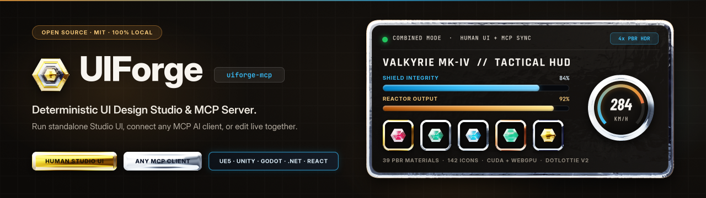
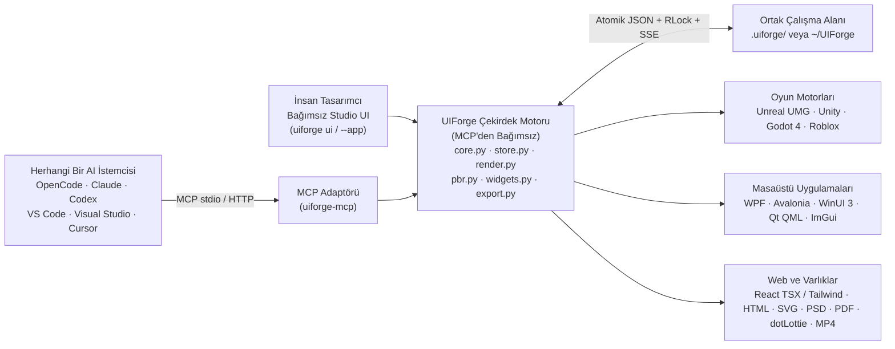
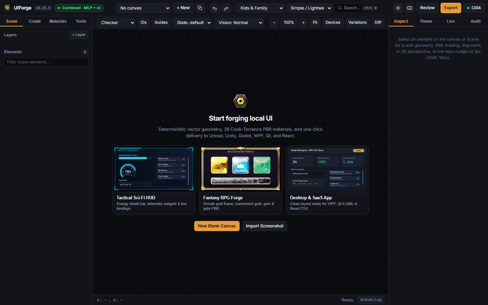
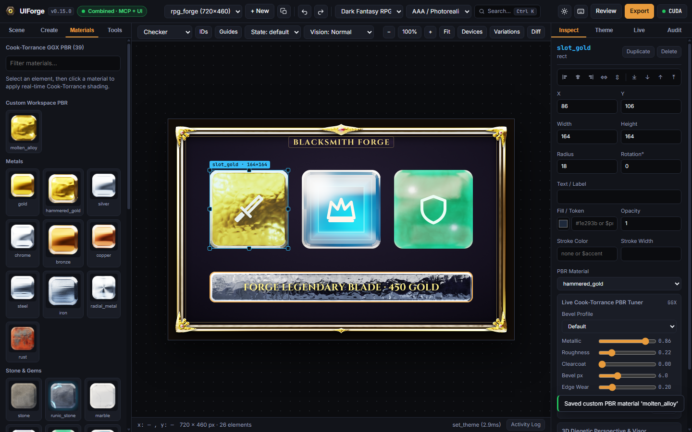
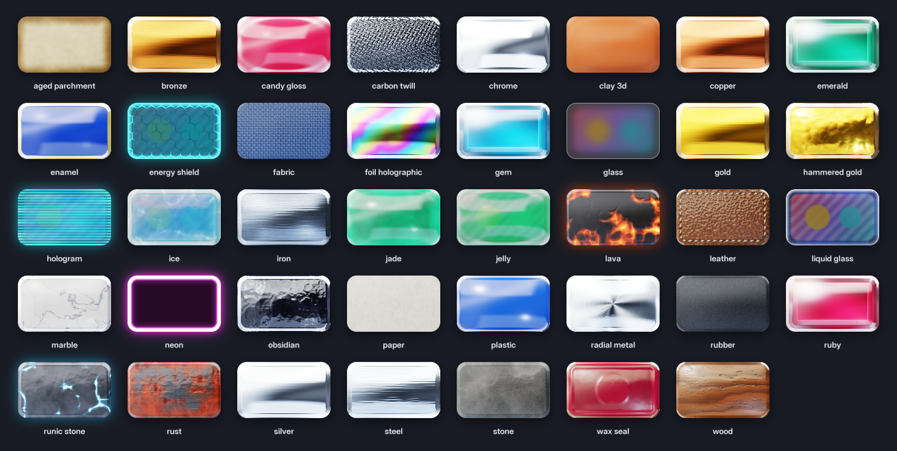
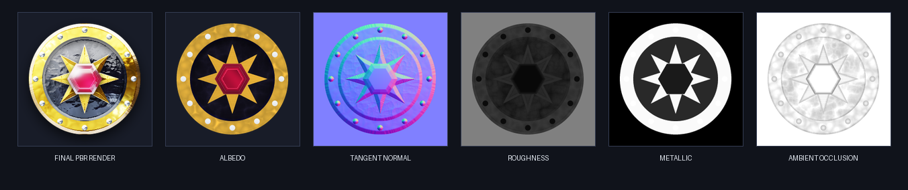
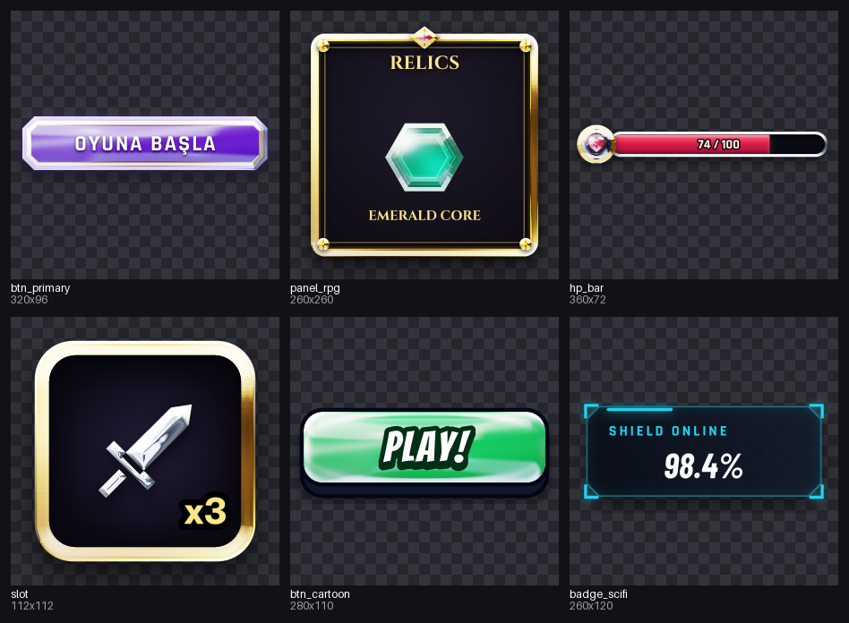
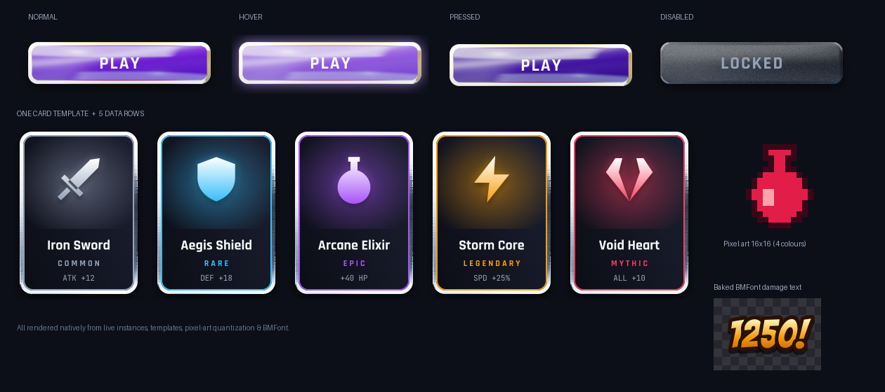

<div align="center">

[English](README.md) · **Türkçe**

<a href="#studio-ui-turu">
  
</a>

<br />

### İnsanlar, yapay zekâ ajanları veya ikisinin canlı ortak çalışması için %100 yerel, deterministik UI tasarım stüdyosu ve MCP sunucusu.

**Oyun HUD'ları, menüler, masaüstü uygulamalar ve web arayüzlerini doğrudan Studio UI'da tasarla, dilediğin MCP uyumlu yapay zekâ istemcisiyle yönet veya Combined Mode'da aynı projede eş zamanlı çalış — abonelik, çağrı limiti ve difüzyon halüsinasyonu olmadan.**

<p>
  <a href="https://github.com/TENETTE/uiforge-mcp/actions/workflows/tests.yml"></a>
  <a href="pyproject.toml"></a>
  <a href="#üç-çalışma-modu"></a>
  <a href="#araçlar-ve-yetenekler"></a>
  <a href="#performans-ve-gpu-arka-uçları"></a>
  <a href="LICENSE"></a>
</p>

<p>
  <a href="#neden-uiforge">Neden UIForge</a> ·
  <a href="#üç-çalışma-modu">Üç Çalışma Modu</a> ·
  <a href="#studio-ui-turu">Studio UI</a> ·
  <a href="#hızlı-başlangıç">Hızlı Başlangıç</a> ·
  <a href="#neye-çıktı-verir">Çıktı Hedefleri</a> ·
  <a href="#örnekler">Örnekler</a> ·
  <a href="#performans-ve-gpu-arka-uçları">Performans</a> ·
  <a href="#sss">SSS</a>
</p>

```bash
# Human Mode — bağımsız görsel Studio UI (MCP istemcisi veya AI IDE gerekmez)
uvx --from git+https://github.com/TENETTE/uiforge-mcp uiforge

# Combined Mode — Studio UI + MCP sunucusu aynı çalışma alanında canlı senkron
uvx --from git+https://github.com/TENETTE/uiforge-mcp uiforge combined
```

<br />


<sub><em>UIForge Studio yerel Combined Mode çalışırken — Cook-Torrance PBR sahnesi, 8 noktalı boyutlandırma tutamakları, canlı işlem günlüğü ve eş zamanlı MCP + UI senkronizasyonu.</em></sub>

</div>

---

## Neden UIForge?

Ücretli tasarım platformları arayüz üretimini kişi başı aboneliklerle, aylık MCP çağrı kotalarıyla, bulut bağımlılığıyla ya da yazıyı bozan difüzyon modelleriyle sınırlandırıyor. **UIForge (`uiforge-mcp`)**, hem **bağımsız görsel Studio arayüzü** hem de **Model Context Protocol (MCP)** üzerinden aynı **%100 yerel, MIT lisanslı, deterministik grafik ve kod üretim motorunu** sunar:

- **Kullanmak için MCP zorunlu değil:** Doğrudan kendi elinle tasarım yapmak, 39 PBR materyalini ve 142 vektör ikonu denemek, canlı veri bağlamalarını kaydırıcılarla test etmek ve tek tıkla oyun/masaüstü/web çıktısı almak için `uiforge` çalıştırman yeterli — AI IDE, API anahtarı veya çalışma zamanında `mcp` paketi gerekmez.
- **Sağlayıcıdan bağımsız evrensel MCP:** Bir yapay zekâ ajanıyla çalışmak istediğinde OpenCode, Claude Code, OpenAI Codex, VS Code, Visual Studio, Antigravity, Cursor, Windsurf, ChatGPT veya MCP destekleyen herhangi bir istemciyle `uiforge-mcp` doğrudan bağlanır.
- **Tek ortak çekirdek motor, sıfır kod tekrarı:** Human Studio UI ve MCP Mode **birebir aynı çekirdek işlemleri, render motorunu, PBR shader'larını, bileşen sistemini ve motor dışa aktarıcılarını** (`core.py` + `store.py`) kullanır. UI'da üretilen tasarım MCP'de, MCP'de üretilen tasarım UI'da birebir aynı kaliteyle açılır ve düzenlenir.
- **Deterministik vektör + Cook-Torrance GGX PBR:** Difüzyon halüsinasyonu yok, bozuk harf yok, dışarıya veri gönderilmez. Her piksel düzenlenebilir vektörlerden, HarfBuzz tipografisinden, `.hdr`/`.exr` IBL + ACES ton eşlemeli Cook-Torrance GGX PBR materyallerden ve keyframe animasyonlardan oluşur.

---

## Üç Çalışma Modu

İstediğin zaman modlar arasında geçiş yapabilirsin — üçü de aynı `.uiforge/` (veya `~/UIForge`) çalışma alanını kullanır:

| Mod | Komut | Kullanım Amacı | MCP / AI IDE Gerekli mi? |
| --- | --- | --- | :---: |
| **Human Mode (UI Mode)** | `uiforge` veya `uiforge ui` (çerçevesiz pencere için `--app`) | Doğrudan görsel tasarım, 39 PBR materyal ve 142 ikon, canlı PBR ayarı, WCAG/CVD denetimi ve tek tıkla motor çıktısı | **Hayır** |
| **MCP Mode** | `uiforge-mcp` veya `uiforge mcp` (`--transport stdio\|http`) | OpenCode, Claude Code, OpenAI Codex, VS Code, Visual Studio, Antigravity, Cursor, Windsurf ve ChatGPT gibi MCP istemcileriyle arayüzsüz çalışma | Evet |
| **Combined Mode (MCP + UI)** | `uiforge combined` veya `uiforge serve --mode combined` | İnsan ve yapay zekânın **aynı projede eş zamanlı çalışması**; canlı SSE güncellemesi, atomik disk eşitleme ve ortak `[MCP]` + `[UI]` işlem günlüğü | İsteğe bağlı (ayrı süreçler arasında da senkron) |

> **Süreçler arası (cross-process) senkronizasyon:** AI IDE'n `uiforge-mcp`'yi kendi başlatıp sen başka bir terminalde aynı çalışma alanında `uiforge ui` açsan bile, atomik yazım (`mkstemp` + `fsync` + `os.replace`) ve otomatik disk izleyici iki tarafı veri çakışması olmadan güncel tutar.

### Ortak Çekirdek Mimarisi



<details>
<summary><strong>Depo yapısı ve temel modüller</strong></summary>

```text
uiforge-mcp/
├── src/uiforge_mcp/            # Ana Python paketi (src-layout + py.typed)
│   ├── core.py                 # MCP'den bağımsız işlem dağıtıcı, render_view ve ActivityLog
│   ├── store.py                # RLock + atomik JSON depo ve süreçler arası disk eşitleme
│   ├── server.py               # MCP adaptörü (97 araç, 4 kaynak, 3 prompt; MCP olmadan temiz düşüş)
│   ├── cli.py                  # Birleşik CLI (`uiforge`, `uiforge-mcp`, `doctor`, `setup`)
│   ├── studio_ui.py            # Bağımsız çevrimdışı Studio HTTP + SSE sunucusu (127.0.0.1)
│   ├── ui_assets/              # Studio HTML/CSS/JS + UIForge ile üretilmiş PBR amblem ve şablonlar
│   ├── render.py / pbr.py      # Deterministik vektör motoru, Cook-Torrance GGX PBR ve HDR IBL
│   ├── gpu.py / gpu_wgpu.py    # Tak-çıkar CUDA 12, WebGPU WGSL ve OpenCV SIMD arka uçları
│   ├── icons.py / frames.py    # 142 saf MIT vektör ikon ve 9 parametrik AAA çerçeve
│   ├── widgets.py / tokens.py  # Yerel UI bileşenleri ve CSS/Tailwind/shadcn/DTCG token içe aktarıcı
│   ├── tools_delivery.py       # Unreal UMG, Unity, Godot, Roblox, PBR doku haritaları ve atlaslar
│   ├── desktop_export.py       # WPF, Avalonia, WinUI 3, Qt 6 QML ve Dear ImGui dışa aktarıcıları
│   ├── webexport.py / lottie.py# React TSX/Tailwind, HTML prototip ve dotLottie v2 durum makineleri
│   └── assets/fonts/           # 11 gömülü SIL OFL-1.1 font ailesi (Noto BiDi/Hintçe dahil)
├── tests/                      # 275+ birim, eşzamanlılık, güvenlik, render ve 3-mod entegrasyon testi
├── configs/                    # 9+ AI istemcisi için hazır MCP yapılandırma şablonları
├── docs/                       # Studio UI ekran görüntüleri, tam kılavuz ve uyumluluk matrisi
├── examples/                   # Yeniden üretilebilir örnek betikler (`python examples/run_all.py`)
├── skill/uiforge-mcp/          # Sağlayıcıdan bağımsız AI ajan tasarım kılavuzu (`SKILL.md`)
├── .github/                    # Çoklu platform CI, PyPI yayın akışı, Dependabot ve YAML issue formları
├── llms.txt                    # AI kodlama araçları için makine okunabilir özet dizin
└── pyproject.toml              # Hatchling paketleme, ekler, pytest ve ruff yapılandırması
```

</details>

---

## Studio UI Turu

Aşağıdaki tüm ekran görüntüleri doğrudan çalışan UIForge Studio uygulamasından alınmıştır (sahte mockup değildir). Stüdyoda **Koyu Atölye & Açık Stüdyo temaları**, **`Ctrl+K` Komut Paleti** (97 işlem, 39 PBR materyal, 142 ikon, 9 çerçeve ve tüm tuvallerde hızlı arama), **8 noktalı canlı boyutlandırma tutamakları**, **manyetik akıllı hizalama çizgileri**, **`Shift+Tık` çoklu seçim + eşit dağıtma**, **çift tıkla satır içi metin düzenleme**, **canlı Cook-Torrance PBR ayar paneli ve özel materyal kaydetme**, **Renk Körlüğü (`Deuteranopia`/`Protanopia`/`Tritanopia`/`Grayscale`) & `Pseudo-Long`/`Pseudo-RTL` simülatörü**, **Çoklu Cihaz Matrisi** (`1080p`/`21:9`/`Steam Deck`/`Mobil`), **Görsel Varyasyon Gezgini**, **CSS `:root` / Tailwind v4 `@theme` / shadcn token içe aktarıcı** ve **Hızlı Hareket + `dotLottie v2`/GIF dışa aktarma** yerleşiktir.

<table>
  <tr>
    <td width="50%" valign="top">
      <br />
      <strong>1. MCP Gerektirmeyen 3 Şablonlu Başlangıç</strong><br />
      Hiçbir AI IDE veya bulut hesabı olmadan <em>Tactical Sci-Fi HUD</em>, <em>Fantasy RPG Forge</em>, <em>Desktop &amp; SaaS App</em>, boş tuval veya ekran görüntüsü içe aktarma ile başla.
    </td>
    <td width="50%" valign="top">
      <br />
      <strong>2. Cook-Torrance PBR Atölyesi &amp; 142 Vektör İkon</strong><br />
      <strong>39 canlı Cook-Torrance GGX örneğini</strong> önizle, pürüzlülük/metalik/aşınma ayarlarını canlı değiştir, özel materyal kaydet, 9 AAA çerçeve kur ve 142 saf MIT vektör ikonu ekle.
    </td>
  </tr>
  <tr>
    <td width="50%" valign="top">
      <br />
      <strong>3. Tek Tıkla Motor, Masaüstü &amp; Web Teslimi</strong><br />
      <strong>Unreal Engine 5 UMG</strong>, Unity, Godot 4, Roblox, WPF / Avalonia / WinUI 3, Qt QML, Dear ImGui, React TSX / Tailwind, SVG, PSD veya PBR haritaları üretip kodu stüdyo içinde incele.
    </td>
    <td width="50%" valign="top">
      <br />
      <strong>4. Duyarlı Düzen &amp; Canlı Veri Bağlama</strong><br />
      Dar bölünmüş ekranlara (<code>900px</code> çekmece) otomatik uyum sağlar. <code>set_binding</code> sürgülerini, durumları, WCAG denetimini, görme simülasyonunu ve piksel fark ısı haritasını canlı test et.
    </td>
  </tr>
</table>

---

## Hızlı Başlangıç

[uv](https://docs.astral.sh/uv/) kurulu olsun (`winget install astral-sh.uv`, `brew install uv` veya `pip install uv`). Windows, macOS ve Linux üzerinde Python **3.10+** desteklenir.

### Seçenek A — Human Mode (Bağımsız UI, MCP Gerekmez)

```bash
# Studio UI'ı doğrudan tarayıcıda başlat (http://127.0.0.1:8766)
uvx --from git+https://github.com/TENETTE/uiforge-mcp uiforge

# Çerçevesiz yerel masaüstü penceresinde aç (pywebview veya Edge/Chrome --app)
uvx --from git+https://github.com/TENETTE/uiforge-mcp uiforge ui --app

# Belirli bir proje çalışma alanıyla başlat
uvx --from git+https://github.com/TENETTE/uiforge-mcp uiforge ui --workspace ./oyunum/.uiforge
```

**Kalıcı pip / uv kurulumu (isteğe bağlı yerel masaüstü pencere sarmalayıcısı dahil):**

```bash
pip install "uiforge-mcp @ git+https://github.com/TENETTE/uiforge-mcp"
# İsteğe bağlı: pywebview ile yerel pencere
pip install "uiforge-mcp[desktop] @ git+https://github.com/TENETTE/uiforge-mcp"
uiforge
```

> **MCP olmadan bağımsız çalışma:** Human Mode'un çalışma zamanında `mcp` paketine bağımlılığı yoktur. Yalnızca temel görüntüleme kütüphanelerinin (`pillow`, `numpy`, `opencv-python-headless`, `uharfbuzz`, `pyclipper`) kurulu olduğu, `mcp` paketinin hiç bulunmadığı ortamlarda bile `uiforge ui` 97 çekirdek işlemin tamamıyla çalışır.

### Seçenek B — MCP Mode (Herhangi Bir AI İstemcisi / IDE)

GPU donanımını otomatik algıla (`nvidia` / `amd` / `intel` / `apple` / `cpu`) ve mevcut diğer MCP sunucularını bozmadan yapılandırmanı yaz:

```bash
# 1. GPU, aktif arka uç, kullanılabilir modlar ve token kullanımını denetle
uvx --from git+https://github.com/TENETTE/uiforge-mcp uiforge-mcp doctor

# 2. İstediğin MCP istemcisini otomatik yapılandır
uvx --from git+https://github.com/TENETTE/uiforge-mcp uiforge-mcp setup opencode --write
uvx --from git+https://github.com/TENETTE/uiforge-mcp uiforge-mcp setup claude --write
uvx --from git+https://github.com/TENETTE/uiforge-mcp uiforge-mcp setup codex --write
uvx --from git+https://github.com/TENETTE/uiforge-mcp uiforge-mcp setup vscode --scope project --write
uvx --from git+https://github.com/TENETTE/uiforge-mcp uiforge-mcp setup visualstudio --write
uvx --from git+https://github.com/TENETTE/uiforge-mcp uiforge-mcp setup antigravity --write
uvx --from git+https://github.com/TENETTE/uiforge-mcp uiforge-mcp setup cursor --write
uvx --from git+https://github.com/TENETTE/uiforge-mcp uiforge-mcp setup windsurf --write

# 3. Uzak / Streamable HTTP istemcileri (örn. ChatGPT Apps/Connectors) — kimlik doğrulamalı + kum havuzlu
uvx --from git+https://github.com/TENETTE/uiforge-mcp uiforge-mcp serve --transport http --port 8765 --auth-token GIZLI_ANAHTAR
```

Elle JSON / TOML yapılandırma örnekleri için [`configs/README.md`](configs/README.md) dosyasına bak.

### Seçenek C — Combined Mode (Human Studio UI + MCP Eş Zamanlı)

```bash
# Studio UI (port 8766) + MCP sunucusu (stdio veya HTTP) aynı canlı çalışma alanında
uiforge combined
uiforge combined --transport http --port 8765 --ui-port 8766 --auth-token GIZLI_ANAHTAR

# Veya ortam değişkeniyle mod seçimi
UIFORGE_MODE=combined uiforge
```

### AI Ajanları İçin Token Tasarruflu Toolset'ler

Bağlam penceresini korumak için araç setini odağa göre daralt ve şemaları sıkıştır (tool listesi token maliyetini **%77'ye kadar** düşürür):

```bash
uiforge-mcp mcp --toolset core --compact      # Temel çizim, tema, önizleme ve PNG/SVG (~7.8K token)
uiforge-mcp mcp --toolset game --compact      # Oyun HUD'ları, çerçeveler, PBR haritalar, animasyon ve motor çıktıları
uiforge-mcp mcp --toolset desktop --compact   # WPF, Avalonia, WinUI 3, Qt 6 QML ve Dear ImGui
uiforge-mcp mcp --toolset web --compact       # Web siteleri, React TSX/Tailwind ve prototipler
```

---

## Ücretli Araçlarla Karşılaştırma

| Özellik | **UIForge (`uiforge-mcp`)** | Figma + MCP | Pencil (`pen.dev`) | Rive |
| --- | :---: | :---: | :---: | :---: |
| **Fiyat ve lisans** | **\$0 · MIT Açık Kaynak** | \$16–\$90/kişi/ay | \$16–\$48/ay | \$9–\$120/ay |
| **MCP olmadan bağımsız UI** | ✅ `uiforge` (tarayıcı veya `--app`) | ✅ | ✅ | ✅ |
| **MCP çağrı limiti** | **Sınırsız · Yerel** | Aylık/günlük kota | Ajan-günü kotası | — |
| **%100 çevrimdışı çalışma** | ✅ | ❌ Bulut | ✅ | ❌ Bulut |
| **Git içinde proje dosyaları** | ✅ Otomatik `.uiforge/` JSON | ❌ | ✅ `.pen` | ❌ İkili `.riv` |
| **Oyun Motorları (UE UMG / Unity / Godot / Roblox)** | ✅ 4 motor + controller + yerel bileşenler | ❌ Elle kurulum | ❌ Web/HTML | Eklenti runtime |
| **Masaüstü (WPF / Avalonia / WinUI / Qt / ImGui)** | ✅ Yerel XAML / QML / C++17 + ViewModel | ❌ | ❌ | ❌ |
| **Cook-Torrance GGX PBR + Özel `.hdr`/`.exr` IBL** | ✅ 39 hazır + özel HDRI | ❌ | Kısıtlı | ❌ |
| **3D Diegetic Perspektif & Kavisli Visor HUD** | ✅ `perspective` / `visor_curve` | ❌ | ❌ | ❌ |
| **Gömülü Saf MIT Vektör İkonlar** | ✅ 142 düzenlenebilir vektör ikon | Eklenti | Kısmi | ❌ |
| **Motor PBR Doku Haritaları (Normal/ORM/CanvasTexture)** | ✅ `export_pbr_maps` | ❌ | ❌ | ❌ |
| **Parametrik AAA Çerçeveler (`add_frame`)** | ✅ 9 düzenlenebilir stil | ❌ | ❌ | ❌ |
| **Ekran Görüntüsünden Düzenlenebilir Canvas** | ✅ `import_screenshot` v2 | ❌ | ❌ | ❌ |
| **Yerel Input / Scroll / Slider / Toggle / Dropdown** | ✅ Canvas + Web/React + Motorlar + Masaüstü | Yalnız tasarım | Kısmi | ❌ |
| **dotLottie v2 Durum Makinesi + MP4 / WebM / PSD / PDF** | ✅ Hepsi yerleşik | SVG / PDF | Kısmi | `.riv` |

---

## Neye Çıktı Verir

| Hedef | Ne Alırsın | İşlem / Tool |
| --- | --- | --- |
| **Unreal Engine 5.5–5.8** | Eksiksiz Python **UMG `WidgetBlueprint` oluşturucu** (`WBP_<Ad>_build_umg.py`): 9-slice `SlateBrush`, `CanvasPanel`, `Image`, `TextBlock`, `EditableTextBox`, `ScrollBox`, `Slider`, `CheckBox`, `ComboBoxString` + `import_uiforge.py` ve PBR harita içe aktarıcı | `export_screen(engine="unreal")`, `export_asset`, `export_pbr_maps`, `write_engine_helpers` |
| **Unity 6** | UI Toolkit (`.uxml` + `.uss` + `Controller.cs`), **uGUI Canvas/RectTransform C# oluşturucu** (`unity-ugui`), 9-slice sprite + `UiForgeImporter.cs`, C# token'ları | `export_screen(engine="unity" \| "unity-ugui")`, `export_asset`, `write_engine_helpers` |
| **Godot 4** | `.tscn` sahne + `_controller.gd` (veri bağlama, `sfx_requested` sinyali, gamepad `focus_neighbor_*`, yerel `LineEdit`/`ScrollContainer`/`HSlider`/`CheckButton`/`OptionButton`), `StyleBoxTexture .tres`, `CanvasTexture .tres` | `export_screen(engine="godot")`, `export_pbr_maps`, `export_asset`, `write_engine_helpers` |
| **Roblox Studio** | Yerel bileşenli `LocalScript` ScreenGui oluşturucu, `SliceCenter` / `SliceScale`, `UiForgeAssets.luau`, Luau token'ları | `export_screen(engine="roblox")`, `export_asset`, `write_engine_helpers` |
| **C# / .NET Masaüstü** | **WPF** (.NET Framework 4.8 & .NET 8/9/10 için `.xaml` + `.xaml.cs` + `INotifyPropertyChanged` ViewModel), **Avalonia** (`.axaml`), **WinUI 3** (`.xaml`) | `export_screen(engine="wpf" \| "avalonia" \| "winui")` |
| **C++ Masaüstü ve Araçlar** | **Qt 6 Quick** (yerel `QtQuick.Controls` `.qml`), **Dear ImGui** (`State` struct'lı tek başlıklı C++17 `_ui.hpp`) | `export_screen(engine="qt-qml" \| "imgui")` |
| **React & TypeScript** | `<Ekran>.jsx` veya tipli **`<Ekran>.tsx`**, CSS veya **Tailwind**, canlı bileşenler, `data` prop bağlama, `onNavigate` / `onSfx`, klavye & **Web Gamepad API** | `export_react` |
| **Web ve Prototip** | Seçilebilir yazılı responsive HTML5/CSS3, canlı giriş/sürgü/anahtar/açılır menü/kaydırma alanları, linkler, üst pencereler, View Transitions, `window.uiforgeSetData()` | `export_web`, `export_prototype` |
| **Motor PBR Doku Haritaları** | **Albedo, Tangent Normal (OpenGL `+Y` & DirectX `-Y`), Roughness, Metallic, AO, Height, ORM paketli + Godot 4 `CanvasTexture .tres`** | `export_pbr_maps` |
| **Hareket ve Video** | **dotLottie v2 (`.lottie` çoklu animasyon + etkileşimli Durum Makinesi ZIP)**, vektör Lottie JSON, H.264 MP4 / saydam VP9 WebM (akışlı), sprite sheet, GIF / APNG / WebP, DOTween & Roblox ease JSON | `export_animation`, `export_layers` |
| **Atlas, Vektör ve Baskı** | **TexturePacker / Godot / Unity / CSS sprite atlasları**, düzenlenebilir SVG, PackBits RLE PSD, çok sayfalı vektör PDF, iOS/Android/Web PNG setleri, ICO, BMFont | `export_atlas`, `export_svg`, `export_psd`, `export_pdf`, `export_png`, `export_bitmap_font` |
| **Tasarım Sistemi** | Geliştirici ölçü dökümü, W3C DTCG JSON, CSS/USS/C#/GDScript/Luau token'ları, **`DESIGN.md`** + CSS `:root` / Tailwind v4 `@theme` / shadcn içe aktarma (`set_theme(tokens=...)`) | `export_spec`, `export_theme`, `set_theme` |

---

## Örnekler

Aşağıdaki her görsel ve animasyon doğrudan UIForge tarafından deterministik olarak üretildi (`python examples/run_all.py` ile yeniden üretilebilir).

### 39 Hazır Cook-Torrance GGX PBR Materyali

Lineer-HDR çift loblu GGX specular, kenar aşınması (`wear`), 5 HDR stüdyo çadırı (`bright`, `warm`, `dark`, `sunset`, `cyberpunk`) + isteğe bağlı özel `.hdr`/`.exr` çevre haritası (`env_map`), OpenCV SIMD SDF pahları, clearcoat vernik, doğrusal/radyal anizotropik metal, yüzey altı saçılım (SSS), kenar AO, HDR ışıma ve ACES filmic ton eşleme.



### Motor PBR Doku Haritaları (`export_pbr_maps`) ve 9 Parametrik AAA Çerçeve (`add_frame`)

Herhangi bir 2B UI rozetini, madalyonu veya çerçeveyi tek seferde **Albedo, Tangent Normal (OpenGL / DirectX), Roughness, Metallic, AO, Height, ORM paketli ve Godot 4 `CanvasTexture .tres`** olarak pişir ya da tek çağrıda 9 stilde (`rpg_gold`, `royal_ornate`, `fantasy_parchment`, `scifi_hud`, `cyber_tech`, `glass_card`, `medieval_iron`, `luxury_minimal`, `cartoon_thick`) %100 düzenlenebilir çerçeve kur.




### HUD'lar, UI Kitleri, Varyasyonlar ve Düzenlenebilir Vektör SVG

<table>
  <tr>
    <td width="50%" valign="top">
      <br />
      <strong>Gerçekçi Yarış HUD'u</strong> — Konik devir kadranı, metalik göstergeler ve keskin telemetri.
    </td>
    <td width="50%" valign="top">
      <br />
      <strong>Bütün Bir UI Kiti</strong> — Butonlar, kartlar, ilerleme çubukları, rozetler ve durum varyantları.
    </td>
  </tr>
  <tr>
    <td width="50%" valign="top">
      <br />
      <strong>Tek Çağrıda Varyasyon Keşfi</strong> — <code>make_variations</code> alternatif palet, şekil ve tipografi yönleri üretir.
    </td>
    <td width="50%" valign="top">
      <br />
      <strong>Düzenlenebilir Vektör Çıktı</strong> — Yollar, boolean işlemler, desenler ve filtreler korunur (<a href="examples/design_tools.svg">design_tools.svg</a>).
    </td>
  </tr>
</table>

### Keyframe Animasyonlar

| Buton girişi + parlama | Devir saati | Menü girişi ve seçim |
| :---: | :---: | :---: |
|  |  |  |

<details>
<summary><strong>Daha fazla örnek (ışık, katmanlar, gerçekçi kit, iş akışı, çoklu çözünürlük)</strong></summary>

<br />

<table>
  <tr>
    <td width="50%" valign="top">
      <br />
      <strong>Işık ve Gölgeleme Kiti</strong>
    </td>
    <td width="50%" valign="top">
      <br />
      <strong>Gerçekçi Materyal Kiti</strong>
    </td>
  </tr>
  <tr>
    <td width="50%" valign="top">
      <br />
      <strong>Kat Kat Boyama Dökümü</strong>
    </td>
    <td width="50%" valign="top">
      <br />
      <strong>Bileşen, Durum, Şablon ve Piksel Sanat</strong>
    </td>
  </tr>
</table>

**Çoklu çözünürlük pin testi (16:9, 21:9, mobil)**


</details>

---

## Performans ve GPU Arka Uçları

UIForge tak-çıkar hesaplama mimarisi (`UIFORGE_MCP_GPU=auto|cuda|wgpu|cpu`) kullanır ve **zorunlu GPU bağımlılığı yoktur**:

| GPU Mimarisi / Platform | Kurulum Eki | Kullanılan Arka Uç |
| --- | --- | --- |
| **Yalnızca CPU (Varsayılan)** | `uiforge-mcp` (veya `[cpu]`) | OpenCV C++ AVX2/NEON SIMD + NumPy (0 GPU bağımlılığı) |
| **NVIDIA (CUDA 12 + WebGPU)** | `uiforge-mcp[nvidia]` (veya `[gpu]`) | Birleşik CuPy CUDA 12 çekirdekleri + `wgpu` yedek |
| **AMD (Vulkan / DirectX 12)** | `uiforge-mcp[amd]` | Taşınabilir `wgpu` WGSL `@compute` shader'ları |
| **Intel Arc / Xe (Vulkan / D3D12)** | `uiforge-mcp[intel]` | Taşınabilir `wgpu` WGSL `@compute` shader'ları |
| **Apple Silicon (Metal)** | `uiforge-mcp[apple]` | Taşınabilir `wgpu` WGSL `@compute` shader'ları |

### Ölçülen Performans (Windows, Python 3.12, NVIDIA GeForce RTX 4060 Ti)

| İş Yükü | CPU (OpenCV SIMD) | WebGPU (`wgpu` Vulkan) | CUDA 12 (`cupy`) | Notlar |
| --- | ---: | ---: | ---: | --- |
| `512×512` kesin Öklid SDF (`distance_field`) | **2.84 ms** | — | — | `cv2.distanceTransform` C++ SIMD (NumPy JFA'dan ~9× hızlı) |
| `512×512` shader (`fbm` + `ridged` + `voronoi`) | 150.2 ms | **4.64 ms** (32×) | **1.12 ms** (134×) | CPU / WebGPU / CUDA arası bit-birebir `uint32` hash (`max_diff < 1e-4`) |
| `512×512` Cook-Torrance GGX PBR + Studio IBL | 289.5 ms | **40.53 ms** (7.1×) | — | WGSL `@compute` BRDF + ACES Filmic |
| 18 Cook-Torrance PBR kartı (`1200×800`, cache) | 593 ms soğuk / **37.2 ms cache** | — | — | 128 MB LRU eleman render önbelleği + bbox kırpma |
| 21 kare `1280×720` HUD sprite sheet | **873 ms** | — | — | Statik katman ön-pişirme + paralel iş parçacıkları |

> **Donanım doğrulama notu:** Yukarıdaki GPU ölçümleri **NVIDIA GeForce RTX 4060 Ti** (CUDA 12 + Vulkan/D3D12 WebGPU) üzerinde fiziksel olarak doğrulandı. AMD, Intel ve Apple Silicon (Metal) GPU'lar standart WGSL (`wgpu-py`) ile mimari olarak hedeflendi, ancak o cihazlarda henüz fiziksel olarak test edilmedi. Tam doğrulama matrisi için [`docs/COMPATIBILITY.md`](docs/COMPATIBILITY.md).

---

## Araçlar ve Yetenekler

### Seçilebilir Kalite Seviyeleri ve Stil Profilleri

Her çıktı koyu veya AAA olmak zorunda değil. Proje (`set_theme`), tek canvas (`update_canvas`) veya Studio UI üst çubuğundan anlık seçebilirsin:

- **4 Kalite Seviyesi (`quality`):** `"simple"` (düz/temiz gölgeleme, 0 gren, sade çerçeve, 2× SS), `"standard"` (dengeli bevel/detay, 3× SS), `"advanced"` (tam Cook-Torrance PBR + zengin süsleme, 4× SS), `"aaa"` (derin mikro-pah, kenar aşınması ve tam filigran süsleme, 4× SS).
- **9 Stil Profili (`style_preset`):** `"kids"`, `"cartoon"`, `"stylized"`, `"minimal"`, `"web_saas"`, `"scifi"`, `"dark_fantasy"`, `"realistic"`, `"photorealistic"`.

<details>
<summary><strong>97 çekirdek işlem / modele açık MCP aracı (+ 2 SEP-1865 uygulama içi araç, 4 Kaynak, 1 Şablon, 3 Prompt)</strong></summary>

| Grup | Araçlar / Çekirdek İşlemler |
| --- | --- |
| **Canvas (9)** | `create_canvas`, `list_canvases`, `get_canvas`, `update_canvas`, `duplicate_canvas`, `delete_canvas`, `fit_canvas`, `resize_canvas`, `canvas_version` (`visual_diff` dahil) |
| **Katmanlar (4)** | `create_layer`, `update_layer`, `delete_layer`, `set_layer` |
| **Çizim, Çerçeve, İkon ve Bileşen (19)** | `add_rect`, `add_ellipse`, `add_line`, `add_polygon`, `add_path`, `add_arc`, `add_ticks`, `add_text`, `add_image`, `add_instance`, `add_svg`, `add_frame`, `add_icon`, `add_input`, `add_scroll`, `add_slider`, `add_toggle`, `add_dropdown`, `import_screenshot` |
| **Düzenleme ve Yerleşim (18)** | `update_element`, `delete_elements`, `duplicate_element`, `boolean_elements`, `path_ops`, `restyle`, `find_elements`, `vectorize_image`, `move_elements`, `reorder_element`, `align_elements`, `arrange_elements`, `scatter`, `copy_elements`, `set_pin`, `batch`, `undo`, `redo` |
| **Veri, Durum ve Çoklu Dil (6)** | `set_binding`, `set_state`, `delete_state`, `generate_from_template`, `set_strings`, `get_strings` |
| **Denetim, Stüdyo ve MCP App (6)** | `live_preview`, `open_studio`, `review_canvas`, `inspect_pixels`, `view_image`, `preview_nine_slice` |
| **Animasyon (7)** | `create_animation`, `set_keyframes`, `delete_keyframes`, `get_animations`, `delete_animation`, `preview_animation`, `export_animation` |
| **Tema ve Bilgi (6)** | `set_theme`, `get_theme`, `make_palette`, `list_fonts`, `measure_text`, `guide` |
| **Önizleme ve Keşif (4)** | `preview`, `preview_resolutions`, `contact_sheet`, `make_variations` |
| **Dışa Aktarma (12)** | `export_png`, `export_svg`, `export_pdf`, `export_web`, `export_react`, `export_asset`, `export_pbr_maps`, `export_layers`, `export_psd`, `export_atlas`, `export_bitmap_font`, `write_engine_helpers` |
| **Teslim ve Motorlar (6)** | `export_spec`, `export_theme`, `set_link`, `set_interaction`, `export_prototype`, `export_screen` |

- **Uygulama içi SEP-1865 araçları (`visibility: ["app"]`, 0 model token'ı):** `studio_app_state`, `studio_app_render`.
- **MCP Kaynakları:** `uiforge://materials`, `uiforge://icons`, `uiforge://workspace`, `ui://uiforge/studio.html` ve `uiforge://guide/{topic}` şablonu.
- **MCP Prompt'ları:** `design_game_hud`, `design_rpg_panel`, `audit_and_polish`.

</details>

---

## Güvenlik

- **Çevrimdışı tasarım:** Dışarıya ağ çağrısı yapmaz. Studio UI (`uiforge ui`) ve `live_preview` yalnızca `127.0.0.1` üzerine bağlanır; `/api/export_preview` yalnızca çalışma alanındaki `exports/` dizinine izin verir.
- **Kimlik doğrulamalı HTTP ve çıktı kum havuzu:** Streamable HTTP (`--transport http`) otomatik `--sandbox-exports` açar, `--auth-token` (`UIFORGE_MCP_AUTH_TOKEN`) olmadan yerel dışı adrese bağlanmayı reddeder ve anahtarları sabit zamanlı `hmac.compare_digest` ile doğrular.
- **Kum havuzlu formüller ve DoS koruması:** `shader.py` ve `binding.py` AST beyaz listesi uygular (import, öznitelik, döngü yok), üs alma ve metin çarpma bombalarını sınırlar.
- **Enjeksiyona karşı korumalı motor çıktısı:** Motor yolları ve tanımlayıcılar izin listesinden geçer; üretilen betikler diske yazılır, asla çalıştırılmaz; SVG `DOCTYPE` / `ENTITY` bildirimleri reddedilir.

Güvenlik açıklarını [`SECURITY.md`](SECURITY.md) üzerinden gizlice bildir.

---

## Gereksinimler ve Uyumluluk

- **Python:** 3.10, 3.11, 3.12 veya 3.13 (Windows, macOS, Linux).
- **İsteğe bağlı ekler:** `[nvidia]` / `[gpu]` (CUDA 12 + WebGPU), `[amd]` / `[intel]` / `[apple]` / `[wgpu]` (WebGPU), `[desktop]` (`pywebview` yerel pencere), `[ocr]` (`rapidocr-onnxruntime`), `[video]` (`imageio-ffmpeg`), `[dev]` (`pytest`, `ruff`).
- **Çalışma alanı:** Bulunduğun dizinde `.uiforge/` varsa otomatik orayı kullanır (Git için ideal), yoksa `~/UIForge` (veya `UIFORGE_MCP_DIR` / `--workspace`). `<workspace>/fonts/` içine atılan `.ttf`/`.otf` fontlar otomatik tanınır.
- **Ayrıntılı doğrulama matrisi:** [`docs/COMPATIBILITY.md`](docs/COMPATIBILITY.md).

---

## SSS

<details>
<summary><strong>MCP veya herhangi bir AI IDE olmadan kullanabilir miyim?</strong></summary>

Evet! `uiforge` (veya `uiforge ui` / `uiforge ui --app`) komutunu çalıştır. Human Mode tam özellikli yerel Studio UI'ı hiçbir MCP istemcisi, AI sağlayıcısı veya çalışma zamanında `mcp` paketi olmadan açar.

</details>

<details>
<summary><strong>Ben UI'da çalışırken yapay zekâ da aynı projeyi düzenleyebilir mi?</strong></summary>

Evet! `uiforge combined` ile tek süreçte veya AI IDE'nin başlattığı `uiforge-mcp` yanında aynı çalışma alanına bakan ayrı bir `uiforge ui` ile eş zamanlı çalışabilirsin. Atomik yazımlar (`mkstemp` + `fsync` + `os.replace`), iş parçacığı kilitleri ve disk izleyicisi iki tarafı senkron tutar.

</details>

<details>
<summary><strong>MCP Mode hangi yapay zekâ istemcilerini destekliyor?</strong></summary>

MCP destekleyen tüm istemciler: OpenCode, Claude Code, OpenAI Codex, VS Code, Visual Studio 2022/2026, Google Antigravity, Cursor, Windsurf, ChatGPT (Streamable HTTP), Goose ve özel ajanlar. Bkz. [`configs/README.md`](configs/README.md).

</details>

<details>
<summary><strong>Görsel üreten bir difüzyon modeli kullanıyor mu?</strong></summary>

Hayır. Her eleman yerel vektör geometrisi, PBR shader'lar, ışıklandırma ve HarfBuzz tipografisiyle deterministik olarak çizilir. Hazır portre veya illüstrasyon gerektiğinde `add_image` (kırpma, arka plan silme, pan/zoom, sprite sheet oynatma) ile ekleyebilirsin.

</details>

---

## Belgeler ve Katkı

| Belge | Açıklama |
| --- | --- |
| [`configs/README.md`](configs/README.md) | Çoklu mod başlatma ve IDE MCP yapılandırma şablonları |
| [`docs/GUIDE.md`](docs/GUIDE.md) | Tüm özellik, materyal, animasyon, masaüstü ve oyun motoru referansı |
| [`docs/COMPATIBILITY.md`](docs/COMPATIBILITY.md) | 2026 motor, çerçeve, GPU ve istemci doğrulama matrisi |
| [`skill/uiforge-mcp/SKILL.md`](skill/uiforge-mcp/SKILL.md) | Sağlayıcıdan bağımsız AI ajan tasarım kılavuzu (Skill) |
| [`llms.txt`](llms.txt) | AI kodlama araçları için makine okunabilir özet dizin |
| [`THIRD_PARTY_LICENSES.md`](THIRD_PARTY_LICENSES.md) | Bağımlılık ve gömülü SIL OFL-1.1 font lisans dökümü |
| [`CHANGELOG.md`](CHANGELOG.md) | Sürüm geçmişi |

```bash
git clone https://github.com/TENETTE/uiforge-mcp
cd uiforge-mcp
uv venv && uv pip install -e ".[dev]"
uv run pytest -q && uv run ruff check src tests
```

Issue ve PR'lara açığız — bkz. [`CONTRIBUTING.md`](CONTRIBUTING.md) ve [`CODE_OF_CONDUCT.md`](CODE_OF_CONDUCT.md).

## Lisans

[MIT](LICENSE) — ticari kullanım dahil tamamen serbesttir. Gömülü 11 font ailesi SIL OFL-1.1 lisanslıdır (her font klasöründe `OFL.txt`); tam lisans dökümü için [`THIRD_PARTY_LICENSES.md`](THIRD_PARTY_LICENSES.md). UIForge ile ürettiğin her şey senindir.

<sub>Figma, Penpot, Pencil, Rive, Unity, Unreal Engine, Godot, Roblox, Photoshop, Illustrator, React, Tailwind CSS, Qt ve adı geçen diğer ürünler sahiplerinin markalarıdır. Bu proje bağımsızdır ve onlarla bağlantılı değildir.</sub>
