# UIForge Showcase Gallery

Every screenshot, material tile, frame, HUD, vector file, and animation below was captured directly from a live UIForge session or rendered deterministically by `python examples/run_all.py`.

---

## Standalone Studio UI (Human Mode & Combined Mode)

<table>
  <tr>
    <td width="50%" valign="top">
      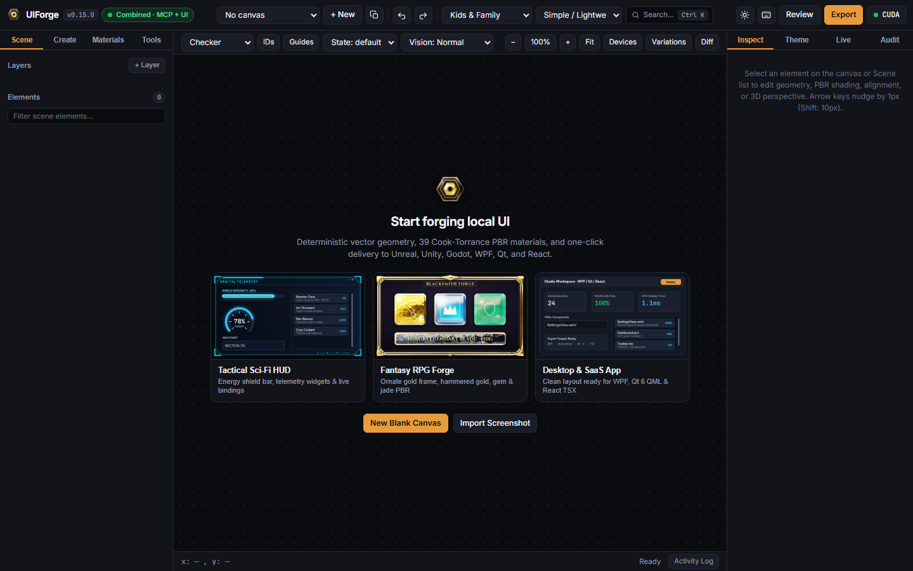 
      <strong>3-Template Studio Launcher (Zero MCP)</strong> 
      Start directly from Tactical Sci-Fi HUD, Fantasy RPG Forge, Desktop &amp; SaaS App, blank canvas, or screenshot import.
    </td>
    <td width="50%" valign="top">
      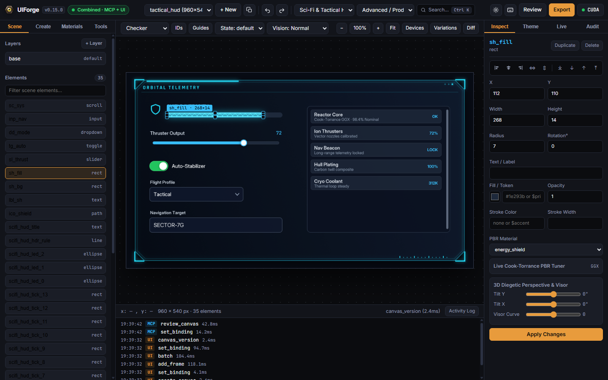 
      <strong>Live Studio &amp; Combined MCP Sync</strong> 
      8-point resize handles, magnetic snap guides, multi-select, inline text editing, Dark/Light themes, and <code>Ctrl+K</code> palette.
    </td>
  </tr>
  <tr>
    <td width="50%" valign="top">
      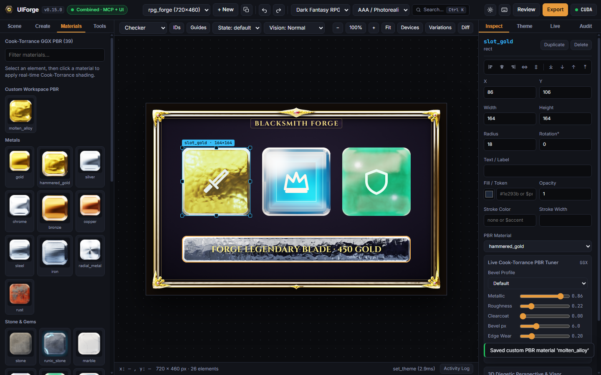 
      <strong>Cook-Torrance PBR Forge &amp; 142 Vector Icons</strong> 
      39 live-rendered GGX PBR swatches, live roughness/metallic/wear tuner, custom material saving, and 142 pure-MIT icons.
    </td>
    <td width="50%" valign="top">
      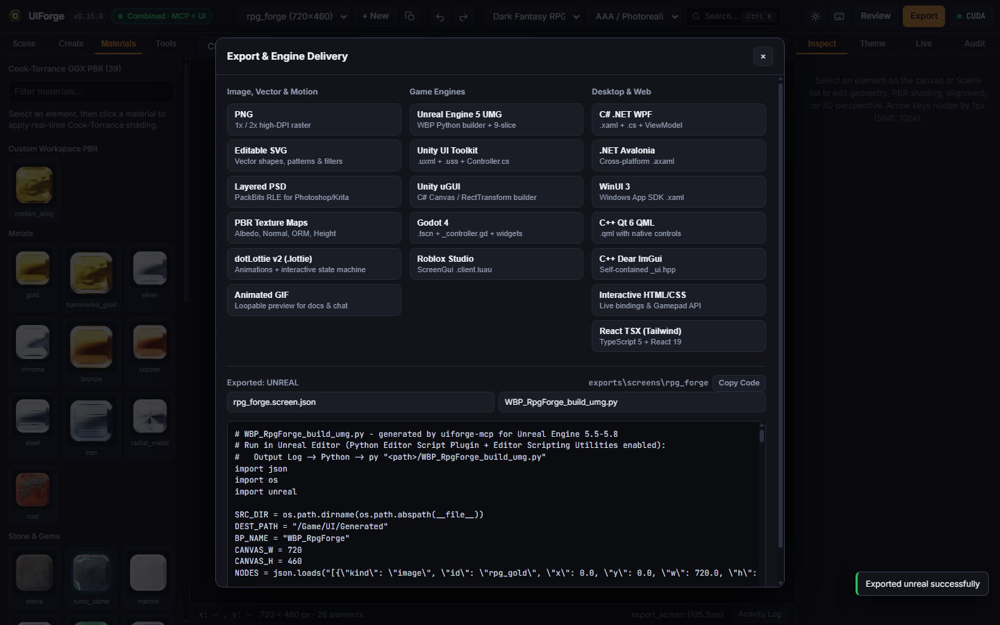 
      <strong>One-Click Engine Delivery &amp; Code Inspector</strong> 
      Export directly to Unreal UMG, Unity, Godot 4, Roblox, WPF/Avalonia/WinUI, Qt QML, ImGui, React TSX, SVG, PSD, or PBR maps.
    </td>
  </tr>
</table>

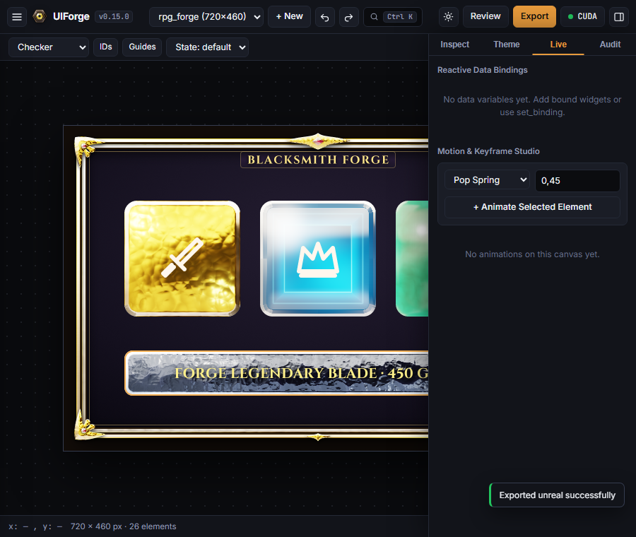

<em>Responsive compact viewport (<code>900px</code> drawer layout) with reactive <code>set_binding</code> sliders, WCAG audit, color-blindness simulator, and pixel visual diff.</em>

---

## Cook-Torrance GGX PBR Materials, Texture Maps & AAA Frames

### 39 Built-in PBR Materials (`examples/materials.png`)
Linear-HDR dual-lobe GGX specular, curvature edge wear, 5 studio HDRI tents + custom `.hdr`/`.exr` IBL, clearcoat lacquer, anisotropic brushed metal, subsurface scattering, crevice AO, and ACES filmic tone mapping.

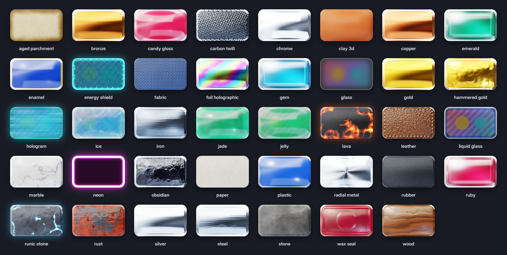

### Real-time Engine PBR Texture Maps (`export_pbr_maps`)
Albedo, Tangent Normal (OpenGL `+Y` & DirectX `-Y`), Roughness, Metallic, AO, Height, ORM packed, and Godot 4 `CanvasTexture .tres`.

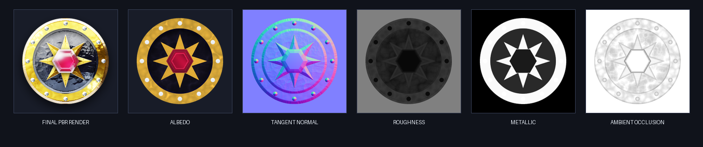

### 9 Parametric AAA Frames (`add_frame`)
`rpg_gold`, `royal_ornate`, `fantasy_parchment`, `scifi_hud`, `cyber_tech`, `glass_card`, `medieval_iron`, `luxury_minimal`, `cartoon_thick`.

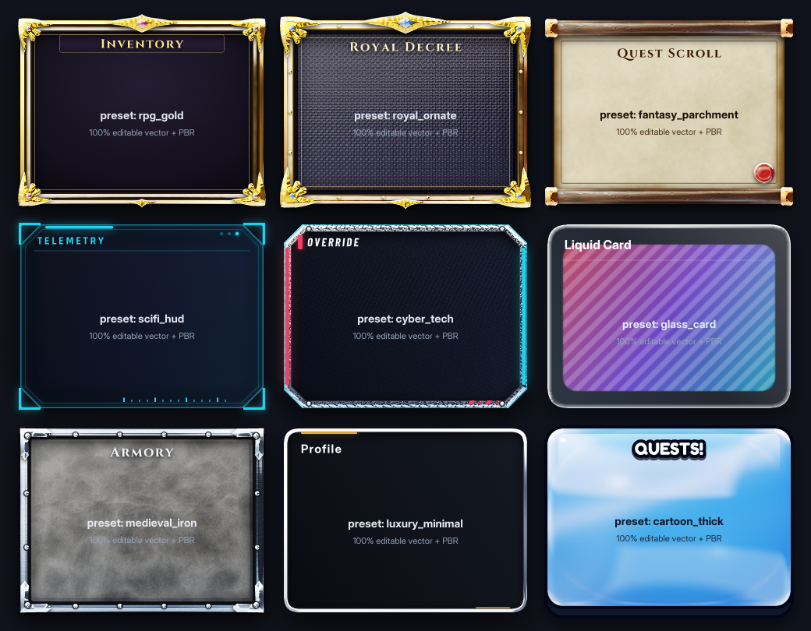

---

## Game HUDs, UI Kits, Variations & Vector Output

<table>
  <tr>
    <td width="50%" valign="top">
       
      <strong>Realistic Racing HUD</strong>
    </td>
    <td width="50%" valign="top">
      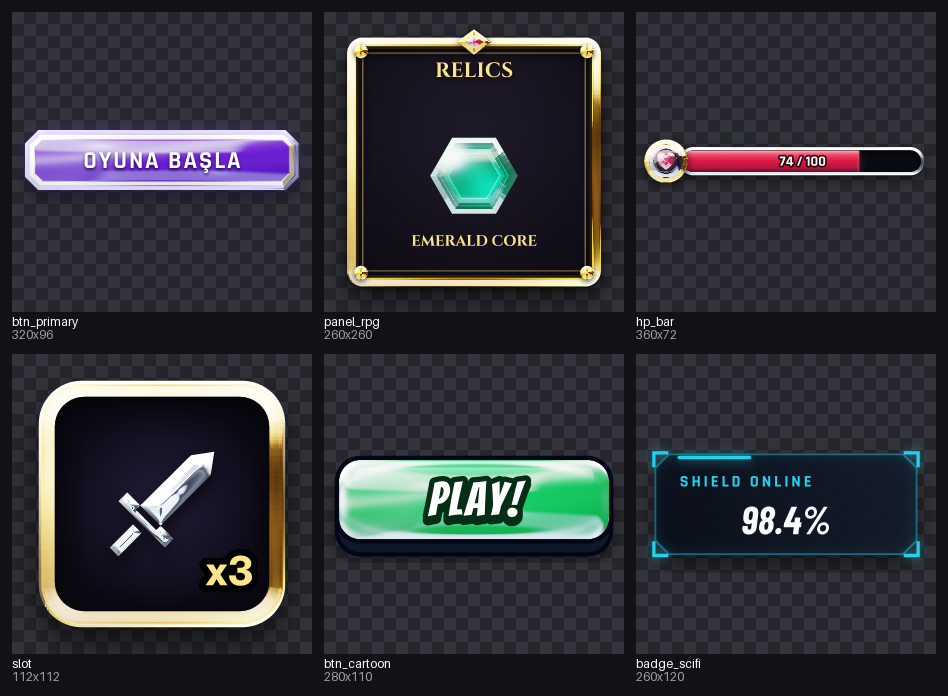 
      <strong>Complete UI Kit</strong>
    </td>
  </tr>
  <tr>
    <td width="50%" valign="top">
      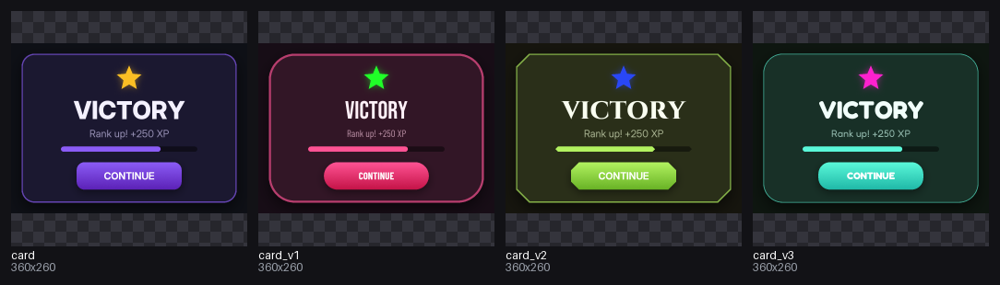 
      <strong>One-Call Visual Variations (<code>make_variations</code>)</strong>
    </td>
    <td width="50%" valign="top">
       
      <strong>Editable Vector &amp; Filters (<a href="../examples/design_tools.svg">design_tools.svg</a>)</strong>
    </td>
  </tr>
  <tr>
    <td width="50%" valign="top">
       
      <strong>Lighting &amp; Shading Kit</strong>
    </td>
    <td width="50%" valign="top">
       
      <strong>Realistic Material Kit</strong>
    </td>
  </tr>
  <tr>
    <td width="50%" valign="top">
       
      <strong>Layered Painting Breakdown</strong>
    </td>
    <td width="50%" valign="top">
      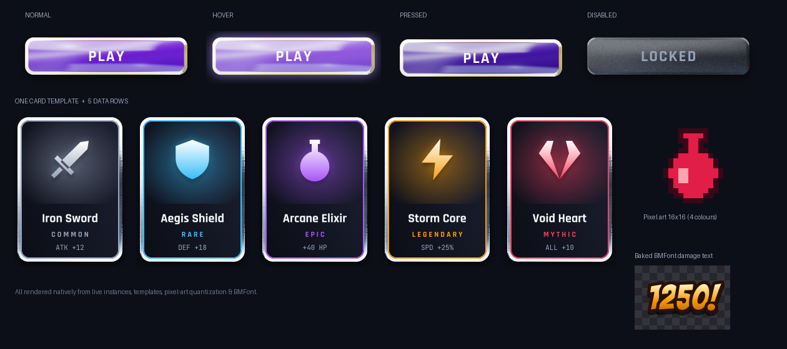 
      <strong>Components, States, Templates &amp; Pixel Art</strong>
    </td>
  </tr>
</table>

### Multi-Resolution Pin Checks (16:9, 21:9, Mobile)

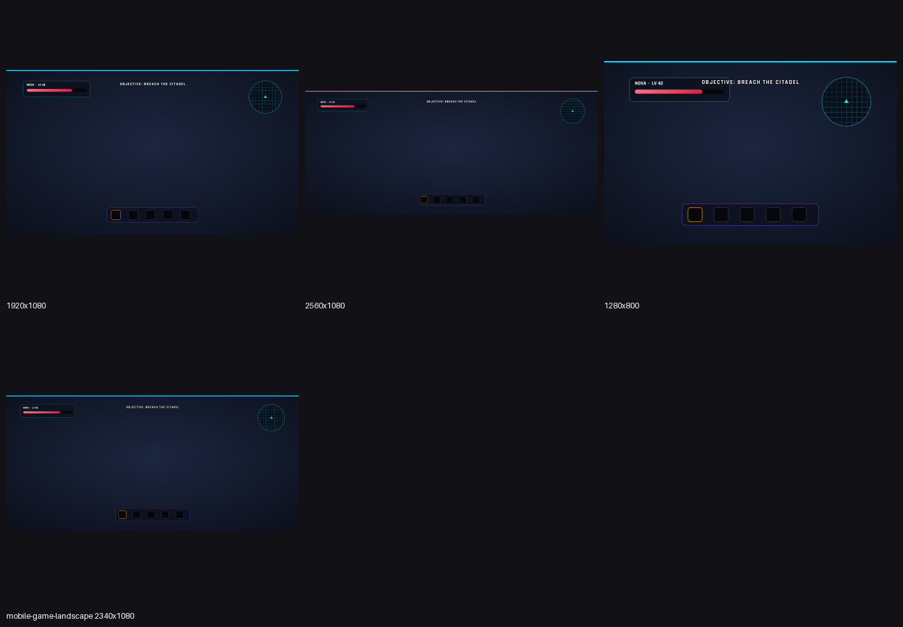

---

## Keyframe Animations

| Button entrance + shine | Rev gauge | Menu entrance & selection |
| :---: | :---: | :---: |
|  |  |  |

---

## All 100 Core Operations & MCP Capabilities

<strong>Expand complete operation index (100 tools + 2 SEP-1865 app tools, 5 Resources, 3 Prompts)</strong>

| Group | Operations / Tools |
| --- | --- |
| **Canvas (9)** | `create_canvas`, `list_canvases`, `get_canvas`, `update_canvas`, `duplicate_canvas`, `delete_canvas`, `fit_canvas`, `resize_canvas`, `canvas_version` (`visual_diff`) |
| **Layers (4)** | `create_layer`, `update_layer`, `delete_layer`, `set_layer` |
| **Drawing, Frames, Icons & Widgets (22)** | `add_rect`, `add_ellipse`, `add_line`, `add_polygon`, `add_path`, `add_arc`, `add_ticks`, `add_text`, `add_image`, `add_instance`, `add_svg`, `add_frame`, `add_icon`, `add_input`, `add_scroll`, `add_slider`, `add_toggle`, `add_dropdown`, `add_button`, `add_progress_bar`, `add_stack`, `import_screenshot` |
| **Editing & Layout (18)** | `update_element`, `delete_elements`, `duplicate_element`, `boolean_elements`, `path_ops`, `restyle`, `find_elements`, `vectorize_image`, `move_elements`, `reorder_element`, `align_elements`, `arrange_elements`, `scatter`, `copy_elements`, `set_pin`, `batch`, `undo`, `redo` |
| **Data, States & i18n (6)** | `set_binding`, `set_state`, `delete_state`, `generate_from_template`, `set_strings`, `get_strings` |
| **Checks, Studio & MCP App (6)** | `live_preview`, `open_studio`, `review_canvas`, `inspect_pixels`, `view_image`, `preview_nine_slice` |
| **Animation (7)** | `create_animation`, `set_keyframes`, `delete_keyframes`, `get_animations`, `delete_animation`, `preview_animation`, `export_animation` |
| **Theme & Info (6)** | `set_theme`, `get_theme`, `make_palette`, `list_fonts`, `measure_text`, `guide` |
| **Preview & Explore (4)** | `preview`, `preview_resolutions`, `contact_sheet`, `make_variations` |
| **Export (12)** | `export_png`, `export_svg`, `export_pdf`, `export_web`, `export_react`, `export_asset`, `export_pbr_maps`, `export_layers`, `export_psd`, `export_atlas`, `export_bitmap_font`, `write_engine_helpers` |
| **Hand-off & Engines (6)** | `export_spec`, `export_theme`, `set_link`, `set_interaction`, `export_prototype`, `export_screen` |

- **App-only SEP-1865 tools (`visibility: ["app"]`, 0 model tokens):** `studio_app_state`, `studio_app_render`.
- **MCP Resources:** `uiforge://cheatsheet`, `uiforge://materials`, `uiforge://icons`, `uiforge://workspace`, `ui://uiforge/studio.html`, and template `uiforge://guide/{topic}`.
- **MCP Prompts:** `design_game_hud`, `design_rpg_panel`, `audit_and_polish`.

